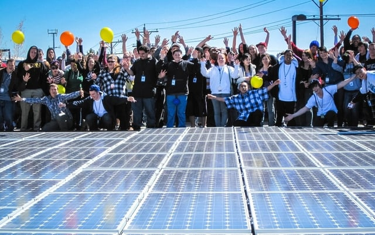

Community solar or shared renewable energy programs are a growing market for renewable energy.These programs are an important vehicle for expanding access to clean energy because one can participate in the benefits of renewable energy without locating the energy source on one’s property. Models for implementing shared renewable energy programs are still evolving because such programs are relatively new and pose regulatory and policy issues. We thought we would look at a well-developed program framework, the Interstate Renewable Energy Council’s (IREC) [Model Rules for Shared Renewable Energy Programs](http://www.irecusa.org/publications/model-rules-for-shared-renewable-energy-programs/).

## Benefits of Shared Renewable Energy Programs

Shared renewable energy programs are critical to increasing access to solar and other sources of renewable energy. Most residential and commercial electricity consumers do not own their own roof or have an appropriate location for installing renewable energy sources. Also, a customer may not be able to undertake the substantial upfront cost of installing a renewable energy source.

A shared renewable energy program allows the energy source to be placed at one location within a community, for example, a school. Then, customers who invest in the project will receive a credit for the generated electricity on their utility bill. By providing more options for access to renewable energy, shared renewable energy programs will allow a broad range of customers access to clean energy, including low-income residents

Community solar programs, the most prevalent programs for shared renewable energy, are already well-developed.in states such as California, Colorado, Massachusetts, and Minnesota. Other states are undertaking initiatives to encourage the [adoption of community solar](/final-review-blog/cook-county-solar-map-bringing-community-solar-to-illinois/).

## IREC’s Development of the Model Rules

IREC is a nonprofit that works on programs to encourage renewable energy adoption, including regulatory reform. The organization’s Model Rules for Shared Renewable Energy Programs (Model Rules) is an update of an earlier version of the rules developed in 2010 in collaboration with the nonprofit Vote Solar. IREC invited stakeholders, including utilities and affected industries, to review the Model Rules before they were finalized.

-   The Model Rules are based on four guiding principles:Shared renewable energy programs should increase access to renewable energy for a more diverse group of customers
-   Program participants should receive financial benefits that are reflected on their utility bill
-   Programs should be flexible enough to honor customers’ preferences
-   Shared renewable energy programs should support and co-exist with other renewable energy programs

IREC also distinguishes shared renewable energy programs from renewable energy project investments, net energy metering, renewable energy group purchasing, and green tariffs.

## Shared Renewable Energy Program Components

The Model Rules are designed around a number of different elements:

-   Shared renewable energy programs may be administered by a utility, a third party working on the utility’s behalf, or a group of customers
-   The benefits of participation are allocated by bill credit on the participant’s monthly utility bill to avoid some of the issues that may result from direct payment, for example, taxable income
-   The valuation for generated electricity should be based on an embedded-cost based approach (cost components of retail rate), value-based approach (value or renewable energy for utility and ratepayers), or other emerging approaches
-   There is no specified size limit for the renewable energy system but for many locations a two-megawatt system makes sense due to system costs, ability to locate the facility near participants, and ease of interconnection to distribution system
-   The shared renewable energy facility may be owned by a utility, program participants, or a third party
-   Programs must have a minimum of two participants, specify whether participation is portable and/or transferable, and should consider how to include low-income participants

IREC also notes that energy restructured states that allow alternative energy suppliers may pose some complications as well as opportunities for shared renewable energy programs. As restructured markets mature, the opportunities and barriers for renewable energy programs will become clearer.

## Using the Model Rules

The Model Rules contain definitions of key terms, general provisions governing program participation, and bill credit provisions. IREC’s Model Rules are a helpful starting point for designing a shared renewable program and could be incorporated into the necessary program contracts. Hopefully, the Model Rules will encourage the creation of new community solar and other shared renewable energy programs, and given that the rules are based on best practices, will ensure any new program's success.
