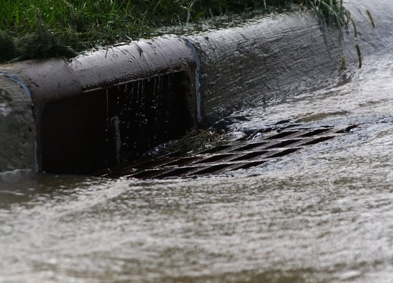

The United States Environmental Protection Agency (EPA) is about to release the final rule regulating small municipal separate storm sewer systems (MS4). There is a concern these revised National Pollutant Discharge Elimination System (NPDES) Permit II regulations may result in stricter requirements for construction sites. The development of the permit program for small MS4s has been a very lengthy process. We thought it would be helpful to explain the evolution of EPA’s small municipal separate storm sewer system general permit rule and its potential impact on construction sites.

## Importance of Regulating Municipal Storm Sewer Systems

Discharges from MS4s are a significant environmental issue. MS4s are intended to collect runoff from, for example, rain or snowmelt and are comprised of drains, pipes, and ditches that are separate from a city’s sewage system.

Stormwater runoff may pick up all types of pollutants as it runs over municipal areas. Regulation is required to prevent untreated stormwater containing pollutants from being discharged from the MS4 into a water body.

## Relationship of the MS4 Regulations to the Clean Water Act

The Clean Water Act (CWA), adopted in 1972, is the federal statute that governs the discharge of pollutants into United States waters. Pursuant to the CWA, it is illegal to release pollutants directly into surface waters without a NPDES permit designed to control discharges. EPA is charged with enforcing the CWA and creating regulations implementing the statute, including the NPDES program.

Amendments to the CWA in 1987 added requirements for municipal and industrial stormwater discharges. [CWA § 402](https://www.epa.gov/cwa-404/clean-water-act-section-402-national-pollutant-discharge-elimination-system) governs the NPDES program, and CWA § 402(p)(3)(B) contains the specific NPDES permit requirements for municipal stormwater discharges.

## EPA Published Small MS4 Permit Requirements in 1999

EPA issues regulations to implement the CWA § 402(p)(3)(B) requirements for MS4s. In communities with a population of 100,000 or more, MS4s are governed by the Phase I regulations that EPA issued in 1990. In 1999, EPA promulgated the Phase II permit requirements that apply to small MS4s.

The Phase II rule allowed small MS4s to obtain a NPDES general permit, a permit that applies to a designated class of discharges in a specific area. To be eligible for the general permit, an MS4 only needed to file a Notice of Intent (NOI) stating how it planned to meet EPA requirements for best management practices (BMP).

EPA may delegate to states its authority to implement the NPDES permit program. If a particular state does not administer the program, the EPA regional office is the permitting authority for purposes of the NPDES program.

## Legal Challenges to the NPDES Phase II Rule

Environmental groups filed several lawsuits challenging parts of the Phase II regulations. The lawsuits argued that EPA’s NOI procedure did not allow for a permitting authority to review the MS4’s permit application to assure the MS4 was using BMP. In addition, there was no opportunity for public input on MS4 permits.

On September 15, 2003, the United States Court of Appeals for the Ninth Circuit in [Environmental Defense Center, Inc. v. United States Environmental Protection Agency](https://law.resource.org/pub/us/case/reporter/F3/344/344.F3d.832.00-70822.00-70734.00-70014.html), 344 F.3d 832 (9th Cir. 2003), required EPA to revise some parts of the Phase II regulations. The court agreed the Phase II regulation’s NOI functioned like permits but provided no opportunity for public hearings and comments in keeping with the CWA’s permit requirements. In addition, EPA’s rule needed to be revised because it did not provide an opportunity for permitting authority review.

EPA published guidance on the effect of the Ninth Circuit decision but never issued revised regulations for small MS4 general permits. As a result, the Environmental Defense Center and the Natural Resources Defense Council petitioned the Ninth Circuit in 2014 to order EPA to issue a rule regarding the small MS4 requirements. In September 2015, the court approved a settlement that required EPA to release a final NPDES Phase II rule for small MS4s which EPA committed to sign for publication by November 17, 2016.

## Current Status of the NPDES Phase II Rule 

In compliance with the process for developing new federal regulations, EPA published a [proposed rule](https://www.epa.gov/sites/production/files/2015-12/documents/proposed_ms4_remand_rule_pre-publication_signed_fr_notice.pdf) in the Federal Register on January 6, 2016, that was open for public comment until March 21, 2016. EPA’s website states that the projected date for publication of the final rule is this November. The proposed rule requires the permitting authority to identify the BMPs a small MS4 must implement and also provides for public review and comment on the requirements for small MS4s.

## Understanding Construction Industry Concern About the New Rule

The NPDES Phase II permit program requires small MS4s to have stormwater management programs that contain six minimum control measures. This requirement is contained in the original rule and two of the six measures are control of construction site and post-construction site runoff (from a site of one acre or larger).

Thus, municipalities complying with EPA’s permit requirements for small MS4s create their own requirements for construction sites in their jurisdiction that release runoff into the MS4. The concern is that the new rule’s procedural requirements may result in the permitting authority creating more stringent requirements for MS4s, and the local municipality will, in turn, create more restrictions for construction sites. These requirements are distinct from EPA’s NPDES general permit requirements for construction sites.

Given the guidance EPA issued after the original Ninth Circuit ruling, many states already began to implement specific BMPs for small municipal separate storm sewer systems. Therefore, significant changes may only be in those states with requirements that do not currently align with EPA’s final rule.
