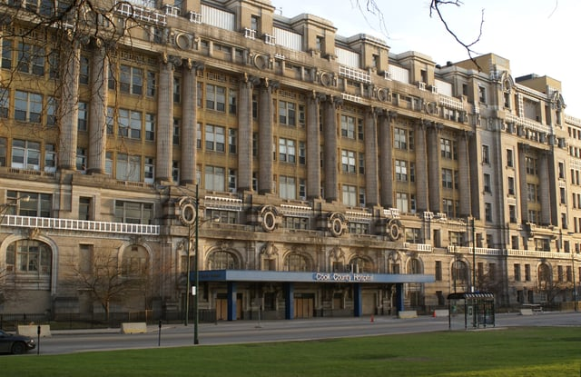

Skidmore, Owings, and Merrill’s $1 billion mixed-use redevelopment of the historic former Cook County Hospital building located on Chicago’s Near West Side is poised to create a host of changes for the 102-year-old Beaux Arts building. Prominent in Chicago history, the historic building was listed on four separate occasions on Landmark Illinois’ Most Endangered Historic Places list after closing in 2002. 

<em>image by Jeff Dahl - Own work, [CC BY-SA 4.0](https://commons.wikimedia.org/w/index.php?curid=3894663)</em>

Now after 16 years of vacancy, the $1 billion plan to renovate the Cook County Hospital building will bring 210 hotel rooms, over 70,000 square feet of new medical space, and a 4,000 square foot museum dedicated to “Chicago’s Ellis Island.” Developed by Murphy Development Group, Walsh Investors, Civic Health Development Group, MB Real Estate, Plenary Group, and Granite Companies, the plan follows a previous attempt in 2010 to renovate the building.

We've chosen to highlight the former Cook County Hospital for its history, relevance, architecture, and unique redevelopment.

## Cook County Hospital's History of Education, Care

Cook County (County) established a [basic free medical care](http://www.encyclopedia.chicagohistory.org/pages/336.html) system in 1832 as required by Northwest Territory and Illinois General Assembly law assigning “the care of paupers to the counties.” While first established, most care was conducted in either temporary hospitals or private homes by “physicians and students from [Rush Medical School](https://www.rush.edu/about-us/about-rush-university-medical-center/history).”

The County constructed the first permanent hospital building in 1857 which housed the [Rush Medical School](https://www.rush.edu/about-us/about-rush-university-medical-center/history), and in 1866 the “Old County Hospital” began to operate out of the same location. In 1916, the hospital moved to its permanent home at 1835 W. Harrison Street, known as the Cook County Hospital Building, where it continued to operate until 2002.

Cook County Hospital became renowned as a teaching hospital, the site of the development of the blood bank system, the establishment of the first intern program for physicians established in 1866, and the development of surgical techniques to repair fractures.

Throughout its history, the building grew to accommodate 3,000 beds with an addition on nearby property housing additional patients. The hospital remained a center for medical education despite corruption problems throughout its history, and the hospital served Chicago residents at no charge at the 1835 W. Harrison location until 2002, when services were moved to nearby Stroger Hospital.

The building has been vacant since that time and now requires significant repair and restoration to the façade and interior, though it remains structurally sound. Formally known as the Cook County Administration Building, the site was placed on National Register of Historic Places in 2006, making it eligible for historic preservation tax credits during redevelopment.

## Current Renovation Plan

Architecture critic Blair Kamin of the Chicago Tribune [reviewed](http://www.chicagotribune.com/news/ct-old-cook-county-hospital-kamin-met-0406-20160405-column.html) the current renovation plan for the site when it was first released in 2016.

Calling the plans “a good design prescription,” the “plan would breathe new life into one of the Chicago’s great buildings, a palace of healing that symbolizes compassionate care for the poor” amid the Illinois Medical District. A collection of hospital campuses and universities on the Near West Site, the Medical District continues to grow, but remains a reminiscent of “a dull suburban office park” according to Kamin. Though the County determined in 1999 that any non-medical use for the facility would not fit the character of the neighborhood, significant new development is transforming the area: a [new 19-story residential building](https://chicago.curbed.com/2018/5/29/17405078/cook-county-hospital-redevelopment-hyatt-hotels) and multiple new medical facilities are slated for the area.

Just visible from the nearby Eisenhower Expressway, the façade of the building is slated to be entirely restored under the new plan. Composed of brick, granite, and terra cotta, restoration will include extensive exterior repairs to stabilize the façade, though the structure itself is sound. Only part of the interior will remain, including the building’s lobby, which will be preserved as part the adaptive reuse project.

[Phase 1A](https://archpaper.com/2018/06/cook-county-hospital-restoration-redevelopment/) will see the renovation of the Cook County Hospital Building, conversion to a dual-branded Hyatt House and Hyatt Place hotel with 210 rooms, and new medical offices and retail space alongside a new parking structure adjacent to the building. The first phase is expected to be completed as soon as 2019 and is expected to receive up to $24 million in federal historic tax credits as per its eligibility.

Though not part of the building itself, there is adjacent county land available, and future phases include possible mixed-use residential space, retail space, and office space adjacent to the building leased from Cook County. Demolition of a nearby 1960s building and construction of a technical center and medical research high rise, construction of a new parking structure, and two potential new high rises could follow the restoration project if successful. This would mark a significant change for the surrounding Medical District and reflect the changing nature of the adjacent [West Loop](/final-review-blog/the-changing-landscape-of-chicagos-fulton-market-district/).

## Redevelopment Promises Continuing Presence of Chicago’s History

After escaping potential demolition in 2001 and the failure of previous restoration plans, the Cook County Hospital Building is poised to bring significant change to the Illinois Medical District through a large-scale redevelopment process. We’re looking forward to seeing the renewal of the nationally significant, storied architecture of “Chicago’s Ellis Island.”

Is the Cook County Hospital redevelopment actually open today? Yes — the Hyatt Place and Hyatt House Chicago Medical/University District opened to the public in summer 2020, becoming the first combined Hyatt Place and Hyatt House hotels in Chicago. Phase 1 includes a 210-key hotel, 72,330 square feet of office space, 24,510 square feet of retail, and a Cook County Medical Museum. What was restored versus rebuilt in the adaptive reuse project? More than $18 million was dedicated solely to restoring the facade, including replacing windows, restoring 4,160 terracotta pieces, and polishing the three-story Ionic columns. Original staircases, 11-foot-wide hospital corridors, and stone terrazzo floors were preserved and restored to their 1914 condition. How did federal historic tax credits factor into this project? The building's 2006 listing on the National Register of Historic Places made it eligible for federal historic tax credits — a key tool Landmarks Illinois had advocated for specifically to make the economics of redevelopment viable, given the scale of deterioration and rehabilitation costs involved. What does the completed project include beyond the hotel rooms? The facility includes a food hall, medical offices with Cook County Health, a daycare center with Bright Horizons, a museum paying tribute to the hospital's legacy, meeting space, and a 24-hour fitness center. Is this a single-phase project or is more development still planned? The hotel is Phase 1 of a four-phase redevelopment plan for the overall site, now called Harrison Square. Future phases on the surrounding 13 acres of Illinois Medical District land could include additional mixed-use residential, retail, and office development, though timelines for later phases haven't been firmly announced.
