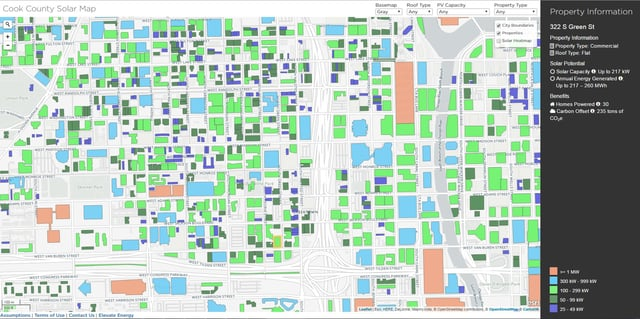

Cook County, Illinois is in the process of creating a solar map. The map is unusual because its focus is to stimulate the development of community solar. Although the map has not yet been released to the public, we recently took a look at a prototype of the map. We want to share some of the goals and features of the Cook County Solar Map.

## Goal to Advance Community Solar in Cook County

The U.S. Department of Energy’s SunShot Initiative is designed to support efforts across the nation to make solar energy cost-competitive with more traditional forms of energy. Cook County received a SunShot Initiative grant to work on bringing community solar to the county, the [Cook County Community Solar Project](http://www.cookcountyil.gov/environmental-control-2/solar-energy/). A number of entities, including Elevate Energy, are partnering with Cook County in this effort.

Community solar programs are steadily growing in the United States because they increase the number of people who may have access to solar energy, including low-income residents. There is no need to own one’s own rooftop to participate. Instead, one can rent or own shares in a community solar program. Despite the high percentage of Cook County residents who would benefit from community solar, there is currently no community solar program in Cook County.

The Cook County Community Solar Project is currently working on identifying the potential for community solar, examining the benefits of different community solar models, proposing solutions to barriers to community solar, and evaluating some sites for pilot programs. [Elevate Energy](http://www.elevateenergy.org/) is creating a solar map to support Cook County’s community solar initiative and received a grant from the Chicago Community Trust to develop the map. The Cook County Department of Environmental Control, the Environmental Law & Policy Center, and the Metropolitan Mayors Caucus are working with Elevate Energy on the Cook County Solar Map.

## Cook County Solar Map

Solar maps, interactive tools on the Internet, are designed to show the potential for solar at a particular location. Frequently, solar maps are created so a homeowner or business can estimate the amount of solar energy that may be generated on their roof. See our recent post about [New York’s solar maps](/final-review-blog/new-york-city-and-state-innovative-solar-maps/) to learn more about this type of solar map. The Cook County Solar Map is unusual because it is focused on showing locations suitable for community solar projects.

The map being developed incorporates a variety of data to determine the suitability of buildings and land parcels for solar. The Cook County Solar Map uses Light Detection and Ranging (LiDAR) information which creates three-dimensional models of land and roof topography. It also employs Geographic Information System (GIS) data to identify both rooftop and vacant land surface and areas. In addition, the map incorporates information about building characteristics and use based on information from the Cook County Property Assessor.

## Cook County Solar Map Features

The home page of the Cook County Solar Map provides basic information about solar energy and community solar. This includes facts about the Cook County Community Solar Project and community solar across the country and in Illinois. The map also contains sections on different community solar business models, tips on developing a community solar project, answers to frequently asked questions, and resources for community solar.

The map can be launched from the homepage and different filters may be used:

-   Basemap gray or satellite view
-   Roof type of flat or pitched roof
-   Photovoltaic (PV) capacity choices of: >= 1 MW, 300 kW - 999k kW, 100-299 kW, 50-99 kW, 25-49 kW
-   Property type: industrial, commercial, municipal, residential, public housing, schools, non-profits, vacant land, and unknown

The Cook County Solar Map is color coded for different building PV capacities. One can also select to overlay city boundaries, properties, or a solar heat map. In addition, it is possible to search for a particular place or address. If one clicks on a particular property, information for that location becomes available:

-   Property’s sector and roof type
-   Technical potential for solar (maximum solar PV capacity)
-   Annual solar energy that could be generated based on the maximum PV capacity
-   Number of homes that could be powered by the generated solar energy
-   Estimate of metric tons of carbon dioxide that could be avoided by using solar at the location

Other features may be added to the Cook County Solar Map over time.

## Cook County Solar Map Timeline

Elevate Energy is planning to launch the Cook County Solar Map this September but has shared the solar map during several webinars. The webinars were held, in part, to provide an opportunity for municipalities to share their GIS data for building footprints because some of this information is still needed for the majority of Cook County. We at Burnham will update you when the Cook County Solar Map is officially released.

<em>Since we wrote this post, the [Cook Country Solar Map](http://www.elevateenergy.org/cook-county-solar-map/home/) went live on October 5, 2016.</em>
