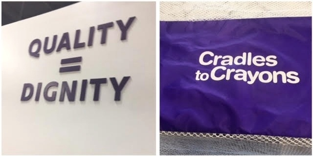
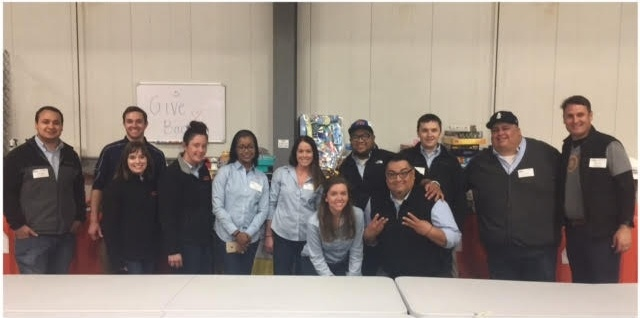

Cradles to Crayons (C2C) is a non-profit organization that provides children with essentials for school and play. By partnering with other charitable organizations and social service providers, C2C has served 942,000 children since its [founding](https://www.cradlestocrayons.org/about/history/) in Boston in 2002, and in 2016, C2C opened its first branch outside of the East Coast in Chicago’s Logan Square neighborhood.

Burnham Nationwide provided permit expediting for C2C’s local “Giving Factory” headquarters and in this post, we would like to provide some insights into the permitting process for the space and - most importantly - introduce the charity’s great work.

## The Cradles to Crayons Mission

Cradles to Crayons is dedicated to providing children ages zero to 12 years old who are from low-income situations, face homelessness, or who are otherwise in need with the items essential for their health and wellbeing in school, at home, and at play. Items accepted range from toys, books, and clothing to diapers, strollers, and hygiene items.

However, a key component of C2C’s mission is that everything given to the children and families the organization serves must be in new or like-new condition. This requires ongoing effort by teams of volunteers who sort through initial donations, clean items, and double check everything that passes out through the doors to guarantee a high level of quality. Items that cannot be cleaned or are otherwise in unusable condition are [recycled](http://chicagotonight.wttw.com/2017/03/30/new-nonprofit-gives-needy-kids-clothes-they-can-be-proud) to eliminate any waste while still allowing only the best to be given out in the organization’s “KidPacks”. By partnering with agencies that work directly with the children they serve, C2C is able to personalize its services to each child’s needs, age, size, and reading level.

## C2C Expands to the Chicago Area

After 14 years in operation, Cradles to Crayons decided to expand beyond its Boston and Philadelphia locations into [Chicago](https://www.cradlestocrayons.org/chicago/), where an estimated 200,000 children live in poverty. By partnering with organizations such as Communities in Schools, ChildServ, Association House, and Heartland Alliance along with the Chicago Public School System, C2C has been able to provide over 10,000 children and families in the Chicago area with the essentials they need free of charge.

Key to the Cradles to Crayons mission is connecting those in need with communities that have on a local level through grassroots donation projects from communities surrounding the charity, and C2C’s Giving Factory is the nexus of all operations in the Chicagoland area. Located at 4141 W. George Street, Chicago, IL 60641, the 22,000 sq ft Giving Factory facility is a collection site and also houses all donations ready to be sorted and is the single location where volunteers examine, sort, and pack items.

Burnham Nationwide was able to assist with the permitting process for the remodel of the warehouse location, formerly a Marshall Field’s distribution center, to fit the organization’s needs. This included permits for the installation of partial height drywall partitions and a new rooftop unit. When the City of Chicago did not allow the permit to be secured through their Self-Certification Permit Program - which allows architects to certify buildings as code compliant without municipal plan review - Burnham was able to negotiate approval with the City of Chicago Department of Buildings quickly and efficiently, and the new center [opened](https://www.cradlestocrayons.org/national/cradles-to-crayons-announces-grand-opening-of-the-giving-factory-in-chicago/) its doors in October 2016.

## Burnham Visits the Giving Factory

On Friday, 5/19, members of Burnham’s Chicago team went to the Giving Factory to see firsthand the work being done by C2C in its new space and contribute to the cause. We were assigned to the Toy Shop, a second step in the C2C assembly line, where toys are sorted, inspected for quality, and cleaned so that they will be ready to be assembled into KidPacks. Toys have to be up to Cradles to Crayons’s standards and any puzzles and kits must have all pieces - all games and puzzles are double checked by another round of volunteers to make sure everything sent out is something a child can take pride in.

Beyond the quality of their items, C2C also focuses on providing kids with support through initiatives such as well-wish notes which will be placed in backpacks filled with new school supplies that will be distributed to area children at the beginning of the school year. Cradles to Crayons Chicago aims to provide 17,000 backpacks to students this year through its Backpack-A-Thon [program](https://www.cradlestocrayons.org/uncategorized/new-chicago-nonprofit-packs-10000-backpacks-for-kids-in-need/) with a personal note of encouragement in each one.

Since its opening, the Giving Factory has been able to [serve](http://www.drugstorenews.com/article/walgreens-joins-huggies-donating-1-million-diapers-national-diaper-bank-network) more than 10,000 children in the City of Chicago and is on track to meet or exceed its current goals. Burnham Nationwide is proud to have assisted with this project and its mission to continue to provide local children with what they need to thrive.

 

<em>Interested in contributing to Cradles to Crayons? Donation information can be found on the organization’s [website](https://www.cradlestocrayons.org/chicago/donate-goods/items-we-accept/) with baby board books, bibs, and new school supplies most needed.</em>
