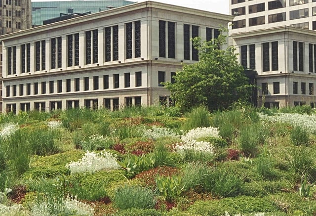

The Chicago Department of Planning and Development (DPD) recently revised the Chicago Sustainable Development Policy (Policy). The Policy has been a key component of the City’s plans to encourage sustainable and resilient design.The new Chicago Sustainable Development Policy is significantly changed from its earlier version and will continue to push the City’s leadership in sustainability.

## History of Chicago’s Sustainable Development Policy

Chicago was looking for ways to encourage the adoption of sustainable building practices and decided to require all real estate developments that received financial assistance from the City, such as tax increment financing (TIF), or special zoning approvals to comply with the newly created Chicago Sustainable Development Policy beginning in 2004.

The Policy required a project to obtain a recognized form of green building certification, such as the United States Green Building Council’s Leadership in Energy and Environmental Design (LEED) certification or the ENERGY STAR building certification. Projects that fell under the Policy were also required to include a green roof. The percentage of the roof to be covered with vegetation was dependent on the nature of the development and the particular assistance received from the City. Certain projects were additionally required to exceed Chicago’s stormwater requirements by a specified percentage.

The Chicago Sustainable Development Policy, along with other City programs promoting sustainability, has made Chicago a leading municipality in the number of LEED-certified buildings and square footage of green roofs.

## Latest Version of the Chicago Sustainable Development Policy

### Goals

Over the past year, DPD worked with an [advisory committee](https://www.cityofchicago.org/city/en/depts/dcd/supp_info/sustainable_development/chicago-sustainable-development-policy-committee-members.html) comprised of representatives from different Chicago companies and organizations to revised the Chicago Sustainable Development Policy. The Policy was updated to incorporate changes in the market and sustainable design, be more flexible than the older version, and allow for tracking the Policy’s impact.

### Applicability

The Chicago Sustainable Development Policy applies to new construction that is a Planned Development, TIF Funded Development receiving funds of over $ 1 million, or multi-family housing project over five units that receives specified types of Chicago financial assistance. Renovation projects falling in one of these categories or those considered a Class L property tax incentive landmark rehabilitation must all comply with the Policy.

### New Points-Based System

The new Policy is much more flexible than the older version because compliance is based on attaining a set number of points which may be achieved by adopting a variety of different sustainability options. The revised Chicago Sustainable Development Policy also embraces a broader view of sustainability. Included in the new Policy’s strategies for compliance are options such as sponsoring the Divvy bike share program, participating in certain types of workforce development, or providing wild bird protections.

All new construction projects that must comply with the Chicago Sustainable Development Policy are required to reach 100 points. Moderate renovation projects, “including partial or minor upgrades to building systems and minor repairs to the exterior envelope,” must attain 25 points. Substantial renovation projects, “including new and/or upgraded building systems and extensive repairs to the exterior envelope,” must attain 50 points.

DPD’s [Chicago Sustainable Development Policy Handbook](https://www.cityofchicago.org/city/en/depts/dcd/supp_info/sustainable_development/chicago-sustainable-development-policy-handbook0.html) provides detailed descriptions of the different strategies for meeting the point requirements and additional resources for learning about the strategies. The handbook also lists the documents that may be necessary to demonstrate compliance with each strategy.

### Different Paths to Compliance

To meet the Policy’s point requirements, projects may choose one of two paths. The first option is to use one of the identified building certification programs, each representing a different number of starting points. The remaining points must be achieved by using some of the other available strategies. Examples of the points assigned to the listed building certification programs are: Leed Gold standard - 90 points, LEED Silver - 80 points, Green Globes 4-Globes - 90 points, and Passive House - 70 points. The second compliance path allows for achieving points without using a building certification program and provides numerous options for compliance.

The point system has 10 categories of objectives that contain various strategies within the category for achieving the objective: (1) health; (2) energy; (3) stormwater; (4) landscapes; (5) green roofs; (6) water; (7) transportation; (8) solid waste; (9) workforce; and (10) wildlife. The different strategies are worth varying amounts of points depending on the nature of the action taken. An overview of all the strategies and their points is provided in a [DPD spreadsheet](https://www.cityofchicago.org/content/dam/city/depts/dcd/Projects/Draftpolicy_12_5_2016.pdf).

The energy category, as an example of the goals and strategy options within a category, provides choices that support energy efficiency and the use of renewable energy. Within this category a building may: (1) be designed to obtain ENERGY STAR recognition; (2) exceed the 2015 Energy Conservation Code standards by 5- 40% (points received based on percentage achieved); or (3) provide onsite renewable energy at a minimum of three percent of the total modeled energy use when the building is completely occupied.

## Demonstrating Compliance

The new Policy applies to all covered projects submitted to the DPD’s Design Review Committee since January 9, 2017. A [Chicago Sustainable Development Policy Compliance Form](https://www.cityofchicago.org/city/en/depts/dcd/supp_info/Chicago-Sustainable-Development-Policy-Form.htm) (Compliance Form) must be completed for each project subject to the Policy. The Compliance Form requires basic information about the project, including a description of the project and its cost, as well as identification of the strategies that will be used to attain the requisite points. Once completed, the Compliance Form is incorporated into the final agreement required for the project.

DPD welcomes input on the new version of the Chicago Sustainable Development Policy and comments may be sent to Michael Berkshire at [michael.berkshire@cityofchicago.org](mailto:michael.berkshire@cityofchicago.org). We are looking forward to seeing how the Policy revisions influence new Chicago developments.
