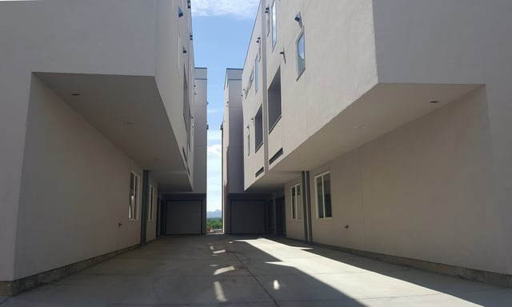

In May 2018, the Denver City Council [voted to ban](https://denverite.com/2018/05/07/denver-slot-home-replacements/) “slot homes” in an unanimous vote. The residential design is an unusual type of multi-family construction, most often featuring two separate structured situated around a narrow driveway, mews, or pedestrian walkway that forms the “slot.” 

Though the design bears a passing resemblance to courtyard apartment buildings such as the ones prevalent in [Chicago](http://moss-design.com/courtyard-apartment/), slot homes are constructed around much narrower space than courtyard buildings with entrances cut off from the street. Though they are prevalent throughout the City of Denver, they are most common in the West Colfax, Jefferson Park, Highland, Five Points, Sunnyside, Berkeley, and Cherry Creek neighborhoods. <em>image via [CARTA at CU Denver](https://cudenvercarta.org/2016/07/13/documenting-change-in-denver/#jp-carousel-193)</em>

## City of Denver Passes Text Amendment After Years-Long Process

The City began the Slot Home Evaluation and Text Amendment Project (the Project) in 2016. Prior to creating a text amendment to the City of Denver Zoning Code, any proposed changes must go through an evaluation process consisting of the following steps:

-   Problem Identification
-   Evaluate Strategies
-   Select Strategy
-   Adoption

The process involves research, community outreach, analysis, and reporting prior to developing a Zoning Code amendment within the City.

The City of Denver Community Planning and Development Department (CPD) formally [defines a slot home](https://www.denvergov.org/content/denvergov/en/community-planning-and-development/zoning/text-amendments/Slot-Home-Text-Amendment.html) as “a multi-unit residential structure consisting of attached dwelling units arranged side-by-side and primarily perpendicular to the street.”

Slot homes may also be called “sideways-facing town homes” or “fraux homes”, and have become increasingly common as a form of residential design throughout Denver. Most structures have individual, direct-access doors that face the interior pedestrian walkway or the side lot line, isolating the entrances from the larger streetscape. They can be constructed as a single row within a block, on a corner or lot, or with center driveways or aisles between smaller structures. Some may have a smaller pedestrian court or mews, while other designs include detached parking.

The design occurs in a variety of zoning districts, including the lower-scale Row House (RH) districts as well as multi-unit (MU) residential districts and mixed-use (MX) districts. They have also been permitted and built under a variety of Zoning Code building forms, including the “Town House, Row House, Garden Court, Apartment, General, and Shopfront forms,” according to the [Denver Slot Home Evaluation Problem Identification Report](https://www.denvergov.org/content/dam/denvergov/Portals/646/documents/Zoning/text_amendments/slot_homes/Slot_Home_Problem_Identification_Report.pdf) (Report) released by the City.

## CPD Task Force Charged with Developing Alternative Design Solutions  

The CPD developed a slot home task force to evaluate the issues associated with slot home design through engagement with residents, property owners, registered neighborhood organizations (RNOs), representatives, elected officials, developers, and architects. The 16-person task force also hosted community open houses to discuss the issues, review alternative design solutions, and provide updates on the amendment process.

The task force determined that slot home design negatively impacted neighborhoods in the five following items:

1.  Public Realm Engagement: “Many slot homes do not engage the street, sidewalk, and semi-public frontages with street-level building activities, porches, or pedestrian entrances”
2.  Neighborhood Context: “The siting, setbacks, and uses (residential, commercial, etc.) within slot homes sometimes do not reflect the existing character” of neighborhoods
3.  Building Mass and Scale: “Many slot homes do not incorporate Human Scale proportions, heights, and design elements such as … coordinated facade widths, heights in stories, window patterns, or distinctions between building floors”
4.  Vehicle-oriented Design: Visible driveways, parking areas, and garage doors negatively impact pedestrian access
5.  Impacts on Neighbors: Homes often orient their most active facade areas towards adjacent properties versus the street and sidewalk  
    

After identifying the problems posed by the most pervasive slot home designs, the task force began the process creating alternatives, prioritizing effectiveness, equity, flexibility, and predictability. After meeting on 10 separate occasions and including public feedback through community meetings, the CPD proposed a text amendment to the zoning code banning some slot home designs and illustrating design alternatives that address the five major issues above.

City staff estimates that at least 100 slots homes have been constructed since 2010, with the design dating back to the 1970s. The approved amendment bans designs that face away from the sidewalk toward narrow inner courtyards, replacing them with a variety of approved styles depending on zoning district.

For example, the “Existing General or Shopfront Building Form” (common in MX districts) must now face the street without a courtyard, while any side-by-side dwelling units must use the new Town House building form identified in the Slot Home Strategy Overview Report ([Overview](https://www.denvergov.org/content/dam/denvergov/Portals/646/images/Zoning/Slot%20Homes/Slot_Home_Strategy_Report-Executive_Summary.pdf)).

The Overview details the required design changes for each use district, unifying the appearance of some slot homes and providing designs that more closely resemble townhouses and row houses that are pedestrian-focused.

After a revision process, the Denver City Council voted to approve [bill #18-0306](https://denver.legistar.com/LegislationDetail.aspx?ID=3455224&GUID=D3ADF3FC-96F1-4C04-A85B-685E9A6F01FE&Options=&Search=) on May 7th, 2018 to amend the City of Denver Zoning Code. The text amendment went into effect on May 10th, 2018 and the new standards now apply to all qualifying construction projects as determined by the amendment.

## Implications of the Zoning Code Amendment  

Though the approved amendment addresses new construction, it does not apply to existing slot homes, and some designs are still acceptable as part of the Garden Court district building forms. Any developments proposed prior to March 14th, 2018, are able to proceed under the previous zoning rules but all subsequent submittals must comply with the new text amendment.

The changes eliminate many of the major issues proposed by slot design, including negative effects on streetscapes and lack of pedestrian access to the front doors of units, but [developers](https://www.denverpost.com/2018/05/06/denver-slot-home-crackdown/) view the amendment as a compromise that may further reduce the availability of dwelling units as Denver’s affordable [housing crisis](https://www.denverpost.com/2018/07/17/denver-housing-crisis/) continues.

However, the long-term effects of the amendment should contribute to healthier neighborhoods with equitable, human-scaled design by eliminating a pervasive form of isolating design.

What is a "slot home" and why did Denver ban them? A slot home is a multi-unit residential structure where attached dwelling units are arranged side-by-side and primarily perpendicular to the street, with entrances facing a narrow interior courtyard or driveway rather than the public sidewalk. Denver banned the most problematic designs in May 2018 because they negatively impacted pedestrian access, neighborhood character, and street-level engagement. Does the slot home ban apply to existing slot homes already built in Denver? No, the May 2018 text amendment applies only to new construction. Existing slot homes are not required to be modified, and projects that were submitted before March 14, 2018 were allowed to proceed under the previous rules. Are all slot home designs now prohibited in Denver? Not entirely - some designs remain acceptable under the Garden Court building form, which still permits certain courtyard-style arrangements. The ban specifically targets designs where units face away from the street toward narrow inner courtyards, replacing them with approved alternatives depending on the zoning district. How did Denver determine what design problems slot homes caused before writing the ban? The City formed a 16-person task force through the Community Planning and Development Department (CPD), held 10 task force meetings, and hosted community open houses before writing any code language - following Denver's formal zoning amendment evaluation process covering problem identification, strategy evaluation, strategy selection, and adoption. Did the slot home ban help or hurt Denver's affordable housing supply? It's a tradeoff - the ban addressed legitimate design and neighborhood quality concerns, but developers argued it reduced unit yield per lot, which was particularly sensitive given Denver's ongoing affordable housing shortage. The amendment reflects a deliberate prioritization of human-scale design over maximum density in those specific residential zones.
