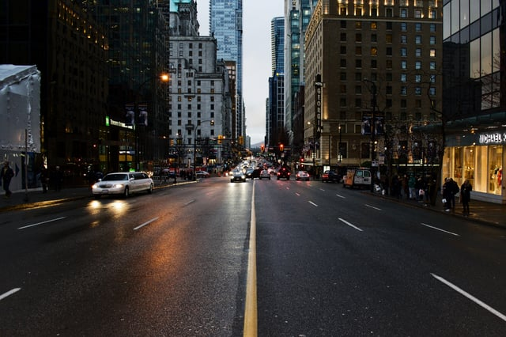
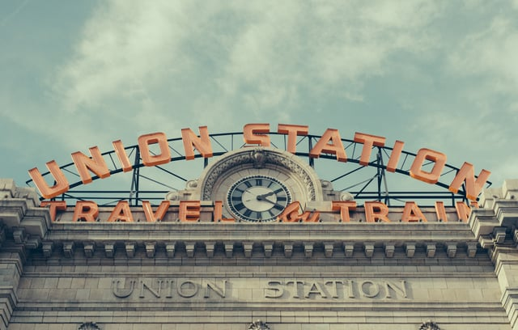

As City of Denver’s metro-area population growth continues, the need for more housing with access to transportation and walkable amenities remains a priority. However, the City is also contending with planning for a sustainable and resilient city by avoiding sprawl due to population increase. Previously profiled in a recent [urban planning overview](/final-review-blog/transit-oriented-development-walkable-cities-urbanism/), in this post, we’ll further examine some of the ways that the City of Denver is approaching these challenges and how strategic planning can benefit mid- and large-sized cities growing similarly across the country.

<em>image credit: [Aditya Chinchure](https://unsplash.com/photos/ghbepAO7BCs)</em>

## Addressing Transit Needs: the RTD FasTrack Program

The City of Denver is uniquely positioned to adapt its public transportation system to the surrounding area’s needs through careful examination and thorough planning to link adjacent cities with the downtown core, surrounding areas, and with the Denver International Airport.

In 2004, the City [adopted](http://www.rtd-denver.com/FF-FasTracks.shtml) the FasTracks program after voter approval with the aim to “expand transit across the Denver metro region” through extension of current light rail service, improved bus service, and new amenities to reduce traffic congestion such as Park-n-Ride parking lots.

The Regional Transportation District (RTD) opened the first [phase](http://www.rtd-fastracks.com/media/uploads/wc/West_Rail_Fact_Sheet_2015_FINAL.pdf) of the plan, the W Line (formerly known as the West Rail Line), in 2013. As the first light rail project completed, the line links Denver’s Union Station with the Jefferson County Government Center with stops within the City of Denver, Lakewood, and Golden, CO. Six of the 12 stations include parking access for commuting and the project also included the creation of 4.26 miles of bike paths for additional, non-vehicular transportation options.

The FasTracks program has also focused on creating new Bus Rapid Transit between Denver and surrounding communities, including the [Flatiron Flyer](http://www.rtd-denver.com/flatiron-flyer.shtml), linking the downtown area with Broomfield, Louisville, Superior, and Boulder, CO with RTD service along US Route 36. While the service offers express routes and dedicated rush hour service for community, the Flatiron Flyer includes all-station buses with morning-to-night daily service to replace the need for a car.

Other improvements [completed to date](http://www.rtd-denver.com/FF-FasTracks.shtml) include the University of Colorado A Line, the first segment of the North B Line, and the Gold (G) Line. Additionally, the I-225 Rail Line (R Line) opened in February 20147 and the planned opening of the North Metro Line is scheduled for 2018.

In total, improvements have or will provide the metro area with 122 miles of new light and commuter rail, 18 miles of bus rapid transit, and 57 new stations. The infrastructure reduces dependence on driving even as the area continues to grow, and can reduce the environmental impact of new urban sprawl. By incorporating TOD and providing incentives to new developments before rapid population growth, Denver has been able to expand its transit access in ways that residents prefer.

FasTracks improvements also provide transit for one of Denver’s Strategic Planning initiatives - the Transit-Oriented Development.

## Transit-Oriented Developments and Denver’s Strategic Plan  
<em>image credit: [Andrew Preble](https://unsplash.com/photos/zrhXd14ICRo)</em>

Transit-oriented developments (TODs) are mixed use developments located near a transit hub with increased density and decreased parking and a focus on decreasing vehicle dependence and congestion. The [Transit-Oriented Development Institute](http://www.tod.org/) defines a TOD as a “walkable design with pedestrian as the highest priority” that functions as a “regional node containing a mixture of uses in close proximity.” While some TODs eliminate all parking, others feature reduced parking, and TODs often include amenities for alternative transportation such as bikes and scooters.

The City of Denver’s [TOD Strategic Plan](https://www.denvergov.org/content/dam/denvergov/Portals/193/documents/TOD_Plan/TOD_Strategic_Plan_FINAL.pdf) (the Plan), first proposed in 2006, uses TODs to address increasing demands for housing while mitigating congestion by adapting developments to different typologies, including dense urban centers and the metro area’s suburbs. Transit communities provide residents with easy access by foot, bicycle, and transit to daily activities including “shopping, dining, jobs, parkings, and schools” and “maximize resident access to public transportation by focusing activities on a major transit stop”.

Typologies include Downtown (mixed-use and highest density with tallest buildings and historic areas), Urban Center (mixed use, high density, grid blocks and multi-modal transportation), General Urban (multi-family residential dominated with commercial streets), Urban (single family residential with walkability and commercial mixed-use), and Suburban (commercial centers with residential neighborhoods).

In addition to identifying the residential style of each neighborhood, the Plan also outlines how TOD can be most successfully incorporated in each typology such as promoting the potential for adaptive reuse of older buildings in General Urban and Urban areas and outlining how the Suburban typology can support and benefit from large-scale new developments located near commuter rail.

The 2006 Plan included long-range planning for new transit, and subsequent Plans have expanded the program to include resources for residents, developers, and public employees. The City continues to promote TOD as a sustainable and desirable way to grow within Denver as well as the surrounding areas by providing residents with the [mixed-use neighborhoods](https://www.strongtowns.org/journal/2016/2/12/americans-want-walkable-neighborhoods) and walkability they continue to prefer.

## Affordable Housing Initiatives

The construction of new housing stock in the City of Denver has included both new single family homes - though housing supply for buyers [remains historically low](http://www.denverpost.com/2016/05/25/10000-new-homes-expected-in-denver-this-year-as-builders-kick-into-overdrive/) and [defect laws](/final-review-blog/colorado-construction-defect-laws-changes/) prevent large scale construction of condos - and new apartment buildings, but demand continues to grow and the need for affordable housing remains high.

In an effort to address affordable housing needs, City of Denver Mayor Michael Hancock proposed a [rent buy-down program](http://www.thedenverchannel.com/news/local-news/mayor-announces-rent-buy-down-program) that subsidizes portions of rent for vacant higher-end apartments so that the units will be affordable for households making between 40%-80% of the area median income.

Previous efforts to address housing shortages included simply building more new units, and Denver saw a record number of [rental units delivered](https://www.curbed.com/2017/1/25/14342828/denver-rents-affordable-housing-apartments) in 2016 as a result, lowering the average rent across the City with the introduction of 9,962 units including affordable units.

Currently a pilot program targeting 400 vacant units, the Mayor’s Office of HOPE (Housing and Opportunities for People Everywhere) hopes to address excess luxury housing vacancies while ensuring that housing built will continue to address the needs of [Denver’s residents](https://www.curbed.com/2017/7/14/15967472/denver-affordable-housing-rent-real-estate).

The City’s newest affordable housing strategy will continue to address the need for housing availability across a range of income levels.

## Denver’s Growth and Resiliency Efforts Will Inform Future Planning

Increasing residential construction in the metro area will only require more sustainability focused and environmentally conscious planning to avoid urban sprawl and address the needs of an ever-urbanising Colorado.

With current plans in place, however, the City’s development strategies will continue to provide creative solutions and promote responsible growth to benefit residents and the future health of the region, and can model how other cities with similar histories can approach future development.
