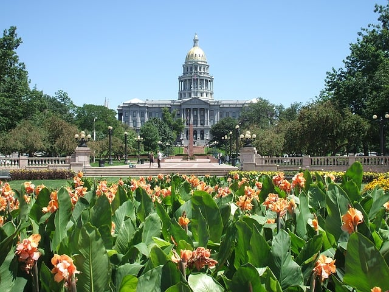

Denver City Council adopted important zoning changes for Denver’s Arapahoe Square district directly north of the City’s downtown area in June 2016. The zoning amendments are significant as they will encourage growth in an area of Denver that needs to be revitalized. The Arapahoe Square rezoning is an excellent example of a newer model of urban planning called form-based zoning. We at Burnham thought we would take a closer look at the Arapahoe Square zoning changes.

## Background to Arapahoe Square Rezoning

Denver’s population has grown by almost 14 percent since 2010 which has resulted in a dramatic increase in building and urban development. This growth has sparked interest in revitalizing the Arapahoe Square district which contains many vacant and surface parking lots as well as deteriorating buildings. Arapahoe Square’s location near downtown and light rail makes it an attractive area for development.

Denver’s [2007 Downtown Area Plan](https://www.denvergov.org/content/dam/denvergov/Portals/646/documents/planning/Plans/Denver_Downtown_Area_Plan.pdf) called for redeveloping Arapahoe Square as a new neighborhood that would be a densely populated, mixed-use district. The [2011 Northeast Downtown Neighborhoods Plan](https://www.denvergov.org/content/dam/denvergov/Portals/646/documents/planning/Plans/Northeast_Downtown_Neighborhoods_Plan.pdf) (Plan) contains a more specific vision and strategy for redeveloping Arapahoe Square. The Plan proposes taller buildings in the Arapahoe Square neighborhood to encourage higher density development and transition neighborhood building heights from those in downtown. In addition, the Plan calls for promoting transit oriented development and pedestrian pathways amongst its recommendations.

Denver City Council representatives and the Community Planning and Development Department created the Arapahoe Square Zoning Technical Task Force comprised of stakeholders to work on the zoning amendments as well the Arapahoe Square Design Standards and Guidelines.The process of developing and adopting changes has taken over a year.

## Overview of New Form-Based Zoning Standards for Arapahoe Square

The Arapahoe Square zoning changes are contained in both [zoning text](https://www.denvergov.org/content/dam/denvergov/Portals/646/documents/Zoning/text_amendments/Amendment-9_Redline_06-27-16_web.pdf) and [map amendments](https://www.denvergov.org/content/dam/denvergov/Portals/646/documents/Zoning/rezoning/Arapahoe_square_rezoning/2016I-00035_Arapahoe_Square_Map_Application_Package041316.pdf).The zoning amendments create two new form-based zoning districts for Arapahoe Square. Form-based zoning is a newer type of land use development that accounts for how the different buildings in a particular area and other area elements, such as streets and sidewalks, relate to each other to achieve a community’s vision.

The two new districts are Downtown Arapahoe Square 12+ (D-AS-12+) and Downtown Arapahoe Square 20+ (D-AS-20+). The map of these new zoning districts shows D-AS-12+ located in the northeastern part of the neighborhood and D-AS-20+ encompassing the southwestern section of Arapahoe Square which is closer to downtown Denver. The area being rezoned includes almost all of Arapahoe Square and small portions of two adjacent neighborhoods. The new districts allow for a height transition from the taller buildings in Denver’s downtown area to the shorter buildings in low-density residential neighborhoods next to Arapahoe Square.

The districts set height limits based on three different building forms: General, General with Height Incentive, and Point Tower. The General building form allows for the greatest variety of building types given it has no restrictions on parking design and upper floor size. It sets the lowest maximum height of the three building forms with D-AS-12+ at eight stories and D-AS-20+ at 20 stories.

The General with High Incentive building form allows for taller buildings if the buildings reduce the amount of visible above-grade parking. If a building meets the General with Height Incentive requirements, meaning no more than 30 percent the parking lot may be visible street-facing parking, a building in D-AS-12+ may be up to 150 feet tall and in D-AS-20+ up to 250 feet in height.

The Point Tower building form allows for greater height when a narrow tower is built over the building’s base. The maximum floor size of 10,000 square feet may be added above the first five stories, and the building must comply with the same above-grade parking requirements as the General with Height Incentive building form.The tower itself may be in D-AS-12+ up to 250 feet and in D-AS-20+ up to 375 feet.

## Arapahoe Square Design Standards and Guidelines

The Arapahoe Square Zoning Technical Task Force also created the document [Arapahoe Square Design Standards and Guidelines](https://www.denvergov.org/content/dam/denvergov/Portals/646/documents/Zoning/rezoning/Arapahoe_square_rezoning/04-13-16_S_Square_DSG_PB_Review.pdf) (Design Standards). To make sure the plans for the area are properly implemented, the Design Standards set forth design standards and guidelines for the review of any proposed new construction or improvements in Arapahoe Square. In addition to standards and guidelines for site and building design, the Design Standards also address street, streetscape, and sign design. The Design Standards will be used by the newly created Arapahoe Square Design Advisory Board, and the Design Standards outline the design review process.

We are looking forward to seeing how Arapahoe Square will be redeveloped in the coming years. The zoning changes will become effective on August 23, 2016, and any projects approved after this date must comply with the new Denver zoning requirements.
