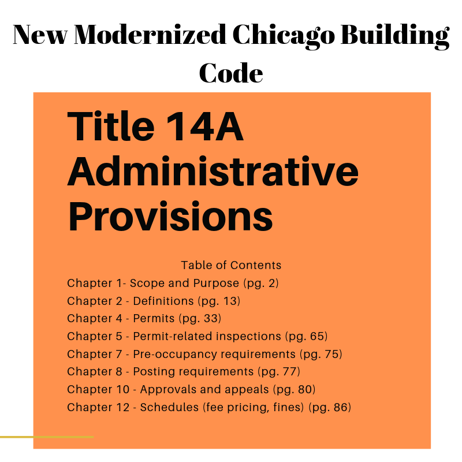
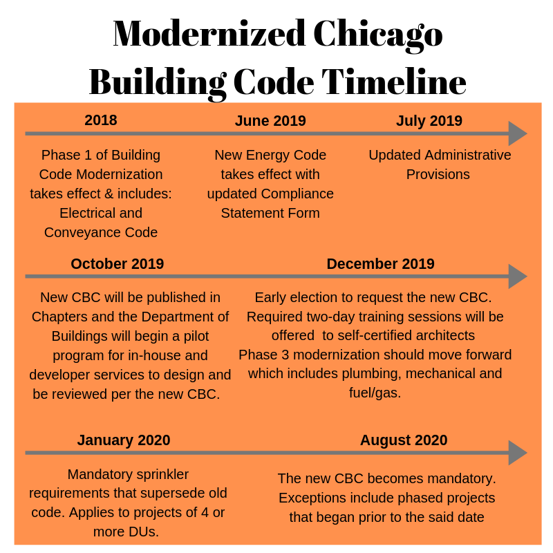

When the City of Chicago proposed to update their building code; the was goal to better align the construction requirements with up-to-date model codes and standards used in other major US jurisdictions, while maintaining long standing  local requirements that are adapted to unique Chicago conditions. This revision has taken [40 years to get to and another 20 years](/final-review-blog/chicago-building-code-change-0-0/) to finally be implemented. 

**For your consideration**

Some key notes to take into consideration when preparing for the new ordinance:

-   *Italic* text - defined term (aligning with I-codes) 
-   Blue text - Chicago ordinance 
-   *Blue italic text* - term defined in Chicago ordinance 
-   Building code **IS NOT** Zoning ordinance 

**Administrative Provisions**

The new **Administrative provisions** is our guide to the Chicago Construction codes located in– **Title 14A** (pg. 2). This will take effect on July, 1 2019. These provisions will state how to use and understand the rules of the codes. It will provide information regarding requirements for permit application, what needs to be included on plans when permits are issued, explaining how inspections work and noting special approval processes, as well as fees for these.

The new construction requirements will be located in **Chicago Building Code - Title 14B** (pg. 161) which is an introduction page into the new code. You will find **Rehabilitation** requirements for renovation, addition, remodeling in **Title 14R** (pg. 611) which is based on the existing International Building Code. 

The new administrative provisions will make it easier to look at requirements prior to going into the building code, better preparing the user. 

We've created an easy to read table of contents for the Administrative Provisions. 

Follow us as we discuss the revisions, additions, and deductions to the new CBC. Interested in learning more? [Reach out to our team](/contact/). 

Where in the Chicago Construction Codes can I find the administrative provisions - things like permit applications, inspections, and fees? Title 14A contains the administrative provisions - the rules governing how to use and apply the code, covering permit application requirements, what must be shown on submitted plans, how inspections work, and applicable fees. It's the starting point before diving into the technical requirements. Where are the actual construction requirements, and where do I look for renovation and rehabilitation rules specifically? Technical construction requirements for new construction are in Title 14B. Rehabilitation requirements - covering renovations, additions, and remodeling of existing buildings - are in Title 14R, which is based on the International Existing Building Code adapted for Chicago conditions. What's the difference between the Chicago Building Code and Chicago's Zoning Ordinance? They're entirely separate regulatory frameworks - the Building Code governs how buildings are designed and constructed (structural, fire, life safety, accessibility, energy), while the Zoning Ordinance governs land use (what type of building or business is allowed in a given location). Both need to be consulted for most development projects, but they're reviewed and enforced by different city departments. How does the 2019 CBC differ from what came before it? It brought Chicago's construction requirements into closer alignment with national model codes (IBC, IEBC, IFC, IECC) that most other major U.S. jurisdictions already use, while preserving Chicago-specific provisions. The previous code was roughly 40 years old, meaning this was the first comprehensive revision in four decades. How do I tell which text in the Chicago Building Code reflects a local Chicago-specific requirement versus a standard model code provision? The code uses a color/style system: italic text indicates a defined term aligned with the I-codes, blue text indicates a Chicago-specific ordinance provision, and blue italic text indicates a term defined by the Chicago ordinance specifically - making it easier to identify where Chicago departs from the national model code baseline.
