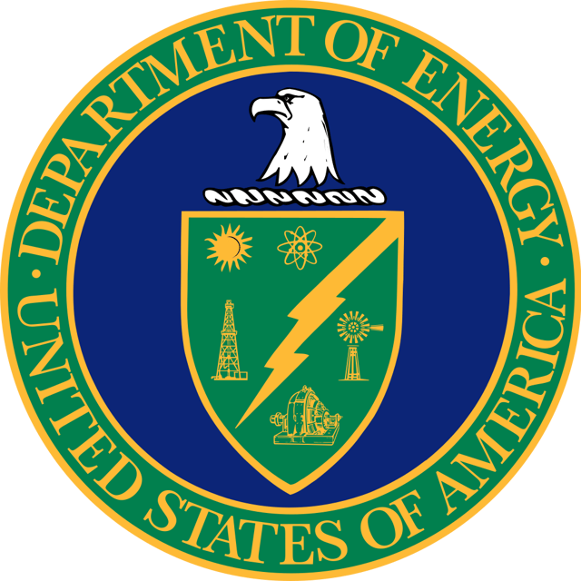

Since his inauguration, President Trump’s administration has taken steps that prevent new energy efficiency standards, including those that affect products and equipment used in the building industry. The potential elimination of the [ENERGY STAR program](/final-review-blog/what-is-the-future-of-energy-star-and-energy-efficiency/), a key program for promoting energy efficiency, has received a lot of press. We want to point out that other energy efficiency standards and programs are also at risk despite the fact that energy efficiency makes good economic sense in addition to benefiting the environment.

  
It is important to understand the different ways the future of energy efficiency is in jeopardy. Fortunately, in response to this assault on energy efficiency gains, a number of organizations and states are now pushing back with lawsuits and other actions.

## Recent History and Background

### Agency-Wide Regulatory Freeze

On January 20, 2017, Reince Priebus, Assistant to the President and Chief of Staff, sent a memorandum (Memorandum) to the heads of all federal executive departments and agencies, [Regulatory Freeze Pending Review](https://www.whitehouse.gov/the-press-office/2017/01/20/memorandum-heads-executive-departments-and-agencies), placing a temporary hold on all new regulation. The Memorandum required that no new regulations be sent to the Office of Federal Register (OFR). Publication in the Federal Register is the last step before regulations become final.

The Memorandum also requires that any regulations sent to OFR but not yet published be withdrawn from OFR. The effective date of regulations that have been published but not yet taken effect must be postponed for 60 days from the date of the Memorandum. Agency and department heads are to consider taking steps to postpone a rule’s effective date beyond the 60-day period. This Memorandum initiated the freeze of all types of regulations, including those regulating energy efficiency.

### Two-for-One Executive Order

Ten days later, President Trump signed the [Executive Order on Reducing Regulation and Controlling Regulatory Costs](https://www.whitehouse.gov/the-press-office/2017/01/30/presidential-executive-order-reducing-regulation-and-controlling) ( Two-for-One Executive Order). We wrote about the Two-for-One Executive Order in detail in an [earlier post](/final-review-blog/impact-of-two-for-one-executive-order-on-ada-title-iii/) as it may apply to regulations under the Americans with Disabilities Act. However, the Two-for-One Executive Order will impact a wide range of regulations, including those pertaining to energy efficiency.

According to the Two-for-One Executive Order and its interim guidance issued on February 2, 2017, for any significant regulatory action, an agency must repeal two existing regulations for a new regulation proposed or promulgated during fiscal year 2017 and the total incremental cost of any new regulation during fiscal year 2017 must be zero. A new regulation’s incremental cost may be offset by eliminating the current costs of two or more prior regulations. In later years, for any regulation that increases the incremental cost, “offsetting regulations” must be identified. If the Two-for-One order remains in place, many important energy efficiency regulations will be prevented or eliminated.

### DOE Halts Energy Efficiency Standards

The United States Department of Energy (DOE), the federal agency charged with creating energy efficiency standards, was in the process of issuing six different sets of energy standards when President Trump was inaugurated. One of the new rules, [the Energy Conservation Standards for Ceiling Fans](https://www.gpo.gov/fdsys/pkg/FR-2017-01-19/pdf/2017-00474.pdf), was already published on January 19, 2017, with an effective date of March 20, 2017. This new rule amended prior ceiling fan standards to improve energy efficiency. In response to the Memorandum, DOE initially delayed the regulation’s effective date until March 21, 2017, and after the appointment of a new Secretary of Energy, further delayed the effective date until September 30, 2017.

The five remaining rules govern energy efficiency standards for portable air conditioners, uninterruptible power supplies, air compressors, walk-in coolers and freezer refrigeration systems, and commercial packaged boilers. These rules all went through a lengthy rulemaking process and have been completed except for the last step required before they become final rules, their publication in the Federal Register. DOE failed to send the five rules to the OFR so they may be published.

## Lawsuit Responding to Executive Order

Public Citizen, the Natural Resources Defense Council, and Communications Workers of America, AFL-CIO brought a lawsuit in February challenging the Two-for-One Executive Order, <em>[Public Citizen, Inc. v. Trump](https://assets.documentcloud.org/documents/3456917/2-8-17-Public-Citizen-Complaint.pdf)</em>, No. 1:17-cv-00253 (D.D.C.filed Feb. 8, 2017). One of the defendants in the lawsuit was the Acting Secretary of Energy when the case was filed.

The plaintiffs in *Public Citizen* are asking for the Two-for-One Executive Order to be invalidated because it is unconstitutional, wrongly requires agencies to repeal regulations merely based on cost, and will force executive agencies to violate a variety of statutory requirements in order to be compliant with the executive order. An executive order cannot contradict or change a federal statute.

The plaintiffs in *Public Citizen* specifically allege that the Two-for-One Executive Order forces DOE to violate the Energy Policy and Conservation Act (EPCA), the federal statute that includes the requirement that DOE creates energy conservation standards for different kinds of consumer products and commercial equipment.

To implement EPCA’s mandate, DOE creates regulations with minimum energy efficiency requirements for appliances and equipment. In setting these standards, DOE must consider factors set forth in EPCA. However, in order to comply with the Two-for-One Executive Order, DOE would have to ignore these factors when creating energy conservation standards; and thus, DOE would be acting in violation of EPCA. Additionally, the requirement that at least two existing rules must be repealed for any new rule issued would prevent the promulgation of critical rules necessary to carry out EPCA’s directives.

## Challenges to Freeze of Energy Efficiency Standards

Several petitions for review have been filed in response to DOE’s delay of the Energy Conservation ceiling fan standards’ effective date. A number of organizations, including the Natural Resources Defense Council and the Consumer Federation of America filed one of the [petitions with the United States Court of Appeals for the Second Circuit](https://www.nrdc.org/sites/default/files/lawsuit-doe-ceiling-fan-standards-20170403.pdf). The [other petition](https://ag.ny.gov/sites/default/files/2017_03_31_petition_and_rules_final.pdf) was filed by the attorneys general of 10 different states and the City of New York. As petitions for review, these legal actions just initiate the court’s review of DOE’s actions and do yet include legal arguments.

Some of the same [organizations](https://www.nrdc.org/sites/default/files/notice-letter-doe-efficiency-standards-20170403.pdf) and [attorneys general](https://ag.ny.gov/sites/default/files/2017_04_03_notice_letter_and_appendices_final.pdf) that filed the petitions for review of the ceiling fan standards, sent 60-day notice letters on April 3, 2017, to DOE Secretary Perry. The letters request that DOE submits to OFR the five energy efficiency rules awaiting publication. If DOE continues to prevent the rules from being published, the organizations and attorneys general intend to file lawsuits compelling DOE to publish the rules in keeping with DOE’s obligations under EPCA and the Administrative Procedures Action.

The Two-for-One Executive Order and the freeze of energy efficiency standards are not the only actions jeopardizing energy efficiency gains. We recently wrote about the [ENERGY STAR program](/final-review-blog/what-is-the-future-of-energy-star-and-energy-efficiency/) that is completely eliminated under President Trump’s 2018 Budget proposal. Numerous groups have voiced their opposition to the elimination of the ENERGY STAR program. We hope concern will also be raised about other energy standards and programs that are at risk.
