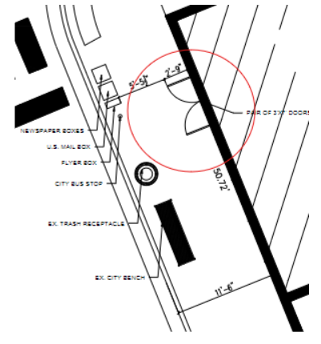

A door swing is a grant of privilege permit category for a door that swings into the public way  
(city-owned public sidewalk, city-owned public alley). Door swings that open out and not into a  
building are often required for assembly units. However, based on building code in cities like Chicago, if your plans include a door that swings into the public right of way, your greatest chance of success with your permit will come if you ensure any doors are reconfigured or have a recessed entry that does not encroach into the public thoroughfare.

## Process for door swing approvals

It has long been rumored that pedestrian lawsuits are the reason that the city of Chicago no  
longer approves door swings which swing into pedestrian sidewalks.

When door swings are open into the sidewalk, the traversable width of the sidewalk is  
decreased.

[Code 14B-32-3202 in Chicago](https://codelibrary.amlegal.com/codes/chicago/latest/chicagozoning_il/0-0-0-52329#JD_Ch.17-17) leaves very little room for interpretation:

 <em>"3202.2 Encroachments above grade and below 12 feet in height. Encroachments into the public way above grade and below 12 feet (3658 mm) in clear height shall be prohibited. Doors and windows shall not open or project into the public way."</em>

The process to get a door swing approved would include:

-   Grant of privilege (GOP) permit issued specifically for the door swing.
    -   In Chicago, The Department of Business Affairs and Consumer Protection will start the process. They are responsible for issuing permits for anything a business places on, over, or under public spaces.
    -   Then, the Department of Transportation (DOT/CDOT) will receive the permit. The DOT will deny the outward door swing that encroaches into the sidewalk.

Due to the code above, new door swings into the sidewalk are not allowed and, if already existing, they can only be permitted as legal-non-confirming-uses. Project stakeholders should consider constructing exteriors to ensure all door swings are set back so that they do not encroach into the public way when fully opened.  

<em>An example of a door swing plan that would not be approved.</em>

Burnham Nationwide can guide you through these and many other compliance issues your team will face during the life of a project. We're here to help you Get It Done. 

Can a door swing out into a public sidewalk in Chicago? No - new door swings that open into the public way are not approved. Per Chicago's encroachment code, doors and windows are prohibited from opening or projecting into the public way below 12 feet in height, and any existing doors that already swing outward can only continue as a legal non-conforming use. Why does Chicago require exit doors to swing outward but not into the sidewalk? These are two separate rules working together. Egress code requires doors serving 50+ occupants to swing in the direction of travel (outward, to prevent crowd pressure from trapping people inside). Separately, the public way encroachment code prohibits that outward swing from extending past the building line into city-owned sidewalk space — so the solution is usually a recessed entry that lets the door swing out without crossing into the public way. What permit is needed for a door that swings into the public way? A Grant of Privilege (GOP) permit. In Chicago, the Department of Business Affairs and Consumer Protection initiates this type of permit, and the Department of Transportation (CDOT) reviews and typically denies any outward door swing that encroaches into the sidewalk. How can a building meet egress requirements without violating sidewalk encroachment rules? By recessing the entry - setting the door back from the property line so it can swing fully open in the required direction of egress travel without ever crossing into the public right-of-way.  
Why did Chicago stop approving door swings into public sidewalks? It's widely understood to trace back to pedestrian lawsuits tied to outward-swinging doors reducing usable sidewalk width, though this is described as a long-standing rumor rather than an officially documented reason - the current code language itself leaves no room for interpretation either way.
