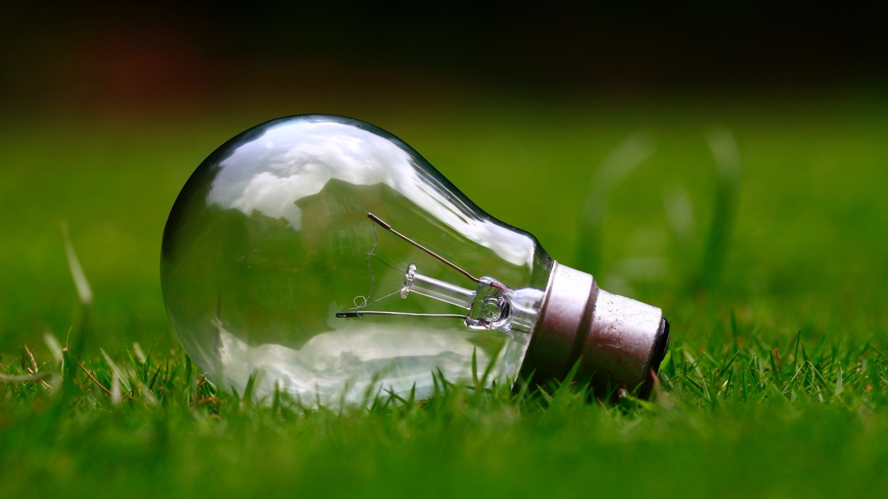

We’ve been [highlighting](/final-review-blog/burnham-nationwides-climate-change-drawdown-series/) Project Drawdown’s strategies for fighting climate change since the beginning of year, including [green roofs](/final-review-blog/project-drawdown-green-roofs-mandates-denver/), [cement](/final-review-blog/cement-and-lowering-greenhouse-gases/), and the number one solution to global warming, [reducing air conditioning refrigerants](/final-review-blog/reductions-in-air-conditionings-global-warming-potential/). The majority of these solutions are focused on a larger scale involving urban planning and global initiatives, but Project Drawdown also has actionable items for individuals and local groups. This year, Project Drawdown and the [Northwest Earth Institute](https://www.nwei.org/) (NWEI) debuted the Drawdown EcoChallenge to spur action on these items.

<em>image by [Ashes Sitoula](https://unsplash.com/photos/UfEyDdXlRp8?)</em>

The 2018 EcoChallenge (the Challenge) ran this past April, and the 21-day [event](https://drawdown.ecochallenge.org/about/event) was social-focused and challenged individuals and teams to act on the solutions posed in Drawdown: The Most Comprehensive Plan Ever Proposed to Reverse Global Warming.

## Drawdown EcoChallenge Overview: Challenges

The Drawdown team established seven challenges for the 2018 event: Electricity Generation, Food, Women and Girls, Buildings and Cities, Land Use, Transport, and Materials. Each challenge included actions to be completed by either an individual or team on either a local or regional scale.

The [power sector](https://drawdown.ecochallenge.org/challenges/electricity-generation), for example, is responsible for 40 percent of all greenhouse gas (GHG) emissions. Sixty-seven percent of all energy worldwide is generated using fossil fuels, with renewable energy composing 24 percent of power generated. Nuclear power composes 11 percent of power sources, while the majority of renewable energy is generated using hydropower. Project Drawdown is targeting energy generation as key to fighting global warming with solutions that include the following energy generation methods among others:

-   Concentrated Solar
-   Geothermal Energy
-   In-stream Hydro
-   Methane Digesters
-   Micro Wind
-   Rooftop Solar
-   Solar Farms

Drawdown also seeks to support related technologies that enable renewable energy generation and solutions of all scopes, providing a framework that addresses GHG emissions across the power sector.

The Electricity Generation tasks target multiple solutions, including #2 [Wind Turbines](http://www.drawdown.org/solutions/electricity-generation/wind-turbines-onshore), #76 [Micro Wind](http://www.drawdown.org/solutions/electricity-generation/micro-wind), and #18 [Geothermal Energy](http://www.drawdown.org/solutions/electricity-generation/geothermal). Participants could take action by contacting elected officials to support power generation through wind energy, signing up for clean energy options through their utility company, consulting for residential solar power, or advocating for clean energy on campus or learning more about the Drawdown solutions. Teams could create and implement a solar energy plan for a larger scale, higher impact result.

Completing a task for each challenge awarded points to the individual and their team as well as to the Challenge’s overall goals. With over 7,000 participants, the 2018 Challenge had an international reach with 767 teams from across the world participating in this year’s event.

Each challenge included a mix of easily accessible tasks such as watching a documentary or starting a conversation as well as more large-scale efforts, providing individuals with a myriad of ways to participate. A key component of the Challenge is the social aspects - utilized both as an incentive by connecting teams in competitions and as a way to spread awareness of Project Drawdown, much of the Challenge focused on disseminating information and starting conversations surrounding global warming solutions.

## 2018 EcoChallenge Event Results

The NWEI compiled this year’s [results](https://ecochallenge.org/wp-content/uploads/2018/05/2018-Drawdown-EcoChallenge-Event-Summary.pdf): the winning team, Asheville High School in Asheville, NC, earned more than 130,000 points. Cumulatively, over 56,000 gallons of water were saved during the Challenge, 21,000+ meatless meals were consumed, and more than 2,000 letters or emails were sent to elected officials. The event saved more than 150,000 pounds of carbon dioxide emissions through bus travel, biking, and carpool as well as locally-sourced and zero-waste meals.

## Illinois Green Alliance Provides a Local Presence

The Illinois Green Alliance completed in the Challenge. Composed of 76 individuals, the Illinois Green Alliance team saved 2,753 pounds of carbon dioxide emissions in April by traveling 158 miles by bike, saving 360 gallons of water, and consuming 248 meatless meals.

Through each task, participants were able to implement some of the solutions detailed by Project Drawdown locally. Though NWEI and Project Drawdown hasn’t confirmed that the Challenge will return in 2019, taking individual action to fight carbon emissions can be done at any time. By increasing awareness around the practical,everyday ways individuals can contribute to GHG reduction, the strategies become actionable by all.
