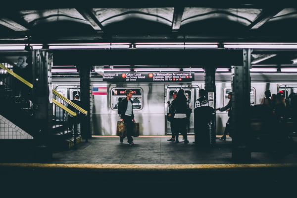

According to Project Drawdown, the [transport sector](https://www.drawdown.org/solutions/transport) is responsible for more than “seven gigatons of carbon dioxide-equivalent greenhouse gas (GHG) emissions annually” and is responsible for 14 percent of total global emissions. Transport emissions in individual countries count for up to 35 percent of all emissions, and the sector share continues to grow. 

International shipping, air transportation, and other subsectors are in high demand, and as “a country develops economically, \[the\] movement of people and good increases.” Without targeted efforts and special focus on transportation emissions in all forms, Drawdown states that “emissions \[could\] balloon out of control” and threaten any plan to fight global warming. 

<em>image by [Andre Benz](https://unsplash.com/photos/XAqaeyzj3NM)</em>

Previously, we covered [bike infrastructure](/final-review-blog/bike-infrastructure-key-to-healthier-cities-reduced-emissions/), one of the project’s solutions to both public health issues and GHG emissions. Here, we’re taking a look at another transportation facet - mass transit - and how improving public transportation use can reduce emissions on multiple scales.

## An Overview of the Transportation Sector

Project Drawdown targets multiple forms of transportation in 11 solutions: airplanes, cars, electric bikes, electric vehicles, high-speed rail, mass transit, ridesharing, ships, telepresence, trains, and trucks. Each solution is focused on a specific aspect to reduce either fuel consumption or promote alternative forms of transportation.

Like many of the other sectors, each facet is interconnected both within the transportation network and to other industries. Ships, trains, and trucks form the Freight group, while ridesharing, walkable cities, mass transit, electric bikes, bike infrastructure, cars, and electric vehicles address urban passenger needs. (Airplanes, high speed rail, and telepresence form the remaining non-urban passenger modes.)

The [project](https://www.drawdown.org/solutions/transport) defines Urban Passenger Transport (UPT) as “the movement of people within built-up areas, which are often not fully within the administrative limits of a city” and encompasses entire metropolitan areas in its calculations.

By improving and promoting the use of sustainable methods of UPT, demand for polluting modes like car travel directly decrease. Urban trip methods follow this model in particular, and by improving access to public transportation, cities can expect a decrease in car use, furthering the emission reduction benefits.

## Mass Transit Provides Emission Reduction, Health Benefits

[Defined](https://www.drawdown.org/solutions/transport/mass-transit) as “the increased usage of mass transit or public transport to get around cities”, the mass transit solution replaces the use of convention cars entirely. The sector includes bus transportation (BRT), metro rail, commuter rail, tram, and other forms integrated within the urban environment.

The Drawdown scenario projections are based on 36 percent of adoption of mass transit globally and a reduction of up to 17 gigatons from 2020-2050, with the optimum adoption scenario providing a 26 gigaton reduction.

Though mass transit is part of the current urban fabric and it is often the only alternative to private cars, its future is not guaranteed. Despite its prevalence, mass transit use is expected to decline to 21 percent of urban travel share as urban populations become wealthier and prefer car use. Cars remain the majority share in North America and Europe, and in order to fight use, modal shifts must occur.

According to Project Drawdown, the oldest bus rapid transit network, established in Curitiba, Brazil in 1971, is orientated for passenger use similar to a subway or metro transit system. It’s an early example of forward-thinking, sustainable mass transit and prioritizes bus efficiency in what is otherwise often considered the slowest form of public transportation. Shifting mass transit options to more efficient methods such as BRT can improve transit adoption, but the freedom of cars continues to appeal to urban residents and pose challenges for reaching Drawdown’s adoption goal.

Public transportation also provides benefits that stretch beyond reducing GHG emissions, including a narrower footprint (no parking required), more equitable access to city services and resources for those who cannot afford a car, and less traffic congestion. Public health is improved through fewer fatalities from traffic crashes and less air pollution from car exhaust, and walkable cities make residents healthier through exercise.

## Challenges to Mass Transit Adoption

Though many public transportation systems are embedded within the existing structures of cities, even well-established modes face barriers to use.

First-mile/last-mile challenges (serving commuters with accessible transit for the beginning and ends of their commutes, a challenge addressed by other solutions such as bike transportation), a persistent car culture, and inequitable access to transportation systems fight against the adoption of public transportation. These challenges must be addressed to reach Drawdown’s emissions goal, but they can also be included in urban planning efforts as cities continue to expand.

Simplifying the transportation process by allowing users to use the same payment methods across modes, “redensification” to make transit more attractive than driving a car where space for parking is limited, and providing better access for all can allow for users to use cars less or even forgo them altogether in a way that is attractive, equitable, and accessible.

Many established transit systems, though more extensive than newer networks, struggle with aging infrastructure. The New York City subway continues [to be plagued with delays](https://www.nytimes.com/2018/01/03/magazine/subway-new-york-city-public-transportation-wealth-inequality.html) and service disruptions, relying on a signal system that dates to the 1920s and 1930s and railcars that are often at least 40 years old. Much of the subway system lies below the water table, threatening infrastructure with flooding, and track fires from trash often cause disruptions.

Long-term service improvements will require major reconstruction, a process that will take years, and headaches may continue for riders. Delays will push users to other transportation modes - if they have access.

Inequitable access remains a major issue. According to a report released by the [Federal Reserve Bank of New York](http://libertystreeteconomics.newyorkfed.org/2018/06/why-new-york-city-subway-delays-dont-affect-all-riders-equally.html), low-income New Yorkers are more likely to experience significant delays during subway travel due to further commuting distance, neighborhoods without close transit access, and lack of access to alternative modes such as rideshares.

## Despite Challenges, Mass Transit Will Grow with Urban Development

The Chicago Infrastructure Trust (CIT) selected the [Boring Company](https://www.boringcompany.com/chicago/) to construct the Chicago Express Loop - a high-speed, underground public transportation that promises a 12 minute trip from O’Hare Airport to downtown Chicago. When completed, the Express Loop will complete the trip up to five times faster than current options, including the CTA’s Blue Line. Future Loop and Hyperloop systems promise even more impressive times with less pollution and less disruption than conventional forms of mass transit, but municipalities will [also need to adjust](https://www.nbcnews.com/mach/science/elon-musk-s-hyperloop-dream-may-come-true-soon-ncna855041) to an entirely new transportation mode with far-reaching impacts.

By linking transportation improvements with other strategies, cities can promote a modal shift in their communities, making urban environments healthier and cities more environmentally friendly. Public attitude is now more positive toward public transportation, but cities must continue to improve access, create more efficient systems, and improve other transportation modes to reach Project Drawdown’s reduction goals.

Did the Boring Company's Chicago Express Loop actually get built? No - the project was cancelled in 2021. Mayor Lori Lightfoot's administration terminated the contract after the company failed to submit financing plans and the COVID-19 pandemic significantly reduced O'Hare Airport traffic. Chicago is no longer pursuing that specific project. Has the NYC subway's infrastructure modernization made progress since this post? Somewhat - the MTA completed its first major signal modernization project on the Queens Boulevard lines, and the $51.5 billion 2020-2024 Capital Program funded additional track, signal, and station improvements. However, the 1920s-era signal system remains on much of the system, full modernization is expected to take decades, and service reliability challenges persist. Is mass transit use recovering from the pandemic-era ridership collapse? Partially but unevenly - most major U.S. systems have recovered 75-90% of pre-pandemic ridership as of 2025-2026, with commuter rail systems recovering the slowest due to persistent hybrid work patterns. Transit agencies are increasingly focusing on off-peak and non-commute trip growth to compensate. What progress has been made on the first-mile/last-mile transit problem since this post? Integrated mobility apps combining transit, bikeshare, and scooter options in a single payment platform have expanded significantly - cities like Chicago (Ventra), New York, and Los Angeles now offer multi-modal trip planning and payment in single apps, addressing some of the payment-barrier issues this post identified. Is mass transit still considered one of the most effective climate solutions for cities? Yes - Project Drawdown's updated analysis continues to rank mass transit highly, and the 2026 ROAD to Housing Act specifically encourages transit-oriented development by prioritizing CDBG housing funding for projects near transit, reflecting growing recognition that land use and transit planning must be integrated rather than tackled separately.
