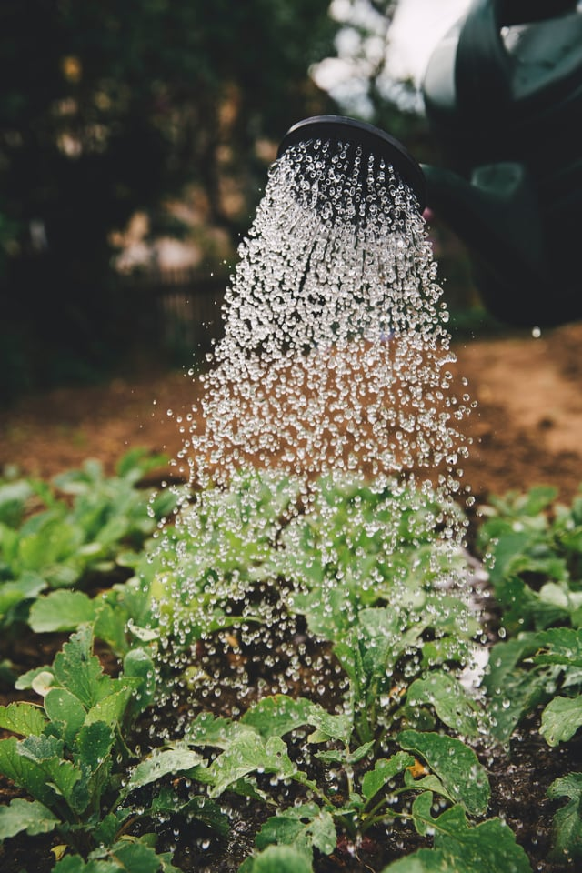

Urban planning that mitigates water loss can reduce greenhouse gas (GHG) emissions. Though water infrastructure is a vital part of the urban landscape, urban planning often overlooks the environmental impacts of storing and transporting water and the amount of energy used during the process.

[Project Drawdown](http://www.drawdown.org/) highlights the significant amount of energy used to pump water from sources to treatment plants and then on to storage and distribution. Each year, over [8.6 trillion gallons](http://www.drawdown.org/solutions/buildings-and-cities/water-distribution) of water are lost worldwide through leaks in water distribution systems, a number divided equally between low and high-income countries. 

<em>image by [Markus Spiske](https://unsplash.com/photos/sFydXGrt5OA)</em>

Project Drawdown ranks water distribution as number 71 in its list of climate change solutions. According to Project Drawdown, mitigating water loss can reduce carbon dioxide emissions by 0.87 gigatons and save 215 quadrillion gallons of water over 30 years. Cities are beginning to address water loss, and thus the impact of water distribution on GHG emissions through policy changes that affect the building community including incentivizing Low Impact Development (LID) and sustainable development.

## Lowering Worldwide Water Loss Mitigates Global Warming and Water Scarcity

Obtaining and transporting water uses [significant amounts of energy](https://www.rivernetwork.org/wp-content/uploads/2015/10/The-Carbon-Footprint-of-Water-River-Network-2009.pdf). Lost water, defined as “non-revenue water” (NRW), is the the [water wasted](https://stateofgreen.com/files/download/9809) during the pumping process from source to treatment plant, from leaks in pipes transporting water to end users. Though NRW never reaches taps, it is still pumped through infrastructure, expending energy. NRW increases GHG emissions via its electricity drain and contributes to global warming, in turn threatening water security.

The [Carbon Footprint of Water](https://www.rivernetwork.org/wp-content/uploads/2015/10/The-Carbon-Footprint-of-Water-River-Network-2009.pdf) study (Carbon Study) names the energy intensity of water (also known as virtual or embedded/embodied energy) as the “total amount of energy, calculated on a whole-system basis, required for the use of a given amount of water in a specific location.” The energy intensity is determined by water quality, pumping requirements such as distance from source to treatment or endpoint, and the efficiency of the water system as well as end use (such as dishwashing, showers, etc.)

The Carbon Study states that energy required to pump water is expected to increase due to “greater reliance on marginal water supplies, development of new energy intensive supplies, and regulatory standards requiring higher levels of drinking water and wastewater treatment.” As water becomes more scarce due to climate change and increased demand, more energy is expended obtaining water from marginal sources, compounding energy usage and further contributing to the cycle.

According to the World Resources Institute’s Aqueduct [Water Risk Atlas](http://www.wri.org/applications/maps/aqueduct-atlas/#x=8.00&y=0.32&s=ws!20!28!c&t=waterrisk&w=def&g=0&i=BWS-16!WSV-4!SV-2!HFO-4!DRO-4!STOR-8!GW-8!WRI-4!ECOS-2!MC-4!WCG-8!ECOV-2!&tr=ind-1!prj-1&l=3&b=terrain&m=group), every continent currently faces water risk. Growing urban populations place further demands on existing water supplies making water loss even more dire.

Since global warming is increasing water instability, eliminating water loss can improve water health and avoid reliance on more energy-intensive or lower quality water sources.

## International Water Association’s “Water Wise Cities” Aims to Combat Water Loss

The [International Water Association](http://www.iwa-network.org/) (IWA) fights water insecurity and system mismanagement. IWA’s main initiatives is the use of urban planning and design to combat water loss. According to the [World Health Organization](http://www.who.int/gho/urban_health/situation_trends/urban_population_growth_text/en/), an estimated 6.4 billion people are expected to live in cities, and over 50 percent of the world’s population is currently urban. Urbanization continues to grow at a rate of 1.84 percent per year.

IWA developed Water Wise Cities (WWC) to create a culture of resiliency around water issues. [Seventeen principles](http://www.iwa-network.org/wp-content/uploads/2016/10/IWA_Brochure_Water_Wise_Communities_SCREEN.pdf), part of four categories, form the basis of the WWC initiative:

1.  Regenerative Water Services: Water bodies and ecosystems are replenished and water is recovered, reused, and recycled; conservation is systematic, and systems are modular
2.  Water Sensitive Urban Design: Urban spaces are developed to reduce flood risks and promote healthier ecosystems, minimize environmental impact; visible water for increased livability; adapting construction materials to minimize environmental impact
3.  Basin Connected Cities: Cities and infrastructure protect the quality of water resources; minimize drought; prepare for extreme events
4.  Water-Wise Communities: Citizens are involved in water actions; professionals are aware of the benefits of water planning in regards to architecture, landscaping, energy, transportation; policy makers enable water-wise action; leaders engage with policies and establish trust

A variety of [cities](http://www.iwa-network.org/city/dakar/) on different continents, including Dakar, Senegal, have implemented the Water Wise Cities principles. Changing demographics as a result of persistent droughts in Senegal has caused rapid expansion in the capital city without proper sanitation or planning, and the increased urban surface means more impermeability and more runoff - leading to an increased flooding risk.

Dakar established policies to address these issues through programs such as the Storm Water Management and Climate Change Adaptation Project (PROGEP) in line with the IWA’s initiatives and currently serves as a model for water management in West Africa - an area at severe risk of water scarcity in the near future as a result of global warming.

## US States Require Improved Water Loss Reduction Policies

Pumping water and treating wastewater uses considerable amounts of electricity even in the United States (US). A [report](http://www.waterrf.org/PublicReportLibrary/4454.pdf) by the Water Research Foundation indicates that in the last 15 years, there has been a 39 percent increase in yearly energy usage for public water supply and treatment and a 74 percent increase in municipal wastewater treatment.

The report indicates “that lowering the amount of water loss lowers water demand, which reduces the volume of water drawn from water supplies, which also reduces the energy required to pump, treat, and transport additional water to end-users.”

Many utilities lose up to 20 percent of water during normal operation. Eliminating leaks and water loss also means less wastewater treatment is needed, significantly lowering the amount of energy consumed by avoiding the secondary function of the water system altogether, including treatment of urban runoff.

The National Resource Defence Council provides [an overview](https://www.nrdc.org/resources/cutting-our-losses) of state government efforts to combat water loss. A few states, such as California and Georgia, have robust policies. These states have required performance benchmarks for municipal water systems as well as annual Water Loss reporting.

Other states implement annual loss tracking only - Texas, Wisconsin, Tennessee, and Pennsylvania all have standardized reporting. Most of the east coast states, Illinois, Oregon, and Arizona have rudimentary, unstandardized loss reporting. Unfortunately, the majority of states take no action to track or mitigate water loss.

Significant savings are also found in reducing both commercial and residential water demand, and the [Carbon Footprint of Water](https://www.rivernetwork.org/wp-content/uploads/2015/10/The-Carbon-Footprint-of-Water-River-Network-2009.pdf) stresses that Low Impact Development (LID) - urban design that prioritizes stormwater management and runoff/pollution reduction - has a significant impact on both energy demand and supply health.

LID can “reduce the energy required for stormwater treatment, avoid the carbon emissions associated with building traditional infrastructure, \[and\] reduce aquifer drawdown.” LID techniques will continue to be adopted and cities have already begun to incentivize water-smart development.

## Better Water Systems Benefit Both Development, Environment

Planning initiatives that promote more efficient water systems have demonstrable savings, but solving water leaks and eliminating NRW extends beyond these economic benefits. By conserving water and eliminating unnecessary energy expenditures, cities are better able to serve their residents with higher quality water, and growing populations will be better equipped to deal with environmental challenges and increasing water scarcity.

Though some states have begun to address water loss, the majority of the US has not - a key factor in reducing carbon emissions. Improving water distribution has the potential to have a snowball effect - by reducing the amount of energy expended by pumping or treating lost water, GHG emissions will decrease, and decreased warming leads to a more stable water supply.

*This blog post is part of Burnham Nationwide’s* [Drawdown Series](/final-review-blog/burnham-nationwides-climate-change-drawdown-series/)<em>.</em>
