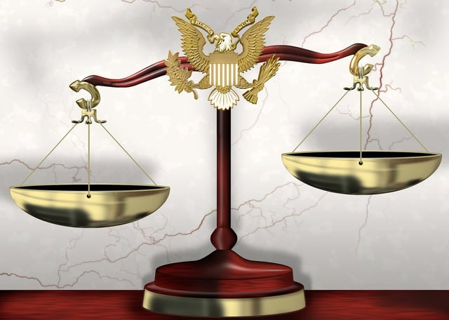

Title III of the Americans Disabilities Act (ADA) is the most relevant of the ADA’s five titles for architects, builders, and others designing, constructing, and managing buildings. Businesses covered by Title III, private entities that operate as places of public accommodation or commercial facilities, must also comply with the 2010 Standards for Accessible Design (2010 Standards) that implement the ADA. It is critical to understand the United States Department of Justice’s (DOJ) role in enforcing the ADA because a failure to comply with the ADA and its standards may result in a DOJ legal action.

## Understanding DOJ’s Enforcement Authority

DOJ is the federal agency responsible for administering and enforcing Title III of the ADA. [42 U.S.C. § 12188](https://www.gpo.gov/fdsys/search/pagedetails.action?sr=2&originalSearch=&st=Cost+Insurance+and+Freight+financial+definition&ps=10&na=&se=&sb=re&timeFrame=&dateBrowse=&govAuthBrowse=&collection=USCODE&historical=true&granuleId=USCODE-2015-title42-chap126-subchapIII-sec12188&packageId=USCODE-2015-title42&fromState=&collectionCode=USCODE&browsePath=Title+42%2FChapter+126%2FSubchapter+III%2FSec.+12188&collapse=true&fromBrowse=true&bread=true) contains Title III’s enforcement provisions. Under the section, both private parties subject to discrimination due to a disability and DOJ may bring a legal action. DOJ’s enforcement authority is specifically addressed in § 12188(b).

## DOJ Investigations and Compliance Reviews

According to § 12188 (b)(1)(A)(i), the agency is responsible for investigating alleged violations of Title III and conducting periodic compliance reviews of covered facilities. A private party may file a complaint with DOJ to be investigated by the agency. DOJ’s website has [instructions](https://www.ada.gov/filing_complaint.htm) for filing a complaint. The agency will review any complaint which can take up to three months.

DOJ may refer a complaint to it’s [ADA Mediation Program](https://www.ada.gov/mediation_docs/mediation-q-a.htm). The program uses professional ADA-trained mediators to help find a resolution to a complaint. It is a voluntary program that can be quicker and less expensive than going to court. The outcome of a successful mediation is a binding agreement that may, for example, require the removal of barriers to accessibility.

If DOJ fully investigates a complaint, the agency may undertake a compliance review, a detailed look at how a business is meeting the 2010 Standards’ requirements. A DOJ investigation can result in a settlement negotiation or a lawsuit. If a DOJ lawsuit stems from a private party’s complaint, DOJ does not act as the complainant’s attorney or representative.

## DOJ’s Authority to Bring Civil Lawsuits

DOJ is authorized to bring a civil case in the appropriate federal district court if: (1) a place of public accommodation or commercial facility covered by Title III has a “pattern or practice” of violating Title III or (2) the Title III discrimination “raises an issue of general public importance.”

A case brought by DOJ may result in a court order to remove the violation causing the discrimination. For example, the party may be required to take specific steps to make the facility accessible. The court may also consider other relief it thinks appropriate, for example, monetary damages. However, such monetary damages do not include punitive damages.

DOJ may also request a civil penalty of up to $50,000 for the first violation and $100,000 for subsequent violations. All discriminatory acts included in the first lawsuit against a business constitute the first violation and any additional lawsuits count as subsequent violations. When determining the penalty, a court may consider any good faith effort by the defending entity.

Information about DOJ’s enforcement activities is publicly available. DOJ ADA Title III enforcement documents, including settlement agreements, consent decrees (court-supervised settlements), complaints, letters of resolution and briefs are available in the [enforcement section](https://www.ada.gov/enforce_current.htm) of DOJ’s ADA website. DOJ sometimes files amicus curiae, “friend of the court” briefs and motions as a non-party in ADA cases that raise significant legal issues.

## DOJ Certification of State and Local Laws

It is important to understand that if a business complies with a state or local jurisdiction’s accessibility requirements, it is not automatically compliant with the federal ADA. There may be differences between the federal, state, and local requirements. Similarly, one cannot rely on a local building department’s accessibility review for ADA compliance because a local building department does not enforce the federal ADA.

DOJ’s § 12188(b) enforcement authority includes the agency’s certification of state or local accessibility laws as meeting the ADA’s Title III minimum requirements. Certification allows greater efficiency and eliminates confusion because only one code theoretically needs to be examined. It also provides businesses with a greater degree of confidence that they have complied with the ADA. The certification of a state or local program may be used as a defense in an ADA lawsuit.

If DOJ makes a preliminary determination of equivalency for a state or local program, a notice is published in the Federal Register opening a 60 day public comment period. In addition, a hearing is scheduled to provide an opportunity for testimony. A final determination is also published in the Federal Register.

## Avoiding ADA Litigation

The best way to avoid a DOJ ADA Title III enforcement action or private party lawsuit is to make sure a facility is ADA compliant. It is important to have an experienced expert conduct an ADA compliance survey. A survey documents how a facility is already in compliance and identifies any issues. It should also include a plan for remedying any problems that are identified. Even if a lawsuit is filed in the interim, evidence that there is a prexisting plan for attaining compliance may be part of the legal defenses.

Read about private party ADA Title III lawsuits, including steps to reduce drive-by cases, in our upcoming post.
