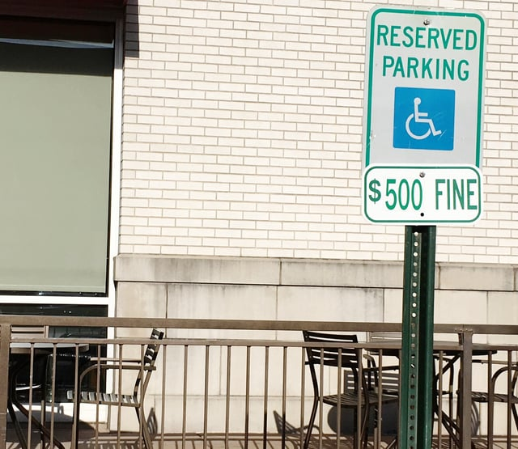

Private parties may bring lawsuits to enforce Title III of the Americans with Disabilities Act (ADA), the section of the ADA that prohibits discrimination against people with disabilities by private entities that provide public accommodations or operate as a commercial facility. The extent to which a private party can receive damages is dependent on both federal and state law. Private party ADA Title III lawsuits are at times controversial because of the large number of “drive-by” or serial ADA Title III lawsuits.

## Private Party Lawsuits Under the ADA

According to [42 U.S.C. § 12188](https://www.gpo.gov/fdsys/search/pagedetails.action?sr=2&originalSearch=&st=Cost+Insurance+and+Freight+financial+definition&ps=10&na=&se=&sb=re&timeFrame=&dateBrowse=&govAuthBrowse=&collection=USCODE&historical=true&granuleId=USCODE-2015-title42-chap126-subchapIII-sec12188&packageId=USCODE-2015-title42&fromState=&collectionCode=USCODE&browsePath=Title+42%2FChapter+126%2FSubchapter+III%2FSec.+12188&collapse=true&fromBrowse=true&bread=true), both private parties subject to discrimination due to a disability and the United States Depart of Justice (DOJ) may bring legal actions to enforce Title III of the ADA. In a recent post, we described [DOJ’s role enforcing Title III](/final-review-blog/essential-guide-to-ada-title-iii-enforcement-dojs-role/), including responsibility for investigating private party complaints. If DOJ brings a lawsuit as a result of a private party’s complaint, DOJ does not actually represent the private party or act as their attorney.

Private parties can bring their own ADA Title III lawsuits without the assistance of DOJ. Section 12188(a)(1) states that a private party subject to Title III discrimination may seek remedies under § 204(a) of the federal Civil Rights Act of 1964 (Civil Rights Act), [42 U.S.C. § 2000a-3(a)](https://www.law.cornell.edu/uscode/text/42/2000a-3). This means that a private party may receive equitable relief, such as a court order requiring a business to remove a barrier or provide auxiliary aids, but cannot be awarded financial damages as a result of their ADA Title III lawsuit. However, the federal law does allow a court to award reasonable attorney’s fees if the private party wins the lawsuit. See 42 U.S.C. § 2000a-3(b).

Defendants in some ADA Title III lawsuits have argued that a plaintiff must first exhaust administrative remedies by filing a complaint with the relevant state agency before bringing an ADA Title III lawsuit in federal court and point to the language of § 204(c) of the Civil Rights Act, 42 U.S.C. § 2000a-3(c). DOJ and the majority of courts agree that private parties are not required to seek such administrative remedies prior to bringing a federal ADA Title III lawsuit. In their view, the ADA does not incorporate § 204(c) of the Civil Rights Act.

## Impact of State Law on Private Party Accessibility Lawsuits

Although a plaintiff cannot collect damages in a federal ADA Title III lawsuit, some states allow private parties to receive compensatory damages under state accessibility laws, a financial award to compensate for the harm or injury caused to the plaintiff. In addition, plaintiffs may use ADA non-compliance as evidence in personal injury or negligence cases that may result in the recovery of damages.

California is one of the states that permit plaintiffs to collect damages in a lawsuit alleging violations of accessibility laws. Plaintiffs in California may bring accessibility lawsuits under the state’s Unruh Civil Rights Act, [California Civil Code § 52(a) and (b)](http://codes.findlaw.com/ca/civil-code/civ-sect-52.html), allowing $4,000 per violation as well as punitive damages and attorney’s fees. The California Disabled Persons Act, as well as a variety of other state laws, provide additional avenues for the recovery of damages

## Drive-By Lawsuits

In some cases, a particular plaintiff, plaintiff group, or attorney may bring hundreds ADA Title III lawsuits. These have been termed “drive-by” lawsuits because litigants are driving to different businesses looking for ADA violations. Even though plaintiffs cannot recover damages in federal ADA lawsuits, attorneys who bring serial lawsuits may recover attorneys fees under the ADA. In addition, some attorneys use a federal ADA lawsuit or threat of a lawsuit to pressure business owners into a financial settlement. Sometimes, these settlements do not even require the defending business to remedy the underlying violation.

State laws that allow a plaintiff to collect compensatory damages for ADA Title III violations provide even greater motivation for drive-by lawsuits. Business owners may also be hit with lawsuits brought by different plaintiffs for the same violation. The legal fees to defend a number of lawsuits are often much greater than the cost of remedying the ADA violation.

## State Actions to Prevent Drive-By Lawsuits

Increasingly, business owners and policymakers view serial ADA Title III litigants as subverting the ADA’s intent. A number of states are now taking steps to prevent drive-by ADA lawsuits. Arizona has been faced with a dramatic increase in ADA Title III lawsuits, and the Arizona Attorney General has recently tried to control this ADA litigation by [attempting to intervene](http://www.azcentral.com/story/news/local/phoenix/2016/08/24/arizona-attorney-general-intervenes-flood-lawsuits-over-compliance-americans-disabilities-act/89309208/) in some lawsuits.

California has adopted several laws to reduce serial litigation. [California Senate Bill 1186](http://leginfo.legislature.ca.gov/faces/billNavClient.xhtml?bill_id=201120120SB1186) was passed in 2012. The law requires that a court consider the reasonableness of a plaintiff’s conduct when determining liability in cases alleging multiple claims for the same violation. The amendments reduced the amount of damages awarded if the business owner corrects the violations within a designated period after being served with the lawsuit. The new law also prohibits alleging a number of claims to increase a potential financial award and a request for money in a demand letter prior to filing a lawsuit.

[California Assembly Bill 1521](https://leginfo.legislature.ca.gov/faces/billHistoryClient.xhtml?bill_id=201520160AB1521), passed in 2015, attempts to decrease the number of drive-by lawsuits by imposing additional requirements when filing accessibility claims, including disclosing whether the complaint is filed by high-frequency litigant, the number of lawsuits they’ve filed in the prior year, and why they were visiting the defendant’s business.

## Proposed Federal Reforms to Prevent Serial ADA Title III Litigation

Several federal bills were introduced in recent years to prevent ADA Title III drive-by lawsuits. The [ADA Education and Reform Act of 2015, H.R. 3765](https://www.congress.gov/bill/114th-congress/house-bill/3765/text?q=%7B%22search%22%3A%5B%22hr+3765%22%5D%7D&r=1), would amend the ADA and imposes a fine on anyone who sends a pre-litigation demand letter without providing certain details about the nature of the ADA Title III violation, including whether there was a prior request to remove the architectural barrier.

The legislation also prevents the filing of a lawsuit unless the potential plaintiff has provided a written notice enabling the business to identify the barrier and the business doesn’t provide written documentation stating how the violation will be remedied in 60 days from the date notice was received or “fails to remove the barrier or make substantial progress in removing the barrier” after 120 days. The last action on the bill was its passage by the House Judiciary Committee in July 2016. A companion bill, S. 3446, was introduced in the Senate but did not progress.

The [Correcting Obstructions to Mediate, Prevent, and Limit Inaccessibility Act, H.R. 4719](https://www.congress.gov/bill/114th-congress/house-bill/4719/text?q=%7B%22search%22%3A%5B%22hr+4719%22%5D%7D&r=1), also requires notice and a 90-day opportunity to correct the violation before a lawsuit may be filed or demand letter sent. These proposed amendments to the ADA, introduced in March of 2016, also have not become law.

## Continuing Controversy Over Private Party Lawsuits

Some disability rights advocates are concerned that laws preventing serial lawsuits may create too many obstacles for those who have legitimate claims. Also, various attorney groups oppose reforms to reduce ADA Title III litigation.

However, there is growing support for the belief that serial lawsuits don’t encourage ADA Title III compliance and are unduly burdensome, especially for small business owners. Much of the legislation focused on eliminating the motivation for drive-by lawsuits simply give the opportunity to remove barriers to accessibility, the intended focus of the ADA, before a lawsuit may be filed.
