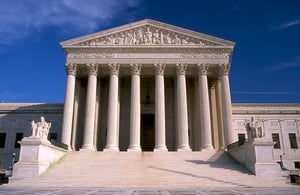

The long and winding road of the Clean Power Plan (CPP) litigation took an unexpected turn when the Supreme Court recently placed a temporary hold on the United States Environmental Protection Agency’s (EPA) rule to limit carbon dioxide (CO2) emissions from coal-burning power plants. Although dramatic headlines called attention to the legal battle over the CPP, the Supreme Court’s decision is only one step in the continuing lawsuits over these important regulations designed to fight global warming. In a recent post, we began our examination of the [Clean Power Plan litigation](/final-review-blog/everymans-guide-to-the-clean-power-plan-litigation-part-i/) and the regulation in dispute. We will continue explaining the complex struggle over the CPP and its implications in this post.

## How Exactly Does the Clean Power Plan Work?

As we learned in the last post, the CPP is a regulation authorized by the Clean Air Act (CAA), a federal statute addressing air pollution. To understand the CPP litigation, it is important to know that the rule falls under Section 111 of the CAA, the statute’s section that governs the emission of dangerous air pollutants from large stationary sources such as power plants, refineries, and other types of industry.

The CPP sets state-specific CO2 emission reduction goals based on each state’s own mix of power plants. However, it is up to each state to determine how it will meet these goals. EPA frequently delegates its authority to administer federal environmental programs to state and local governments with EPA oversight.

The CAA requires that CO2 emission rates set by EPA reflect the “best system of emission reduction” (BSER), meaning the adopted measures must be sufficiently demonstrated and take into account such factors as cost. EPA identified three “building blocks” as BSER for controlling power plant CO2 emissions: (1) improve efficiency at coal-burning power plants; (2) increase natural gas generation; and (3) increase renewable power generation. A state will decide the mix of these three building blocks it will use to meet its CO2 emission reduction goals.

## How do the Lawsuits Challenge the CPP?

Opponents of the CPP are making a number of sophisticated legal arguments to stop the regulation. However, armed with a basic knowledge of the CPP, you will understand the issues being raised. One of the challenger’s main arguments is that the CAA only gives EPA the ability to regulate the coal-burning power plants themselves by requiring, for example, improved designs and operations for power plant emission reduction. However, EPA is going beyond measures that apply to power plants by giving states the option to substitute natural gas or renewable power generation for energy from fossil-fuel burning power plants. This has come to be known as the “beyond the fenceline” argument, the means of compliance are outside of the boundaries of the power plants being regulated. EPA and its supporters believe the CAA gives EPA authority to move the production of electricity to methods that use less fossil fuels.

Opponents of the CPP also claim that a different section of the CAA, Section 112, prohibits EPA from regulating any air pollutant from an industrial category already regulated under Section 112, and EPA previously used Section 112 to regulate mercury emissions from power plants. Therefore, these earlier rules prevent EPA from regulating power plants under Section 111, the CAA section the CPP derives from. According to EPA, the cited Section 112 language results from Congress accidentally adopting two different drafts of the CAA’s 1990 amendments. Congress did not intend to remove EPA’s authority to regulate hazardous pollutants under Section 111, and deference is granted to EPA’s interpretation if there is a conflict in language.

The CPP’s challengers also argue that the CPP violates the Constitution, specifically the Tenth Amendment, by telling states how to use their resources. EPA has responded that their is no constitutional violation because states are given choices as to how they will comply with the CPP. Also, as noted earlier, EPA frequently delegates its authority to implement the environmental laws. Congress intended for states and local governments to play a role in carrying out the environmental statutes.

## So Now What are States Supposed to do?

Many states already began working on their CO2 emission reduction plans which were due September 6, 2016, with the option of requesting an extension until September 6, 2018. Now, with the Supreme Court stay of the CPP, these deadlines will be changed. EPA, environmental groups, and some attorneys recommend states continue work on their plans despite the Supreme Court stay. First, they believe it is wise for states to move forward with planning because the CPP may still be implemented. Second, given the reality of climate change, there are many good reasons besides the CPP for states to work on reducing CO2 emissions.

Some states, particularly those opposing the CPP, have completely stopped work on CO2 emission reduction plans since the stay of the CPP. For example, Wisconsin’s Governor Scott Walker issued an order prohibiting any further work on the CPP. A number of states already announced that they will continue implementation of the CPP, and other states are still evaluating how to respond to the Supreme Court’s stay.

## What Could this Mean for the Future of CO2 Reductions?

There is good reason to believe that even without the CPP there are important laws, policies, and market factors that will encourage reductions in CO2 emissions and increase the adoption of solar and other renewables. For example, with the declining cost of renewable energy and natural gas, the market share of energy derived from coal is shrinking. In addition, the recent extension of the Investment Tax Credit for solar and Production Tax Credit for wind will assure the growth of the country’s renewable energy capacity.

Another important CAA regulation, the Mercury and Air Toxic Standards (MATS), affects the same coal-burning power plants regulated by the CPP. Rather than incurring the cost of complying with MATS, many power plants have been or are in the process of being shut down.

At the state level, there are legislative and regulatory changes underway to increase renewable energy and energy efficiency. Also, 17 governors recently signed an agreement, [Governors’ Accord for a New Energy Future](http://www.eenews.net/assets/2016/02/16/document_pm_02.pdf), to pursue clean energy goals.

## When Will We Know the Outcome of the CPP Litigation?

The Supreme Court will only review the challenge to the CPP after the D.C. Circuit reaches a decision, possibly this summer or fall. Procedurally, once the D.C. Circuit has spoken, the losing side must petition the Supreme Court to take the case. Then, a Supreme Court decision will only happen after the parties submit briefs and participate in oral arguments, taking the case into at least 2017. If only eight justices are on the Court when the Clean Power Plan litigation comes before them, they may choose to re-schedule the case in the hope that a new justice will be appointed during the interim. In reality, no one can predict when we may see the conclusion of this critical environmental litigation!
