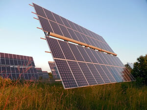

Reducing rooftop solar interconnection approval timeframes is a critical part of the effort to decrease solar installation soft costs. EQ Research’s July 2015 report, [Comparing Utility Interconnection Timelines for Small-Scale Solar PV](http://eq-research.com/wp-content/uploads/2015/07/IC-PTO-Timeline-Report-7-2015.pdf) (Interconnection Timelines Report), examined interconnection timeframes, the utility granting approval to connect to the grid, for small residential solar installations and found they are actually increasing with the expansion of solar. This post will discuss the results and recommendations of the Interconnection Timelines Report.   

## Timeframes for Permission to Operate

The formalized rooftop solar interconnection process is designed to ensure that any connection of a photovoltaic (PV) system to the grid does not diminish the grid’s safety and reliability. However, the interconnection procedures can be complicated and time-consuming. Despite many states following the Federal Energy Regulatory Commission’s [Standard Interconnection Agreements & Procedures for Small Generators](http://www.ferc.gov/industries/electric/indus-act/gi/small-gen.asp), the interconnection process varies from state to state. In addition, there can be considerable differences in how a state’s utilities implement the interconnection procedures set by the state regulatory body overseeing public utilities. In other states, the utilities develop their own interconnection procedures. All this variation in the interconnection process can add complexity and cost for installers.

The Interconnection Timelines Report focuses on how long it takes utilities to grant small residential PV systems (up to 10 kilowatts) permission to operate (PTO) after the system is installed and required documentation is completed. Surveyed installers were asked about the PTO timeframes in 2013 and 2014. EQ Research found that PTO timeframes increased 68% from 2013 to 2014. The median waiting period was 25 days in 2014. With the increase of solar installations, the report makes it clear that the interconnection process will become more complicated if changes are not implemented.

A weakness of the Interconnection Timelines Report is that it only looked at 13 states and Washington, D.C. concentrated in two areas of the country: the West Coast and Northeast. It is not clear how well the interconnection issues in these states are representative of the rest of the country. Also, the Interconnection Timelines Report ignored the inspection component of the interconnection process. The procedures and timeframes for utility inspections can cause delays in PTO and is an area that also needs improvement.

## Keys to Decreasing Costs and Delays

Based on its survey results, the Interconnection Timelines Report developed a number of recommendations:  

### More Streamlined Application and Approval Process

The Interconnection Timelines Report recommends interconnection applications be available online and use simpler forms. Most of the utilities included in the report had no online application option which may not be representative of other utilities countrywide. Utility staff manually entered application form data which resulted in mistakes and delays. According to the report, a more streamlined process for the utility’s interconnection review, including the use of dedicated software tools, would expedite applications.

Another report suggestion is to eliminate the utility pre-construction approval requirement in order to accelerate installation procedures. However, as the concentration of solar increases, this recommendation will have limited application due to concern that interconnection of too much distributed generation could adversely impact the grid. The pre-construction approval is required to assure that a particular installation will not impact the grid’s reliability and safety. Utilities are unlikely to be comfortable eliminating the pre-approval requirement except in areas of less developed solar. The report acknowledges that ultimately, even for small installations, the pre-approval requirement will be essential in high concentration areas of rooftop solar.

### Improve State Regulation of Deadlines  

The Interconnection Timelines Report also recommends that states mandate a time limit for how long it takes utilities to grant permission for turning on a PV system. Some, but not all, states have set timelines. For states that do set timelines for small units (25 kilowatts or less), PTO can take from five to thirty business days. Also, states need to do a better job enforcing timelines. The researchers found that often utilities do not comply with their state required timeline.

### Better Communication and Coordination with Installers and Local Jurisdictions

Clearer and more efficient utility staff communications with installers would help the interconnection process. According to the report, delays are caused by utility staff’s failure to communicate errors to installers when the mistake could have been corrected in minutes. Under-staffing at utilities causes some of these problems. The Interconnection Timelines Report suggests that utility reviews would be expedited if more of an “assembly line” approach to processing applications were used rather than one staffer reviewing an application in its entirety.

Significant delay is also caused by the utility waiting for the local jurisdiction to issue all the required permits before the utility can grant PTO. There is great variation in local jurisdiction permit requirements and timeframes even within one utility’s territory. The report recommends that utilities do a better job coordinating with local jurisdictions. For example, the interconnection process would be expedited if a utility and local jurisdiction have access to each other’s software. The utility could then immediately see a permit’s status and issue PTO soon after the local jurisdiction permit is approved.   

### Share Data About Area Levels of Rooftop Solar

Interconnection applications are more likely to be rejected in areas where there is a high concentration of rooftop solar due to concerns about grid reliability. According to the report, utilities should be communicating with installers about areas where there is a large concentration of PV systems on the grid. The Interconnection Timelines Report recommends utilities share data, such as maps of grid concentration, with installers. It is also up to installers to stay informed about areas where grid reliability may be an issue.

## Interconnection Delays Will Increase Without a Proactive Approach

It is critical that utilities and other stakeholders expedite the rooftop solar interconnection process. Rooftop solar will only continue to grow and more areas of concentrated solar penetration will raise concerns about grid reliability. This will only cause further interconnection delays and raise the cost of solar installations unless a more proactive approach to improving interconnections is developed.
