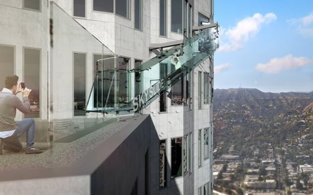
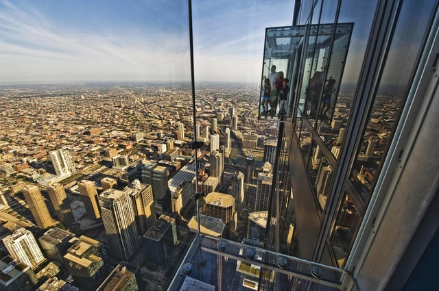

The use of glass as a structural material is becoming more popular as architects and designers have greater access to new glass technologies and manufacturing methods. For example, the use of interlayers has expanded glass applications in addition to preventing the glass systems from failing. Structural glass can be defined as using glass material to support the specified design loads being applied in lieu of a structural frame or other supporting assembly system. This year, the Chicago Department of Buildings (DOB) streamlined the process for using some forms of structural glass. We at Burnham thought it would be helpful to review the approval options for using structural glass in Chicago.

## New Uses of Structural Glass

There have been a number of boldly engineered applications of structural glass that have continued to motivate architects and designers to push the limits of this unique material. The following are two recent examples.

The new “Skyslide” at the U.S. Bank Tower in Los Angeles consists of a 45 foot long exterior glass tube which descends from the 70th floor down to the 69th floor open-air observation deck. This slide provides an exhilarating way to experience downtown Los Angeles, from nearly 1,000 feet above grade, and is supported by a system of transparent 1-1/4 inch structural glass panels. 

A well-known Chicago example, “The Ledge” on the Willis Tower Skydeck (formerly named the Sears Tower), consists of a series of retractable glass boxes that extend out from the tower’s 103rd floor. Each box utilizes triple laminated tempered glass that provides for unobstructed views over downtown Chicago, and is capable of supporting applied loads of approximately 5 tons.

Both of these examples are site-specific applications that offer a truly unique experience. However there are many more common applications of structural glass materials, such as when used for canopies, awnings, balustrades, guardrails, atriums, façades, and even for stairs.

## Previous Chicago Structural Glass Approval Process

The Municipal Code of Chicago, which includes several chapters referred to as the Chicago Building Code (CBC), does not have any specific provisions regarding the use of glass as a structural material. Therefore, it has been necessary for all structural glass proposals to be reviewed by the Committee on Standards and Tests (Committee). [CBC Chapter 13-16](http://library.amlegal.com/nxt/gateway.dll/Illinois/chicago_il/title13buildingsandconstruction/chapter13-32buildingpermits?f=templates$fn=default.htm$3.0$vid=amlegal:chicago_il) charges the Committee with insuring the public safety by reviewing and approving any new building materials, method, or system that is not currently included within the Code.

The Committee reviews a limited number of proposed projects each month, and the meeting agenda is typically filled at least a month in advance. This may add time to the overall permit approval process for a project. Detailed application procedures and forms for applying to the Committee are provided on the [City of Chicago’s website](http://www.cityofchicago.org/city/en/depts/bldgs/supp_info/committee_on_standardsandtests.html). The following highlight some of the Standards And Tests application requirements:

-   [Applications](http://www.cityofchicago.org/content/dam/city/depts/bldgs/general/Standards_Tests/61713StandardsTestsApp.pdf) should be completed by the person with the ability to explain the technical issues of the case. Typically, this is the project architect
-   Professional of record or an Illinois licensed professional (Architect or Engineer) familiar with the project is required to attend the presentation
-   Fee of $125 with application to secure an opening on the agenda docket
-   Applicants must prove the safety of the proposal with supporting information that describes how the proposal will either meet or exceed the intent of the code
-   Supporting materials may include manufacturer certifications and approvals of the proposed process from testing organizations, standards-making organizations, major U.S. cities, and model code groups’ materials-evaluation organizations

A significant amount of work goes into drafting the application and narrative, researching supporting reference standards and data, and preparing the presentation materials. All the materials are required to be hard copy delivered to all Committee members two weeks prior of the presentation date. In our experience, a typical project may take approximately two months from the time we file an application to receiving a decision by the Committee. The timeframe is dependent on the completeness of information provided to us in addition to available openings on the Committee agenda docket. A response from the Committee is typically provided within 72 hours of the presentation date, and a hard copy letter is sent from the DOB once signed. The Standards and Tests approval letter must be provided on a separate plan sheet and included as part of the permit set of drawings. Until recently, applying to the Committee was the only option when using structural glass for a Chicago project.

## Administrative Relief is Now Available for Some Structural Glass Applications

The DOB recently issued Code Memoranda stating the two most commonly requested structural glass applications, [glass guardrails and handrails](http://www.cityofchicago.org/content/dam/city/depts/bldgs/general/Building%20Code/CodeMemorandumGlassStructuralGuardrailsHandrails.pdf) and [glass awnings and canopies](http://www.cityofchicago.org/content/dam/city/depts/bldgs/general/Building%20Code/CodeMemorandumGlassStructuralAwningsCanopies.pdf), may seek approval through the Administrative Relief process.

The DOB issues Administrative Relief as part of the building permit process in cases involving new building materials, equipment, or systems that are not addressed by the Code but have been previously approved by the Committee. The DOB has created two separate [Administrative Relief application forms](http://www.cityofchicago.org/city/en/depts/bldgs/supp_info/administrative-relief-permit.html) for: (1) Glass Guardrails and Handrails and (2) Glass Awnings and Canopies.

For the Administrative Relief applications for glass when used as a structural material, both types of applications require meeting all of the following conditions prior to submittal:

-   Glass must be laminated
-   Glass must meet the requirements of the 2015 International Building Code (IBC), Chapter 24
-   Structural calculations must demonstrate that the glass can safely handle the CBC superimposed loads found in Chapter 13-52. These calculations must be provided by an Illinois licensed structural engineer either through the railing and shoe manufacturer or hand calculations can be provided by the project structural engineer (usually no more than one sheet of calculations is necessary)
-   Provide a finite element analysis of a representative panel of glass as part of the structural submitted documentation
-   Include building plan identifying the location of the glass installation
-   Dimensioned drawings that include elevations, sections, and details of the proposed system

#### Additionally for the Guardrails and Handrails Application:

-   A continuous metal top cap rail or side mounted handrail must be provided, each section of top cap rail or handrail must cover a minimum of at least three adjacent glass panels, and each individual rail section must be splined, welded, or otherwise joined to act as a continuous top cap railing or handrail
-   A detail must be provided that shows the method of structural attachment of proposed system to structural floor system
-   Per CBC, the glass must meet the test requirements of being safety glazed per the ANSI Z97.1 standard as well as comply with CBC 13-52-100, Thrusts on Handrails and Guards

#### Additionally for the Awnings and Canopies Application:

-   Structural plans showing the layout of the proposed system with all related structural framing elements that may include beams, girders, spider clips, tension hangers, or other connections
-   Recommends providing renderings of the proposed system

The completed Administrative Relief form and supporting documents must be emailed to the DOB as a PDF file. The Administrative Relief request is typically reviewed within approximately two weeks of being received, and if approved, is jointly signed by the Deputy Building Commissioner and Regulatory Reviewer. In some specific instances, other DOB Department heads may be required to review and approve the application request, such as for glass enclosures. The Administrative Relief approval letter must be provided on a separate plan sheet and included as part of the permit set of drawings.

## Other Uses of Structural Glass and Administrative Relief

We at Burnham have experience both in presenting projects to the Committee and in compiling and reviewing Administrative Relief packages on behalf of our clients who seek approval for proposals that deviate from the CBC. Hopefully, some of the other more commonly requested structural glass applications will also be allowed to proceed through the Administrative Relief process, or perhaps a new Glass and Glazing chapter may be formally adopted into the CBC, as is widely adopted in municipalities following the IBC. Either way, this new expedited process for structural glass in Chicago will certainly make proposals for structural glass awnings, canopies, guardrails, and handrails a faster way to proceed through the overall permit approval process.

It is important to note that all other proposed uses of structural glass such as: beams, floors, stair treads, landings, glass bridges, or shaft enclosures will still require review by the DOB and may need further approval from the Committee on a case-by-case basis.

Feel free to [Contact Us](/contact/) if you have any questions about your structural glass project.
