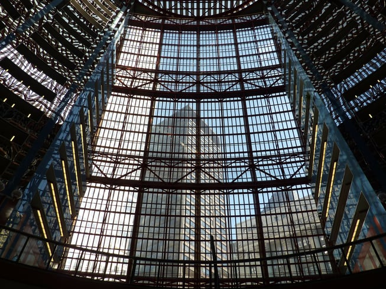
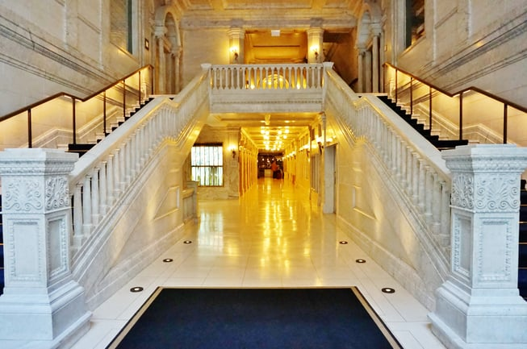

Recently, Landmarks Illinois released their 2017 [list](http://www.landmarks.org/preservation-programs/most-endangered-historic-places-in-illinois/) of Most Endangered Historic Places in Illinois. Compiled yearly since 1995, the list highlights buildings, structures, and monuments that are, according to the non-profit organization, threatened due to “deterioration, lack of maintenance, insufficient funds, or inappropriate development.”

This year’s list includes three Chicago structures and four statewide designations, as well as buildings scattered throughout central and southern Illinois. We’ll take a closer look at these threatened structures as well as Burnham’s contributions to preservation efforts within the City of Chicago.  

## The James R. Thompson Center

Perhaps the most well known and most controversial of all the sites, the James R. Thompson Center is at the top of the 2017 list. Designed by Helmut Jahn in 1979 and debuted as the State of Illinois Building in 1985, the building has been the subject of both praise and ire since its construction. Located at the corner of Clark and Randolph Streets in the Chicago Loop, the building is home to government offices, a recently remodeled food court, and a CTA public transit hub and is a prime example of Chicago’s post-modern design. 

However, the structure has been plagued with maintenance issues since its construction, including immense heating and cooling costs, prompting the call for the [sale](http://www.chicagotribune.com/news/opinion/editorials/ct-thompson-center-rauner-loop-architecture-chicago-edit-0129-jm-20170127-story.html) of the building to a private developer for redevelopment. This would most likely end in the demolition of the tower and a new office-retail complex constructed on the 300 W. Randolph St. block.

Landmarks Illinois champions that the Thompson Center can be [repurposed](http://www.landmarks.org/wp-content/uploads/2017/04/Thompson-Center.pdf) without demolishing the structure with its striking glass atrium. Helmut Jahn has offered his own redesign of the space which “includes a new, approximately 13,000-square-foot tower to house a hotel and residences.” Renderings of the [redesign](https://chicago.curbed.com/2017/1/20/14339894/helmut-jahn-thompson-center-proposal) show a proposed 110-story tower that would be constructed on the existing lot by demolishing a portion of the existing structure and complete conversion of both spaces to mixed-use.

Both the organization and the Chicago Tribune’s editorial board agree to sale of the tower, but with the Thompson Center’s eligibility for the National Register of Historic Places established in 2009, Landmarks Illinois is calling for “a full rehabilitation and reuse of the Thompson Center without a tower addition \[which\] could be undertaken using the Federal Historic Tax Credit” which would allow for preservation and cost savings.

## The Rotunda - O’Hare International Airport

Built in 1962, the Rotunda at Chicago’s O’Hare Airport has remained mostly intact since its construction and is one the few remaining facets of the airport’s earliest days. Designed by Gertrude Kerbis of C. F. Murphy Associates, the Rotunda is notable for more than just its jet age design - Kerbis, who was a student of Mies van der Rohe at the Illinois Institute of Technology, was one of the first women to be at the forefront of Chicago architecture in the 1960s. After working with C. F. Murphy and Skidmore, Owings, and Merrill, she opened her own firm, Lempp Kerbis, in 1967.

Landmarks Illinois draws attention to its similarities to  the New York JFK Airport’s TWA terminal in their [report](http://www.landmarks.org/wp-content/uploads/2017/04/Rotunda_OHare.pdf). Designed by Eero Saarinen, built in 1962, and unused since 2001, the TWA terminal is being reimagined as a [hotel and retail complex](https://ny.curbed.com/2017/3/8/14850240/twa-terminal-eero-saarinen-hotel-lockheed) in a fully realized plan that stays true to the terminal’s irreplaceable historic character.

While there are no plans for active alterations at this time, O’Hare has long term plans for expansion, which could threaten the [mid-century modern space](https://www.flickr.com/photos/landmarks_illinois/sets/72157681922324386).

## The Federal Historic Tax Credit

The Federal Historic Tax Credit (FHTC) provides incentives for the “rehabilitation of historic, income-producing buildings that are determined by the Secretary of the Interior, through the National Park Service, to be ‘certified historic structures’” and for non-historic buildings built prior to 1936 and also provides incentives for [preservation easements](https://www.nps.gov/tps/tax-incentives/taxdocs/easements-historic-properties.pdf), volunteer agreements that protect historic structures in perpetuity.

Landmarks Illinois is a holder of historic preservation easements for Illinois properties, including the [Chicago Theater](http://www.landmarks.org/preservation-programs/preservation-easements/), however the majority of historic preservation efforts depend on the use of credits such as FHTC for funding and incentive to preserve older, significant structures (see the Thompson Center above). With budget cuts looming, Landmarks Illinois has included the program to draw attention to the possible impact that the elimination of the credit could have on preserving many of the buildings on their 2017 list.

## Success Stories: The Kimpton Gray Hotel

In 2016, Burnham Nationwide provided permitting assistance and code compliance for the [Kimpton Gray Hotel](/final-review-blog/helping-to-preserve-chicago-architecture-the-kimpton-gray-hotel/), a successful adaptive reuse initiative repurposing the New York Life Insurance Building in the Chicago Loop. Designed by William LeBaron Jenny, the New York Life Insurance Building was constructed in 1894 and is the oldest remaining building in the city designed by Jenny. While there was a long term plan to demolish the building for a new hotel, new ownership allowed the property to be updated, repurposed, and restored.

Adaptive reuse can help provide buildings with a new purpose when their original use is no longer applicable and avoids demolition of the structure, and Landmarks ILlinois actively advocates for adaptive reuse as a respectful and sustainable method for preserving the form and function of historic structures. Burnham is proud of have assisted with the remodeling of one such building.

<em>If you would like to learn more about specific buildings on the Most Endangered List and how to get involved with preservation efforts, visit Landmarks IL’s [website](http://www.landmarks.org/preservation-programs/preservation-easements/).</em>
