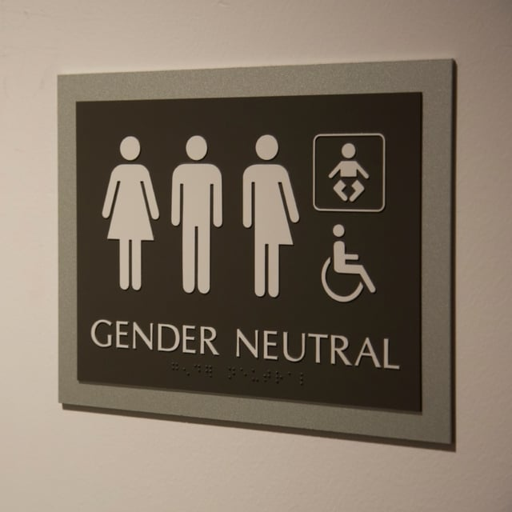

A growing number of municipalities are passing laws governing gender-neutral bathrooms. However, we are finding that sometimes the gender-neutral bathroom laws are limited by existing code requirements, particularly those imposed by plumbing codes that need to be updated. In other instances, architectural designs to more easily incorporate gender-neutral bathrooms are conflicting with code requirements. We thought we would take a look at some of the different municipal gender-neutral bathroom ordinances and how codes may be limiting their reach.

Different Municipal Gender-Neutral Bathroom Requirements

The major focus of the gender-neutral bathroom ordinances adopted in a variety of major cities is the requirement that public single-occupancy bathrooms be gender-neutral and display gender-neutral signs. Therefore, these ordinances are requiring a gender-neutral designation rather than mandating the addition of any fixtures. Gender-neutral signage usually means the replacement of signs that state “men” and “women” with a sign that doesn’t indicate gender, such as “restroom” or “bathroom.” Some municipalities are also passing ordinances stating that an individual has the right to use a gender-specific bathroom, including a multi-stall bathroom, that aligns with their gender identity. It is necessary to check your local ordinance for the specific requirements.

These ordinances can have enforcement provisions and violations may result in financial penalties. However, usually there is an attempt to notify a business of a violation, and a penalty is only imposed if the violation isn’t remedied. For example, in Philadelphia, the City of Philadelphia Office of LGBT Affairs initially contacts a business If a violation is found and helps them come into compliance. Similarly, if there is a violation of the gender-neutral bathroom requirements in Seattle, the Seattle Office of for Civil Rights will first send an advisory letter to the business.

There is divergence as to the parts of their municipal code municipalities are incorporating the gender-neutral bathroom requirements. For example, some municipalities are adopting the gender-neutral bathroom rule as part of their human rights provisions. Others are including the new mandate in their buildings codes or business operation requirements. Here are highlights from a few cities:

#### Washington D.C.

In 2006, Washington, D.C. passed one of the nation’s [first municipal rules on gender-neutral bathrooms](http://www.dcregs.dc.gov/Gateway/ChapterHome.aspx?ChapterNumber=4-8). The requirement is part of the City’s rules implementing Washington, D.C.’s Human Rights Act of 1977. In Washington, D.C., anyone has the right to use a gender-specific bathroom in keeping with their gender identity and entities with single-occupancy bathrooms must use gender-neutral signage.

#### Philadelphia

Amendments to Philadelphia Code Chapter 9-600, Services and Businesses in October 2015, added a new [Section 9-636](https://phila.legistar.com/LegislationDetail.aspx?ID=2456381&GUID=D4CF5519-30FB-4FA7-A12F-44F6F35FB67F&Options=ID%7cText%7c&Search=gender+neutral+bathroom&FullText=) requiring that gender-neutral signs be used for any single-occupancy bathrooms in places of business open to the public and city-owned buildings. However, If a bathroom has art work or a design indicating a specific gender and it predates the amendments, the design may remain so long as there is also some clear indication that any gender may use the bathroom. Philadelphia also adopted a law in 2013 requiring any new city building have gender-neutral bathrooms.

#### Seattle

In August 2015, Seattle passed an [ordinance](http://clerk.seattle.gov/~scripts/nph-brs.exe?s3=&s4=&s5=all+gender+restroom&s1=&s2=&S6=&Sect4=AND&l=0&Sect2=THESON&Sect3=PLURON&Sec) amending Title 14 of Seattle Municipal Code, the title pertaining to human rights, to state that individuals have the right to use gender-specific bathrooms in keeping with their gender identity, whether single or multiple stall bathrooms. In addition, the ordinance mandates that single-occupancy restrooms must be gender neutral in city-owned buildings or places of public accommodations.

#### Chicago

Chicago [amended the Human Rights Chapter](https://chicago.legistar.com/LegislationDetail.aspx?ID=2730860&GUID=84FD9F82-3633-4818-BC19-120DD86DD937&Options=Advanced&Search=&FullText=1) of the Municipal Code in May 2016 stating that access to a public accommodation, including a bathroom, cannot be denied based on gender identity. Previously, the Chicago code stated that facilities were open to use based on gender as stated in a form of government identification.

#### New York City

In June 2016, New York City [amended the New York City Plumbing and Building Codes](http://legistar.council.nyc.gov/LegislationDetail.aspx?ID=2404411&GUID=E9FA5622-7E3A-496B-ADB2-58FA61262689&Options=ID%7cText%7c&Search=bathr) to require all single-occupancy bathrooms to be gender neutral and have signage indicating they are for all sexes. Earlier in the year, Mayor de Blasio also signed an Executive Order that requires all City-owned buildings to permit use of single-sex bathrooms that align with someone’s gender identity.

## Code Requirements that may Conflict with Gender-Neutral Bathroom Laws and Designs

Other code requirements, such as those found in plumbing and accessibility codes, may present conflicts with the gender-neutral bathroom requirement. For example, some state and municipal plumbing codes mandate that all bathrooms be gender specific. These codes, frequently based on international codes, also have requirements for the number of male and female plumbing fixtures depending on the occupancy and nature of a business. It may be necessary to amend some plumbing codes and provide clarification as to how the gender-neutral bathrooms impact formulas for fixtures.

New York City’s law is an example of the need to amend plumbing codes to align with the gender-neutral bathroom requirement. The City’s new ordinance includes amendments the New York City Plumbing Code because the code previously required separate facilities for each gender. The New York City amendments also specify that the fixtures in a gender-neutral single-occupancy bathroom can be included in the number of fixtures required by the Plumbing Code.

This becomes more of a problem when municipalities want to make a change but the state code presents an issue. For example, the Illinois Plumbing Code Section 890.810(b) (2)(A)(iii) requires that separate public restrooms be provided for men and women unless it is a small establishment that is allowed to have only one bathroom. This provision creates a problem for Illinois businesses with only two single-occupancy bathrooms.

Two Illinois municipalities, Evanston and Highland Park, have passed ordinances requiring gender-neutral signage for single occupancy bathrooms. However, the drafters of both ordinances tried to work around the Illinois Plumbing Code restrictions but there are still issues. For example, the [Evanston amended ordinance](http://www.cityofevanston.org/assets/42-O-15%20Amending%20Code%20to%20add%20Gender%20Neutral%20Bathrooms.pdf), passed in October 2015, requires gender-neutral signage where there is only one single-occupancy restroom or three or over. However, of the three or over single-occupancy bathrooms, there must still be at least one bathroom for each gender and the remaining bathrooms must be designated gender-neutral. If a location has only two single-occupancy restrooms, they still have to be designated as one for males and one for females.

The Highland Park ordinance took a different approach to mandating gender-neutral signage which is only a requirement for new buildings. The ordinance states that where conflicts arise between the municipal ordinance and the International Building Code or Illinois Plumbing Code as adopted by Highland Park, the City’s gender-neutral bathroom requirements will control. However, this doesn’t completely resolve conflicts with the state plumbing code.

We frequently review plans for code compliance, and we are seeing more designs that incorporate gender-neutral bathrooms. One design we have come across to facilitate gender-neutral bathrooms places a shared sink in a common area outside the bathrooms. However, this is a violation of the Illinois Plumbing Code Section 890.810(a)(2)(C) that specifies all of the required plumbing fixtures must be placed within the restroom. Hopefully, the plumbing codes will be revised in coming years to accommodate gender-neutral bathrooms.
