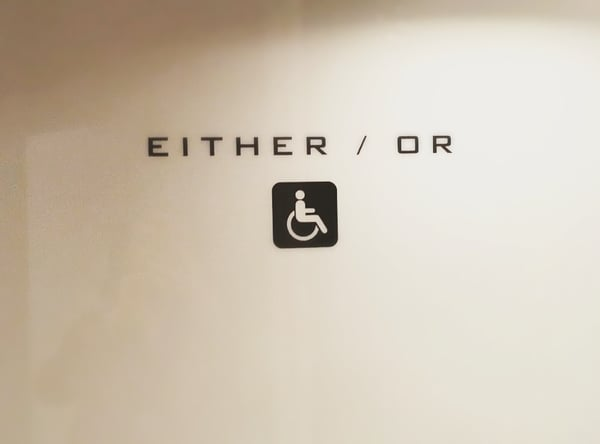

In August 2016, we published a [blog post](/final-review-blog/gender-neutral-bathrooms-code-conflicts/) highlighting a variety of municipal laws providing for gender-neutral bathrooms. We discussed gender-neutral bathroom requirements in Washington, D.C., Philadelphia, Seattle, Chicago, and New York City. The post also noted that the ability of some municipalities to bring about changes is limited by state codes. We thought we would review developments regarding gender-neutral restrooms since our 2016 post.

Code Conflicts and the 2018 IBC

  
Our original post provided some examples of new municipal gender-neutral bathroom laws that conflicted with state plumbing codes that require a specific number of male and female plumbing fixtures depending on the occupancy and type of business.

Since our post, the 2018 version of the International Building Code (IBC) introduced an important change to Section 403.1.2, the provision that governs single-user toilet facilities and bathrooms. The update specifies that the single-user facilities (including family and assisted use) may contribute to the overall number of required plumbing fixtures. Additionally, “single-user toilet facilities and bathing rooms, and family or assisted-use toilet and bathing rooms shall be identified for use by either sex.”

State and local jurisdictions may adopt the 2018 IBC change as part of their regular code updates. However, this process may take time depending on the jurisdiction but will hopefully eliminate some of the conflicts between local and state codes. .

Meanwhile, Yale University filed a [lawsuit](https://www.nhregister.com/colleges/article/Yale-files-lawsuit-against-Connecticut-in-effort-11310140.php) in June of 2017 against the State of Connecticut challenging the Connecticut State Building Code’s plumbing requirements. The university wanted to redesignate single-user bathrooms in the law school as gender-neutral, and thereby reduce the number of gender-specific bathrooms. In order to redesignate the bathrooms, the university sought an exemption from the state’s gender-specific plumbing requirements. The Connecticut Codes and Standards Committee denied Yale’s request, and the university appealed the decision in the Connecticut Superior Court.

The Connecticut governor later indicated he planned to grant Yale’s request.  This summer, Connecticut is also expected to adopt updates to its building code following the 2018 IBC. Thus, the state will now allow gender-neutral bathrooms to count toward the number of bathrooms required for male and female users.

## Additional Municipalities and States Allowing Gender-Neutral Bathrooms

Since our original post, additional cities and states have adopted their own laws providing for gender-neutral bathrooms. Here are few highlights:

### Denver

In December 2016, Denver [amended](https://www.denvergov.org/content/dam/denvergov/Portals/696/documents/Denver_Building_Code/2016_Denver_Building_andFire_Code_Amendments.pdf) the Denver Building and Fire Code to require all single-occupant restrooms, including family or assisted-use restrooms, in both the City and County of Denver to have gender-neutral signage. (See sections 2902.4.2 and 403.4.2)The new requirements went into effect for existing buildings in April 2018 and will be necessary for all new construction.

The amendments do not mandate a particular type of signage. All that is required is that the signage clearly shows that the bathroom can be used by any gender. All plans for new buildings submitted to Denver Development Services for review must show that proper signage will be used if they include single-occupant restrooms.

### Hoboken

The mayor of Hoboken, New Jersey issued an Executive Order on April 25, 2018, requiring all municipal single-occupancy restrooms to be gender-neutral. Hoboken, a city of approximately 50,000, is located on the Hudson River across from New York City.

On May 16, 2018, the City Council [passed](http://www.hobokennj.gov/docs/council/5.16.18.certified.resolutions.pdf) [Ordinance B-29](http://hobokennj.gov/docs/council/5.16.18.2nd.readings.pdf) adding a new Section 115-10 to Hoboken’s Health/Sanitary Code requiring all single-occupancy bathrooms in “any business establishment, place of public accommodation, and city-owned building or facility” to be gender-neutral. The new law will include single-occupancy employee restrooms in places covered by the ordinance.

Existing buildings were given 60 days from the effective date of the ordinance to put in place signage indicating the bathrooms were gender-neutral.

### California

The governor of California signed [Assembly Bill No. 1732](https://leginfo.legislature.ca.gov/faces/billTextClient.xhtml?bill_id=201520160AB1732) into law on September 29, 2016. Amendments to California’s Health and Safety Code mandated that “all single-user toilet facilities in any business establishment, place of public accommodation, or state or local government agency” will be identified by signage indicating they are all-gender. The amendments went into effect March 1, 2017.

### Vermont

Vermont [House Bill 333](https://legislature.vermont.gov/assets/Documents/2018/Docs/ACTS/ACT127/ACT127%20As%20Enacted.pdf) became law on May 11, 2018, and will be effective July 1, 2018. It adds a new Chapter 40 of 18 Vermont Statutes Annotated (Health) that requires all single-user restrooms in public buildings be open to any gender. The amendment doesn’t mandate a specific type of signage but simply states that the “toilet facility may be identified by a sign, provided that the sign marks the facility as a restroom and does not indicate a specific gender.”

The new Vermont law also references the state plumbing code and provides that separate male and female facilities are no longer required so long as the total number of required plumbing fixtures is available for use by any gender. Any rules adopted by the Plumbers’ Examining Board should be consistent with the new requirements.

## Future Changes

With the new 2018 IBC provision and changing public expectations, it is likely that the number of jurisdictions adopting laws supporting gender-neutral bathrooms will increase significantly. We will continue to follow this trend and appreciate the assistance our summer intern Jordan Nelson who conducted the research for this post.

Has the number of states and cities requiring gender-neutral single-occupancy bathrooms grown since this 2018 post? Yes significantly - California expanded its requirements by requiring all K-12 schools to have at least one gender-neutral bathroom by July 1, 2026, and Colorado passed a law effective January 1, 2024 requiring newly constructed or renovated public entity buildings to provide non-gendered restroom facilities on each floor. Has the 2018 IBC's change on single-occupancy bathrooms continued into newer code editions? Yes - the 2024 International Plumbing Code goes further, requiring that single-user restrooms be identified as available for use by all persons regardless of sex, and when they are provided, separate sex-designated restrooms are not required. The 2024 IPC also allows multi-user all-gender restrooms, but with stricter requirements - the minimum fixture count is calculated at 100% of the total occupant load, and each water closet must be in a separate compartment with full privacy. Has the federal government taken a position on gender-neutral bathrooms since this post? Yes, and in the opposite direction from many state trends - as of 2026, no federal workplace law requires employers to provide gender-neutral restrooms, and the EEOC issued a federal-sector decision holding that Title VII permits a federal agency employer to maintain single-sex bathrooms and exclude transgender employees from opposite-sex facilities, reversing a 2015 ruling. Do gender-neutral single-occupancy bathrooms still need to count toward the total required fixture count? Yes - the 2018 IBC change allowing single-user toilet fixtures to count toward the required total has been maintained and clarified in subsequent code editions, with the clear intent being not to reduce the total quantity of plumbing fixtures required for a building. Does a building need separate men's and women's rooms if it provides enough single-occupancy gender-neutral bathrooms? Under the 2024 IPC, no - a building with enough lockable single-user restrooms can skip traditional men's and women's rooms entirely, provided the total required fixture count is still met. Local jurisdictions must adopt the updated code before this applies locally.
