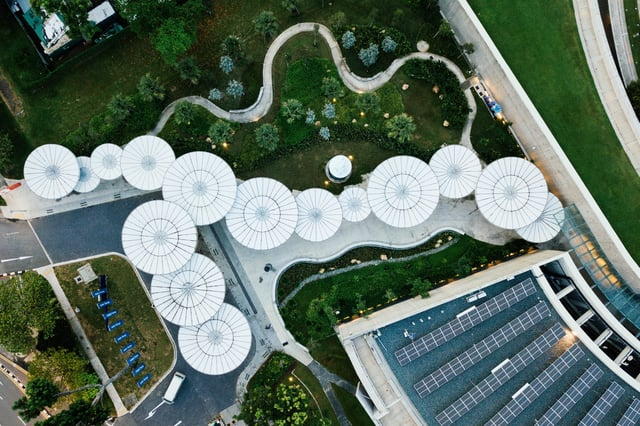

Last week, we [covered](/final-review-blog/new-york-citys-solar-storage-illustrates-benefits-of-drawdowns-rooftop-solar-solution/) New York City’s rooftop solar and storage and how the city is one of the leading municipalities in solar implementation in the eastern United States - if approved by the New York City Council, a mandate requiring green roof installation (including solar panels) could place New York alongside other U.S. cities with robust solar roof requirements, leading in the way in sustainable energy generation and resilient planning. 

<em>image by [chuttersnap](https://unsplash.com/photos/dh-5RWTr34M)</em>

Part of the Electricity Generation sector, rooftop solar ranks #10 in [Project Drawdown](https://www.drawdown.org/solutions/electricity-generation/rooftop-solar)’s list of solutions for fighting global warming. If implemented according to their scenario results, growth from .4 percent to 7 percent of worldwide rooftop solar energy generation will net a 24.6 gigatons reduction in carbon dioxide emissions and save $3.4 trillion dollars in home energy costs by 2050.

According to information published in Drawdown: The Most Comprehensive Plan Ever Proposed to Reverse Global Warming, photovoltaics (PV) provide “less than 2 percent of the world’s electricity at present, \[however\] PV has seen exponential growth over the past decade.” Once confined mostly to a few countries such as Germany - one of the world’s solar leaders - small-scale systems now form approximately 30 percent of solar PV capacity installed worldwide.

We’ll take a look at the global spread of rooftop solar this week and the implications this may have for both Drawdown’s goals and urban planning.

## Rooftop Solar’s Global Growth is Exponential

Solar energy is “the most abundant energy source on earth,” [according to the National Oceanic and Atmospheric Administration](https://sos.noaa.gov/datasets/energy-on-a-sphere/) (NOAA), as “173,000 terawatts of solar energy strikes the earth continually.” It outranks all other renewable energy sources in potential energy production.

To harness this power, Project Drawdown’s rooftop solar solution concentrates primarily on rooftop modules on residential buildings. Roof modules are, according to Drawdown research, compose the majority of this growth.

Rooftop solar is spreading rapidly as it becomes more affordable, both through incentive programs such as the New York initiatives covered last week and through cheaper, more accessible technology. In some locations, small-scale PV generates electricity more affordably than utilizing the grid, even when accounting for soft costs such as financing, acquisition, and permitting. This benefit is global and includes parts of the United States, island nations, and Australia, Denmark, Germany, Italy, and Spain.

Solar systems assist in meeting electricity demand in both urban and rural areas, especially when coupled with storage systems, and reduce energy losses incurred during grid transmission. More than one billion people lack access to an energy grid system and

rooftop solar also offers unprecedented electricity access. Individual panels and battery systems provide those without electricity access with means to power, without relying on greenhouse gas (GHG) emitting sources.

## Rooftop Solar and Utility-Use Installations Increase Energy Access in Chile, Bangladesh

Though high-income countries previously provided the most investment in solar technologies, countries such as Chile, China, India, and South Africa now make up a significant portion of rooftop PV users.

In Chile, small solar systems are a growing source of electricity generation. By [March 2017](https://www.pv-magazine.com/2017/03/10/chile-registers-increase-in-pv-installations-for-self-consumption/), residents had installed 900 solar systems designed for self-consumption - mostly personal rooftop PV arrays - reaching a combined capacity of 6.4 watts, after new rules simplified the process. Requests for installation continue, and the country has [established an ambitious plan](https://www.pv-tech.org/features/chile-1gw-of-solar-and-the-road-to-70-renewables-by-2050) to reach 70% renewable energy consumption by 2050. Rooftop solar installations, along with utility-scale solar, will compose a large component of the plan’s energy sources.

Chile is well-suited to both large and small-scale projects. Home to the Atacama desert - the world’s driest - it also receives one of the [highest amounts of solar radiation](https://www.bloomberg.com/news/features/2018-08-07/these-massive-renewable-energy-projects-are-powering-chilean-mines) in the world. Current mandates require that 20 percent of energy come from renewables, and with little fossil fuel resources, solar energy is more affordable for many.

In Bangladesh, with a population of greater than 150 million, more than 3.6 million systems are installed in homes, providing on-site electricity generation for millions of individuals. Solar power is “accelerating access to affordable, clean electricity and \[is\] thereby becoming a powerful tool for eliminating poverty” as well as “creating jobs and energizing local economies,” according to Drawdown. Solar installation in Bangladesh has created 115,000 direct jobs alone, with additional job creation possible.

Rooftop PV systems are accessible, clean, and economically beneficial - homeowners in some locations can sell unused electricity through “net metering” arrangements that benefit utilities and offset the installation and maintenance costs of personal systems.

## Though Costly, the Potential Impact of Solar Systems is Positive

Though cost challenges remain for photovoltaic systems, Project Drawdown ranks rooftop solar high in their solutions through its numerous benefits and increasing accessibility. It has the potential to improve utility stability and make cities more resilient, shift populations away from relying on fossil fuels and GHG-emitting energy sources, and is infinitely renewable.

Solar power also provides energy for electric vehicles, and Drawdown is hopeful that this will eventually supplant oil companies, creating a network of residences and buildings across the globe with more equitable clean power access.

*This blog post is part of Burnham Nationwide’s* [Drawdown Series](/final-review-blog/burnham-nationwides-climate-change-drawdown-series/)<em>.</em>

How much of the world's electricity does solar now generate, compared to when this post was written? Substantially more - solar PV has grown from less than 2% of world electricity in 2018 to approximately 6.9% globally as of 2024, with some projections estimating it could reach 20-25% by 2030 as installation costs continue to fall. Is rooftop solar still growing, or has the market plateaued? Still growing strongly - global solar capacity additions hit a record 593 gigawatts in 2024 alone, more than doubling 2022's record. The cost of rooftop solar has fallen dramatically, making it cost-competitive with grid electricity in most U.S. states and many countries without any incentives. Does net metering - selling surplus solar electricity back to the grid - still work the way this post describes? Net metering still exists in most U.S. states, but terms have shifted in some major markets. California's NEM 3.0 (adopted 2023) significantly reduced the credit rate for exported electricity, making battery storage much more financially important for new residential solar installations there. Is rooftop solar still primarily a wealthy-country technology, or has that changed? It's changed significantly - as this post was beginning to note, India, China, Chile, and Brazil have all become major solar markets, and Bangladesh's Solar Home Systems program (one of the largest distributed solar programs in the world) has connected over 6 million households to off-grid solar, demonstrating that distributed rooftop solar is a genuinely global technology now. Has Project Drawdown updated its ranking of rooftop solar as a climate solution since this post? Yes, Drawdown's methodology and rankings have been revised multiple times since 2018. In its current framework, distributed solar (which includes rooftop PV) remains among the highest-impact solutions, though the specific gigaton estimates and rankings differ from the original 2018 figures cited in this post, reflecting both updated modeling and the dramatic acceleration in actual solar deployment.
