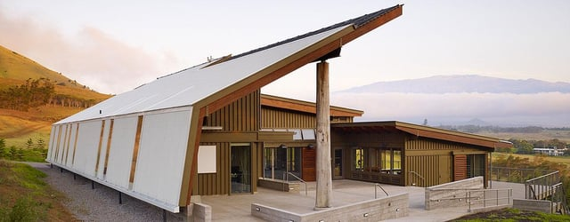

The Living Building Challenge is an exciting green building certification program, probably the most stringent green building rating method currently available. To be certified, a project must meet twenty different requirements including net positive energy and net zero water usage. We at Burnham thought we would take a closer look at the Living Building Challenge.

[*Photo from living-future.org*](http://living-future.org/case-study/hpaenergylab) 

## The Growth of Green Building Rating Systems

There has been a concerted effort since the 1990’s to design more sustainable buildings and a variety of different green building rating and certification programs have developed as a result. Many of the green building rating systems look at a building’s impact on the environment through a building’s entire life cycle.

Two of the best known rating systems are [Energy Star Rating System (Energy Star)](https://www.energystar.gov/buildings?s=mega) and [Leadership in Energy and Environmental Design (LEED)](http://www.usgbc.org/leed). Energy Star, developed by the United States Environmental Protection Agency and the United States Department of Energy, benchmarks a building’s energy usage against similar buildings in the United States. The U.S. Green Building Council created LEED which assigns points for sustainability strategies in seven different areas to determine the certification level.

## History of the Living Building Challenge

The Living Building Challenge has its roots in a sustainable design project, the Educational Performance & Innovation Center, (EPICenter) in Bozeman, Montana. The EPICenter, completed in 1997, was a joint project of the architecture firm BNIM, Montana State University, and the National Institute for Standards and Technology. The project was intended to create new standards for green building design. It brought together representatives from a variety of different disciplines, including architects, engineers, and scientists, to design a “Living Building” that used new types of materials and innovative systems.

Jason McLennan and Eden Brukman, who worked on the EPICenter, developed the Living Building Challenge with the support of the Cascadia Green Building Council. The Cascadia Green Building Council, a chapter of the U.S. Green Building Council, represents a network of collaboratives in Alaska, Columbia, Washington and Oregon that work on designing and promoting green buildings. Eventually, the Cascadia Green Building Council founded the International Living Future Institute, the organization that administers the Living Building Challenge.

## How the Living Building Challenge Works

The Living Building Challenge is a certification program and has seven Petals, performance categories that contain [20 specific requirements](https://living-future.org/sites/default/files/16-0504%20LBC%203_1_v03-web.pdf).The current version, made available in 2016, is Living Building Challenge 3.1. It can be applied to different sizes and uses of buildings. The Living Building Challenge has three levels of certification:

1.  Net Zero Energy Building Certification - all a building’s energy needs must be satisfied by on-site renewable energy
2.  Petal Certification - three of the seven Petals must be achieved
3.  Living Building Certification - the project meets the requirements of all seven Petals

Given that the Living Building Challenge is performance based, certification is determined by how the building actually operates rather than anticipated performance. A building must be occupied for a minimum of twelve months before one can apply for a Living Building Challenge certification.

The Following are the requirements for the Living Building Certification, the highest level of certification, organized by the seven Petals:

#### 1\. Place 

The goal of Place is to encourage a more healthy relationship with nature and limit growth. There are strict guidelines for where a project may be built. It must be located away from sensitive ecological habitats and on land that was previously developed, a greyfield or brownfield. Also, the project must include opportunities for agriculture and promote “human powered living” which reduces dependence on gasoline-fueled cars. Also, project development needs to be offset by support for habitat development.

#### 2\. Water

This Petal seeks to reduce waste water with a net positive water requirement. The project may only use water that is captured from rain and other natural sources or is recycled discharge water that is treated on site.

#### 3\. Energy

All of a project’s energy needs must be provided by on-site renewable energy with a minimum of five percent spare energy, making it a net positive energy requirement. Additionally, the project must include energy storage to provide resiliency.

#### 4\. Health and Happiness

To create a healthier and happier environment, windows must function to provide fresh air and daylight. Also, a variety of steps must be taken to support healthy indoor air quality, and the project must contain design elements that support the human connection to nature, known as biophilic design.

#### 5\. Materials

The project cannot contain specified materials or chemicals regarded as harmful to humans. Also, there must be a one-time carbon offset, such as funding a portion of a renewable energy project, for the carbon impact of the project’s construction. The project must use a certain quantity of certified sustainable resources such as salvaged wood. Each project must have a Material Conservation Management Plan that seeks to reduce waste during all phases of the project from design to end of life.

#### 6\. Equity

A project seeking Living Building Certification must follow guidelines for paved areas, street and block design, building scale, and signage to help the project focus on human-scale rather than automobile-scale development. Also, the project must assure universal access, including for people with disabilities, to roads and transportation. It also should not block access to fresh air, sunlight, and natural waterways. In addition, the project must donate to charity half a cent or more for every dollar of total project costs. At least one of the project team member’s organization must be a Just organization, a program for promoting social justice and measuring corporate transparency.

#### 7\. Beauty

The project must contain beautiful design features and integrate public art. Also, the project must use a variety of different methods to educate the public about the project to encourage others to bring about change.

## Living Building Challenge Inspires New Illinois Net Zero Incentive Program

A new Illinois program, the [Net Zero Energy Building Program](http://www.illinoiscleanenergy.org/energy-program/net-zero-energy-building-program), was just launched by the Illinois Clean Energy Community Foundation with support from the International Living Future Institute. The program draws on some of the Living Building Challenge’s ideas and offers grants for projects that are designed to attain net zero energy performance. We are looking forward to following this new program to support green buildings in our home state.
