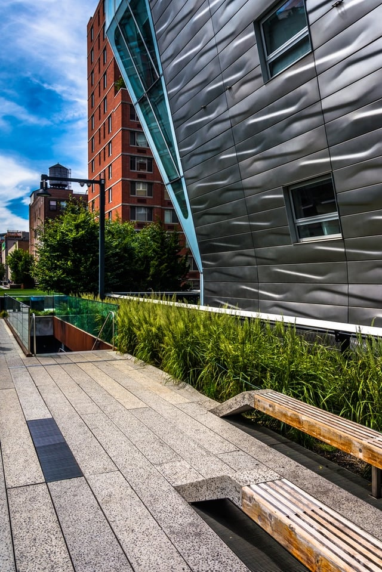

Cities have long been exploring avenues to provide their residents with urban parkland and accessible green areas. These public spaces are most often at a premium and require designs unique to the metropolitan landscape - rooftop gardens, urban farms, and conservatories are all common features. 

Recently, a growing number of cities have been utilizing existing infrastructure to create linear parks through adaptive reuse projects. These parks are innovatively designed to repurpose industrial elements and provide pedestrian-friendly areas in dense neighborhoods. In this post, we’ll explore examples of these types of projects and examine the ways that adaptive reuse and linear parks will continue to influence the creation of urban public spaces.

## The Chelsea High Line

Fully completed in 2014 and stretching over a mile and a half, the [High Line](https://adaptivereuse.info/portfolio/the-high-line/) linear park in New York City’s Chelsea neighborhood is one of the most well-known examples of adaptive reuse. The High Line infrastructure was built in 1943 as elevated train tracks that delivered goods into central Manhattan’s industrial areas. The tracks remained in service until 1980 after which they were decommissioned and left abandoned.

While inactive, the tracks became full of [self-seeded](http://www.thehighline.org/about) plant growth, a feature that helped spark interest in converting the tracks into park space. [Joe Sternfeld](http://www.newyorker.com/magazine/2001/05/21/a-walk-on-the-high-line) captured the striking plant life in a series of photographs in 2000 that helped crystallize the movement for preservation of the tracks and their reuse.

Integral to the High Line park project were the efforts of Peter Obletz, a Chelsea resident who advocated for preservation of the tracks and the Friends of the High Line organization which was founded in 1999. The Friends of the High Line were the first to call for the structure to be repurposed as public space and in 2004, the organization called for parkland designs and James Corner Field Operations, a landscape architecture firm, Diller Scofidio + Renfro, and Piet Oudolf, a planting designer, were selected to design the park.

CSX Transportation, Inc., owners of the tracks, donated the High Line to New York City in November 2005 and groundbreaking on the park commenced in 2006. By 2014, all three sections of the High Line had been completed and the park now runs through New York’s Meatpacking District, Chelsea, and Hell’s Kitchen neighborhoods.

The High Line is restricted to foot traffic only and continues to draw visitors, creating a public space that both functions as a space for residents and an attraction for tourists.

## Chicago’s “The 606” Linear Park

Chicago is home to a [linear park](http://www.the606.org/about/history/) with a history not dissimilar to New York City’s High Line. Built on tracks for the former Bloomingdale Line, the rail system had been operating since its [construction](http://forgottenchicago.com/features/the-bloomingdale-line/) in 1872. At the time, the tracks were - and continue to be - surrounded by residential areas, however crossings were at grade level until the early 20th century when Chicago required that all freight tracks be elevated to eliminate pedestrian danger.

The elevated tracks were utilized heavily for freight service to manufacturing districts on the City of Chicago’s Northwest side until the 1980s. Operations slowed in the 1990s and all service was rerouted in 2001, leaving the tracks abandoned. This allowed for self-seeding and the growth of native plants and the tracks became an informal trail for residents which provided inspiration for reuse of the tracks.

However, unlike the High Line, advocacy for converting the tracks into park space existed even before the plans for the 606 were finalized. The [Friends of the Bloomingdale Trail](http://www.bloomingdaletrail.org/) organization was established in 2003 to promote conversion of the tracks and Chicago’s Department of Planning and Development proposed that the tracks be utilized for bike access as part of their Bike Plan, issued the same year.

In 2004, the [Logan Square Open Space Plan](https://www.cityofchicago.org/city/en/depts/dcd/supp_info/logan_square_openspaceplan.html) (Open Space Plan)called for the tracks to be repurposed as parkland to benefit the surrounding communities. The Humboldt Park, Wicker Park, Bucktown, and Logan Square neighborhoods surround the majority of the track system and at the time of the Open Space Plan, Logan Square had a severe need for public green space. Repurposing the rail corridor allowed for the City to address a portion of this need at a scale that would otherwise have been impossible.

In addition to providing park space, the 606 is also promoted as infrastructure for [bike transit](https://chicago.curbed.com/2016/12/30/14124726/chicago-606-trail-extension-city-plans-lincoln-park-transportation) by allowing bike commuters to avoid roadways, a feature unique to Chicago’s linear park.

The 2.7 mile Bloomingdale Trail [portion](http://www.chicagotribune.com/news/ct-606-trail-anniversary-met-0531-20160602-story.html) of the 606 opened in 2015 and to date, there are additional plans for the completion of trail amenities and for possible expansion of the path to the Lake Michigan [lakefront](https://chicago.curbed.com/2016/12/30/14124726/chicago-606-trail-extension-city-plans-lincoln-park-transportation).

## Current and Future Adaptive Reuse Projects

Adaptive reuse has become a touchstone for other cities with industrial infrastructure and many are mirroring their own projects after the success of the High Line.

The City of Miami is planning a 10-mile [Underline](https://www.forbes.com/sites/allieearly/2016/05/18/meet-the-underline-miamis-new-park-designed-by-the-creator-of-the-high-line/#2ffac07678fa) that will connect South Miami, Coral Gables, and Miami and allow for walking and biking. Designed by James Corner Field Operations, the park will be bike-commuter focused while also providing areas for art installations and community gathering.

Since the establishment of the linear park design, the focus of reuse efforts have increasingly centered on providing space for bike travel through areas that may lack safer biking options such as protected lanes, in an effort to promote environmentally-conscious transportation. Construction is scheduled to begin on the Underline in 2017.

The City of Chicago is also exploring a “Low-Line” concept to provide pedestrian-friendly walkways and park space without altering existing structures. Proposed for the Lakeview neighborhood, the [Low Line](http://www.chicagotribune.com/news/local/breaking/ct-low-line-cta-tracks-lakeview-met-20170329-story.html) will be built under existing Brown Line public transit infrastructure and follow the elevated tracks 0.5 miles from Southport Avenue to Paulina Street. The proposed parkway will complement the existing [Low Line Market](http://www.lakeviewchamber.com/low-line-market), a permanent plaza and farmer’s market located under the Southport Avenue transit stop.

Plans have also been released for another New York City project with the goal of [repurposing](http://thequeensway.org/the-plan/plan-overview/) the defunct Long Island Railroad Rockaway Beach Branch line in Central Queens. The QueensWay 3.5 mile linear park will link sections of neighborhoods such as Rego Park, Forest Hills, Woodhaven, and Ozone Park, NY that have limited open space with the Forest Park Grove and other parkland in the borough of Queens, granting more neighborhoods access to green space and creating safer, dedicated walking and biking paths. 

Construction of the park would mitigate issues related to the abandoned tracks including rampant litter and flooding caused by embankments. The vision for the parkway also includes the possible reuse of buildings along the railway, construction of new recreational spaces, and planning for new cultural hubs that will create a cohesive and sustainable community center in Queens.

Other [linear parks](http://thequeensway.org/the-plan/plan-overview/) currently under construction or completed include Atlanta's Beltline, the Midtown Greenway in Minneapolis, and Washington, DC's 10 mile long Capital Crescent Trail, which has been in use by bike commuters since 1996. 

## Adaptive Reuse Parkland Continues to be Cost-Effective and Culturally Valuable

Both the existing and proposed projects centralize the pedestrian experience and link to calls for walkability and open space as urban areas become increasingly more dense. As the number of cities exploring these projects continue to increase, adaptive reuse will continue to promote innovative design that makes the most of what is available and create sustainable and culturally-relevant community spaces and urban parks.

<em>This post was updated on June 1st, 2017.</em>
