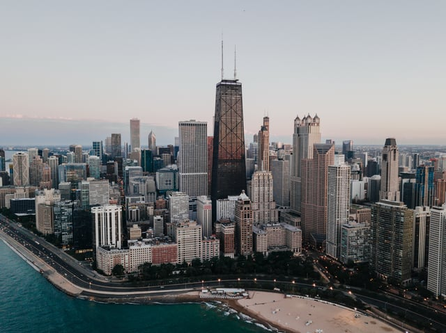

Earlier this year, Preservation Chicago released their 2018 most endangered buildings list known as the “Chicago Seven.” [Preservation Chicago](http://www.preservationchicago.org/), established in 2001, has worked to save buildings threatened with demolition at a grassroots level. The organization has successfully landmarked historically significant buildings and advocated for adaptive reuse. The majority of Preservation Chicago’s campaigns focus on this preservation method, which most often consists of repurposing structures from their original use. 

<em>image by [Aaron Bean](https://unsplash.com/photos/ewtdGmhY1vI)</em>

Common examples of adaptive reuse include repurposing warehouses or loft spaces as residential or office space, but even transit infrastructure can be repurposed in creative ways, such as New York City’s [High Line linear park](/final-review-blog/high-to-low-adaptive-reuse-in-pursuit-of-urban-parkland/). Adaptive reuse is environmentally beneficial and [key to healthy cities](/final-review-blog/reurbanism-and-adaptive-reuse-preservation/), and can provide an avenue to save buildings slated for demolition.

Recently, Preservation Chicago helped save the deteriorating former [Cook County Hospital Building](/final-review-blog/cook-county-hospital-redevelopment-promises-new-life-for-storied-building/), a site that was once on previous lists and faced demolition since its closure in 2002. We’ve profiled the state of Illinois’ most endangered building [last year](/final-review-blog/exploring-2017s-most-endangered-historic-places-in-illinois/), as well as historic preservation advocacy [across the United States](/final-review-blog/preserving-historic-endangered-places/), and we’re taking a look at some of the recent developments with Chicago’s threatened places.

## Jackson Park and the South Shore Cultural Center

The 2018 “Chicago Seven” places significant emphasis on buildings and places on the South Side, where historic - and architectural significance - is often overlooked.

The most endangered site on this year’s list, Chicago’s [Jackson Park](https://preservationchicago.org/chicago07/?cat=69) is at the center of an ongoing debate. Currently slated as the location for The Obama Presidential Center as well as for alterations to the Jackson Park Golf Course, “extensive alterations to the park, which would see hundreds of trees removed \[and would\] affect the integrity of Frederick Law Olmsted’s vision” for the lakefront park, according to Preservation Chicago’s executive director [Ward Miller](http://www.chicagomag.com/city-life/March-2018/Jackson-Park-Tops-Chicagos-Most-Endangered-Buildings/).

Once the site [for the 1893 World's Fair](https://chicago.suntimes.com/entertainment/1893-worlds-fair-what-remains-125th-anniversary/), Jackson Park, the Midway Plaisance, and the South Shore Cultural Center have become increasingly interconnected through new developments by the Chicago Park District, city agencies, and others. Little remains of the Exposition’s buildings - the Palace of Fine Arts is home to the Museum of Science and Industry - [and preservation organizations](https://chicago.suntimes.com/entertainment/1893-worlds-fair-what-remains-125th-anniversary/) believe that Jackson Park should remain intact.

A Designated Chicago Landmark, the 500 acre Jackson Park is well known for its landscape design and history. Though Preservation Chicago agrees that the presidential center site should be within the City of Chicago, it advocates that an alternative location be used that would not fundamentally alter the existing park.

## “Starship Chicago”: The James R. Thompson Center

The James R. Thompson Center, formerly known as the State of Illinois building, frequently appears on the Chicago Seven list. Faced with 33 years of ongoing maintenance costs, heat and cooling issues, and controversy, the site may be placed for sale by the State of Illinois for redevelopment.

Since its construction in 1985, the Helmut Jahn-designed building has been a polarizing, albeit architecturally-significant structure within the downtown Loop. Recently, advocates called for landmarking of the site to avoid demolition, while Jahn [unveiled renderings](https://chicago.curbed.com/2018/4/26/17282574/thompson-center-preservation-jahn-landmarks-illinois) of a potential redesign plan that would mitigate many of the building’s issues: enclosing the interior office balconies behind glass to reduce rampant noise, opening the atrium as an outside space, and building an 110-story tower at the site’s southwest corner for additional space.

At the end of September, architects and preservation advocates [called for](https://chicago.curbed.com/2018/9/26/17896484/thompson-center-landmark-preservation) saving the building and are currently circulating petitions and planning additional events to highlight the building’s threatened status. Most call for renovations to the site or significant alterations to make the building more efficient and increase its potential for office space and hotel use.

## Remaining Buildings Face Significant Threats

The [remaining five places](http://chicagopatterns.com/preservation-chicagos-2018-chicago-7-endanged-list-released/) on the 2018 list include Harper High School in the south side Englewood neighborhood designed by Dwight Perkins, numerous electric substations located within the city limits - especially the largest of these unique structures in Washington Park - Chicago’s fast disappearing brick-paved streets and alleys, the Woodruff Arcade in Rogers Park which is the last remaining indoor arcade in the city (at time of writing, [this building has been demolished](https://chicago.curbed.com/2018/5/4/17318848/edgewater-construction-woodruff-arcade-apartments)), the Guyon Hotel in West Garfield Park, and Chicago’s Union Station.

Though each site faces challenges, Preservation Chicago encourages dialogue around the potential of each location even if the site must be adapted to a new use. By concentrating on creating a city with a fabric of new and old buildings, Chicago - and other cities - can benefit from both preserving history and [remaining attractive to residents both young and old](/final-review-blog/reurbanism-and-adaptive-reuse-preservation/).

Did the Obama Presidential Center end up being built in Jackson Park despite preservation opposition? Yes - after years of legal battles, federal review, and community opposition this post captured, the Obama Presidential Center opened to the public on June 19, 2026 (Juneteenth), on a 20-acre campus in Jackson Park. Construction began in September 2021 after a federal judge approved the project in 2019. What ultimately happened to the Thompson Center - was it saved, demolished, or something else? Saved through adaptive reuse - Google purchased the building for $105 million in 2022 and is converting it into its new Chicago Midwest headquarters in a $280 million renovation. The building is keeping the Thompson Center name; base building work is expected to finish in late 2026 with Google planning to move in during 2027. The atrium will be kept and remain publicly accessible. Is the Thompson Center renovation preserving the original Helmut Jahn design? Partially - the building's atrium is being retained, but the distinctive postmodern exterior glass facade has been replaced with a more opaque glass skin, significantly altering the building's look. The late Jahn's own firm (Jahn) is involved in the renovation, which critics note offers some design continuity. What is adaptive reuse and why do preservation organizations like Preservation Chicago advocate for it? Adaptive reuse converts existing buildings to new uses rather than demolishing and replacing them. It's environmentally beneficial (avoiding construction waste and embodied carbon in new materials), preserves architectural and cultural fabric, and can be economically viable - the Thompson Center's conversion being a current major Chicago example. Does Preservation Chicago still publish an annual "Chicago Seven" most endangered buildings list? Yes - Preservation Chicago has continued publishing its annual Chicago Seven list every year since this 2018 post was written, highlighting threatened buildings and advocating for their preservation or adaptive reuse. The list changes annually based on current threats and campaigns.
