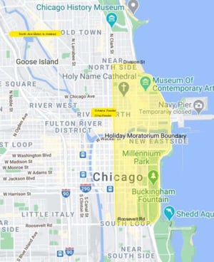

Across the country, municipalities limit construction activity, building permit issuances, or street closures during certain dates and times through November and December. This is done to promote full access to retail stores, restaurants and other businesses by the public. This year, the Chicago Department of Transportation (CDOT) has reduced the parameters due to the reduction in holiday activities. This provides contractors an opportunity to complete work in areas that would've otherwise be heavily trafficked.

The [City of Chicago Department of Transportation](https://webapps1.chicago.gov/StreetClosure/org/cityofchicago/streetclosure/cdot/ward.jsp) (CDOT) Office of Underground Coordination has issued this year’s moratorium beginning at

1.  The easternmost point of Division Street, extending west to Clark Street. South on Clark Street to Roosevelt Road. East on Roosevelt Road to its easternmost point extending to Lake Michigan.
2.  North Avenue between North Elston Avenue and North Halsted Street
3.  Streets within the vicinity of the Ohio and Ontario feeder ramps, such that work on  
    those streets would impede ingress or egress to the feeder ramps.

No street openings or traffic obstructions, except for emergencies shall be allowed within the  designated area from <strong>Friday, November 20th, 2020 at 4 p.m. until Thursday, January 4th, 2021 at 9:30 a.m.</strong> unless issued emergency approval.

All existing permits are revoked during this time and any special permit exemptions must be approved by CDOT and the Division of Infrastructure Management - Permit Section. After January 4, 2021 through April 1st, 2021, work remains subject to snow removal/control rules.

As always, the Burnham Nationwide team is available to answer any questions on moratorium procedures or to assist with the application process for waivers in our offices throughout the country.

Are the dates listed in this post (Nov 20, 2020 – Jan 4, 2021) still the current Chicago holiday moratorium dates? No — these dates are from the 2020-21 holiday season and have long since passed. Chicago's holiday construction moratorium runs annually, with new dates and boundaries issued each year by CDOT's Division of Infrastructure Management; check the current year's official memo rather than relying on this post's specific dates. What areas were covered under this 2020 version of the moratorium? The boundary ran from the easternmost point of Division Street west to Clark Street, south on Clark to Roosevelt Road, then east on Roosevelt back to Lake Michigan — plus North Avenue between Elston and Halsted, and streets near the Ohio/Ontario feeder ramps. Note that boundaries have shifted in subsequent years, so this footprint shouldn't be assumed current. What happened to existing permits during this moratorium period? All existing permits within the moratorium boundaries were automatically revoked for the duration, and any special exemption required separate approval from both CDOT and the Division of Infrastructure Management's Permit Section — a structure that has remained consistent in later years' moratoriums as well. Were emergency repairs allowed to continue during the moratorium? Yes — street openings and traffic obstructions were prohibited except for emergencies, which is the same exception structure CDOT has continued to apply in subsequent annual moratoriums. What rules applied immediately after this 2020-21 moratorium ended? From January 4 through April 1, 2021, work was subject to standard snow removal/control rules — meaning any steel plates in the public right-of-way had to be cleared, or the city's snow operations unit had to be notified if removal wasn't possible. This post-moratorium snow rule structure has also continued in later years.
