Hong Kong is  truly impressive and much can be learned from this ultra-modern Asian city. It is helpful to sometimes look abroad and consider a different way of approaching issues. The following are some of the factors that make Hong Kong such a unique city and noticeably different from many American urban areas.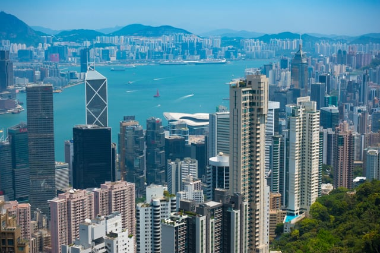<em>Photo by [Ben Silverman](http://www.bensilv.com/)</em> 

## 1\. Numerous Skyscrapers

The number and height of Hong Kong’s skyscrapers distinguish it from other urban areas. Skyscrapers include both commercial and residential property in this densely populated city.

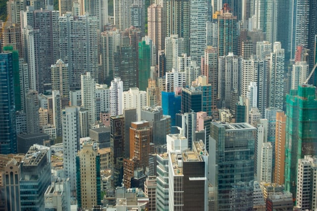<em>Photo by [Ben Silverman](http://www.bensilv.com/)</em>

According to [Emporis](https://www.emporis.com/statistics/most-skyscraper-cities-worldwide), Hong Kong has more skyscrapers than any other city in the world. It contains almost double the number of skyscrapers (1381) as the next city on Emporis’ list, New York City (759).

Skyscrapers, as well as other high-rises, are also built very close together due to the limited amount of flat areas available for development in Hong Kong.

## 2\. Vertical Living

The vast majority of Hong’s residents live in high-rises. Given the city’s large population and high cost of real estate, high-rises are the most cost-effective and realistic way to accommodate the need for housing.

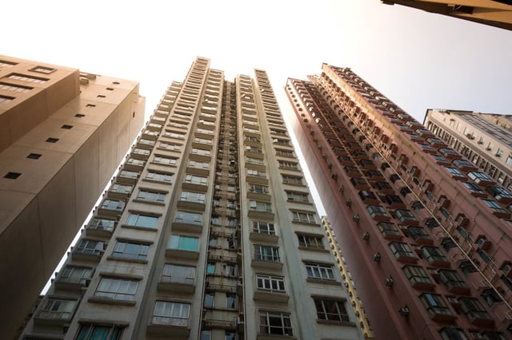<em>Photo by [Ben Silverman](http://www.bensilv.com/)</em>

Hong Kong contains blocks of residential high-rises that are little cities onto themselves. These high-rise communities contain supermarkets, shops, restaurants, recreational facilities, and gardens.

Many of Hong Kong’s restaurants are located on buildings’ upper floors due to the high cost of ground-floor rent. This has created a whole category of Hong Kong dining establishments known as upstairs cafes located on the upper floors of commercial buildings in the city’s business districts. Many of the upstairs cafes have themes and entertainment in addition to serving food.

## 3\. Feng Shui Influenced Buildings

The interesting shapes and positions of Hong Kong’s buildings, including its ultra-modern skyscrapers, result from incorporating principles of Feng Shui, the harmonizing of the built environment with forces of nature. The influence of Feng Shui is most noticeable in the many Hong Kong high-rises with large holes in them, some cutting away at multiple floors.

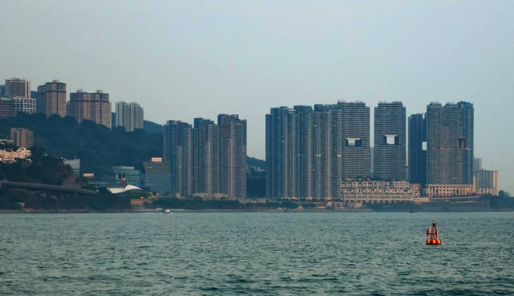<em>Photo by [Ben Silverman](http://www.bensilv.com/)</em>

One of the most famous of Hong Kong’s Feng Shui influenced buildings is the HSBC tower. In lieu of a ground floor, the base of the building is an open plaza covered by a 10-story atrium containing large escalators [specially angled to comply with Feng Shui principles](https://www.theguardian.com/cities/2015/may/28/hong-kong-hsbc-hq-bank-history-cities-50-buildings).

  

To respond to the triangle shaped facade of the neighboring Bank of China, potentially reducing the fortunes of surrounding buildings, two cannon looking structures were added on top of the HSBC building directed at the Bank of China to protect HSBC.

For an overview of Feng Shui in Hong Kong, watch this Vox Borders’ [video](https://www.youtube.com/watch?v=mlDBgOkxgS8).

## 4\. Bamboo Scaffolding

The prevalence of bamboo scaffolding throughout Hong Kong is striking. Bamboo scaffolding is even used for new skyscrapers. This ancient form of scaffolding, known as taa pang, is a stark contrast to the city’s modern architecture.

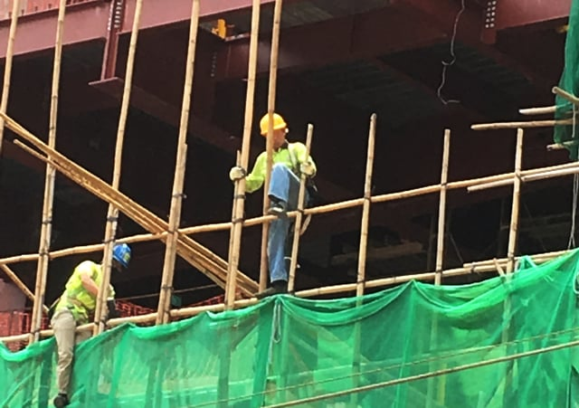

*Photo by Arlene Haas* 

The rods of bamboo are tied together with nylon. Once the scaffolding is completed, the bamboo is wrapped in colorful fabric, calling attention to all the new construction throughout the city.

Although an ancient construction method, the use of bamboo scaffolding is regulated in modern-day Hong Kong.The Hong Kong government has a [Code of Practice for Bamboo Scaffolding Safety](https://www.labour.gov.hk/eng/public/os/B/Bamboo.pdf).

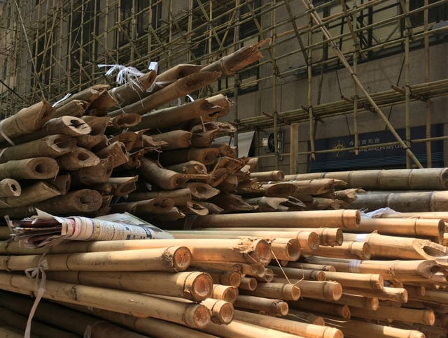*Photo by Arlene Haas*

According to The Loop, bamboo is [“cheaper, faster to build, and easier to transport.”](https://www.theloophk.com/hong-kong-history-culture-guide-whats-the-deal-with-bamboo-scaffolding/) Bamboo is very strong, and some believe, safer than iron rods. Using bamboo, a renewable resource, is also a more environmentally friendly way of creating scaffolding.

## 5\. Beautiful Green Space Despite Compact Living

Hong Kong’s high-density development leaves a surprising amount of green space. In addition to parks such as Kowloon Park in the city center, there is considerable green space in the hills surrounding Hong Kong. There are many hiking trails with beautiful views such as the Dragon’s Back Trail.

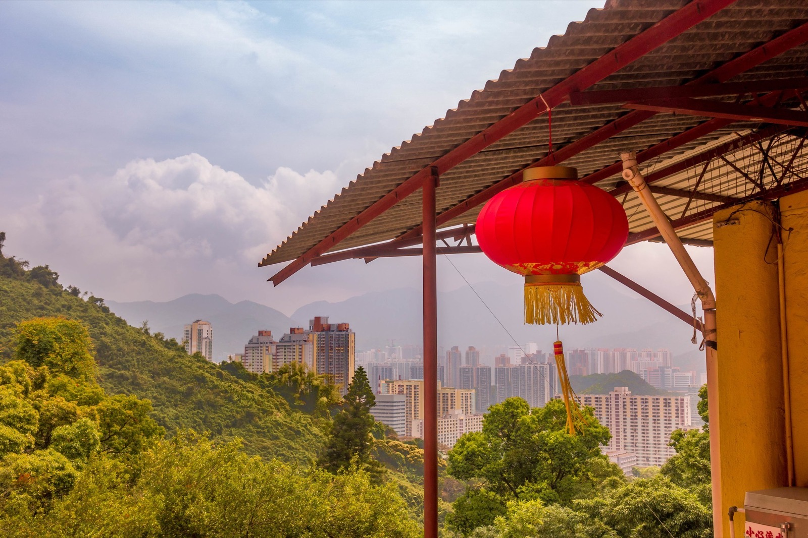

<em>Photo by [Ben Silverman](http://www.bensilv.com/)</em>

Additionally, there are scenic natural areas all along Hong Kong’s coastline. One can visit beautiful beach towns and fishing villages, including those on the islands of Lantau and Cheung Chau that are accessible by Hong Kong’s many ferries.

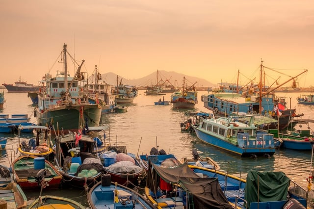<em>Photo by [Ben Silverman](http://www.bensilv.com/)</em>

## 6\. A Wealth of Public Housing

Approximately half of Hong Kong’s population, both middle and low-income residents, live in public housing. Much of the public housing consists of self-contained blocks of high-rises scattered throughout the city.

<em>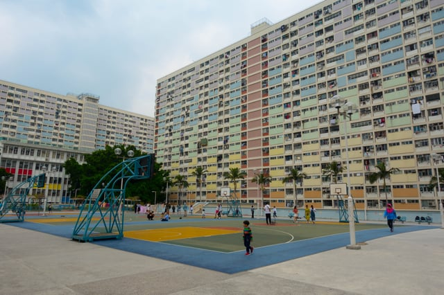</em>

<em>Photo by [Ben Silverman](http://www.bensilv.com/)</em>

In addition to rental housing, Hong Kong’s public housing includes apartments purchased with government subsidies in government built and/or managed buildings. Hong Kong’s public housing doesn’t have the stigma associated with public housing in the United States.

## 7\. Impressive Subway System

Hong Kong’s modern transit system, the Mass Transit Railway (MTR), is very clean, brightly lit, and runs on time. Glass barriers between the platform and tracks contain doors that slide open upon the train stopping and precisely align with the train doors, dramatically increasing safety.

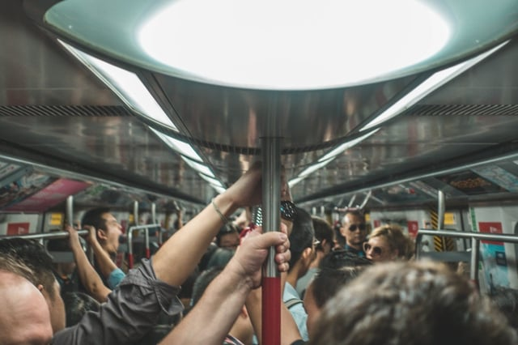<em>Photo by [Ben Silverman](http://www.bensilv.com/)</em>

Signs on the floor and overhead show where to line up for the train, creating orderly boarding.Tunnels between stations post signs guiding the heavy flow of rush hour pedestrian traffic.

<em>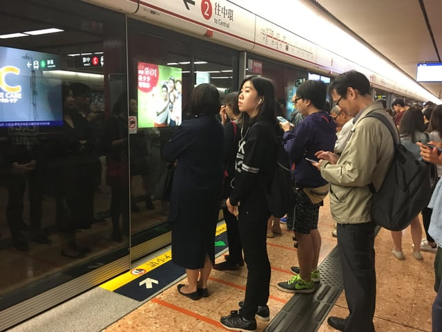</em>

*Photo by Arlene Haas*

Electronic maps within the trains show the different lines and illuminate the stations the train will be stopping. Elaborate signage within the stations clearly identifies the locations of different exits.

Riding the MTR is very inexpensive due to the financial model used to develop and sustain the system. According to a [report by McKinsey & Company](https://www.mckinsey.com/industries/capital-projects-and-infrastructure/our-insights/the-rail-plus-property-model), the Hong Kong government grants MTR the right to develop the land around the station (MTR pays the government the land’s market value prior to the railway addition):

MTR then builds the new rail line and partners with private developers to build properties. MTR receives a share of the profits that developers make from these properties; this share could be a percentage of total development profits, a fixed lump sum, or a portion of commercial properties built on the site. By capturing part of the value of the land property around railway lines, MTR generates funds for new projects as well as for operations and maintenance. This is why it doesn’t need government subsidies or loans.

Rides are paid for using a preloaded Octopus Card that is read by the machines at the station entrance.

## 8\. Up-to-Date Use of Accessible Design

Most Hong Kong MTR stations have wheelchair lifts or ramps for access. Additionally, stations have an intercom so station staff can be notified if a passenger needs assistance.

Train stations, tunnels, and shopping mall concourses have tactile guide paths for those who are visually impaired. Audible devices are placed at station gates and escalators. Most train stations have tactile maps of the station.

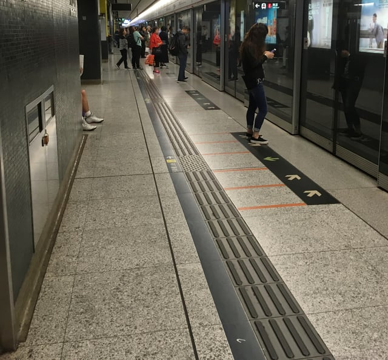

*Photo by Arlene Haas* 

Additionally, all train stations have accessible toilets containing handrails and call buttons. For more information about MTR accessibility, there is a [booklet](http://www.mtr.com.hk/en/customer/services/caring_booklet.html) available.

Crosswalks in bustling shopping areas have audible signals for the visually impaired with buttons reachable from a wheelchair.

## 9\. Extensive Use of Neon Signs

Hong Kong has long been associated with its shopping streets full of neon signs. They are particularly prevalent in the congested Mong Kok shopping area, known for its markets and street performers. Neon signs were traditionally used for all kinds of businesses, and they appear in both Chinese and English.

<em>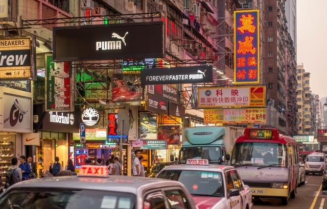</em>

<em>Photo by [Ben Silverman](http://www.bensilv.com/)</em>

According to [Neonsigns.HK](http://www.neonsigns.hk/neon-in-visual-culture/tomorrows-neon-a-history/?lang=en), a website dedicated to Hong Kong’s neon signs, the use of neon grew in Hong Kong during the late 1950’s:

In Hong Kong’s dense and crowded spaces, restaurants, small shops and department stores competed for attention. Neon became a key tool. Business owners used signs that were larger than their competitors. Or they chose devices so memorable that they turned into urban landmarks.

The use of neon signs is declining as energy efficient LED lights become more widespread.

## 10\. Dramatic Skyscraper Light Shows 

Hong Kong’s skyscrapers around Victoria Harbor are lit with colorful LED lights, lasers, and projection lights. Most evenings, a light show known as [Symphony of Lights](http://www.discoverhongkong.com/us/see-do/highlight-attractions/harbour-view/a-symphony-of-lights.jsp) and choreographed to music takes place around the harbor. The light show began in 2004 but has been updated over the years. It is way ahead of anything being done in major American cities.

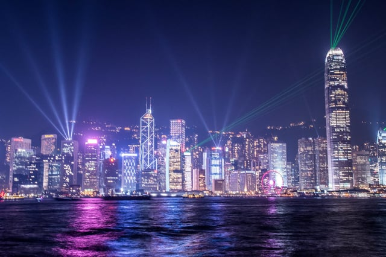<em>Photo by [Ben Silverman](http://www.bensilv.com/)</em>

Hong Kong has its own struggles largely stemming from conflicting views regarding how the city should be governed moving forward. Yet, Hong Kong is still awe-inspiring and can serve as a model for some aspects of American urban planning.

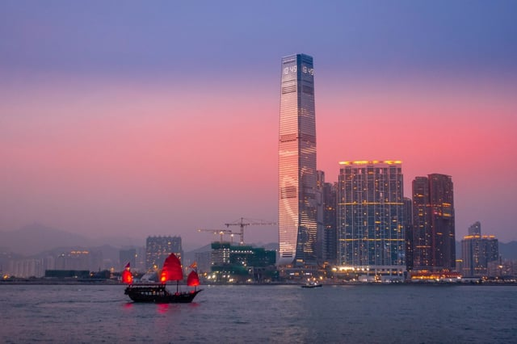<em>Photo by [Ben Silverman](http://www.bensilv.com/)</em>

Why does Hong Kong have more skyscrapers than any other city in the world? A combination of extremely limited flat land (most of Hong Kong is steep hillside), a very large population concentrated in a small area, and historically high real estate demand has pushed development almost entirely vertical — both for residential and commercial use, making high-rise living the default rather than the exception. How does Hong Kong's MTR transit system sustain itself financially without government subsidies? Through a "rail plus property" model — the government grants MTR development rights over land around new stations (at pre-railway market value), and MTR captures a share of the property value increase that the new rail line creates. Revenue from that real estate development funds ongoing rail operations and expansion, eliminating the need for operating subsidies or fare-covering loans. Is bamboo scaffolding still widely used in Hong Kong today? Yes — bamboo scaffolding (taa pang) remains common on Hong Kong construction sites including high-rises, governed by the Hong Kong government's Code of Practice for Bamboo Scaffolding Safety. It's still favored for being lighter, faster to erect, and more flexible than metal scaffolding in dense urban sites, though metal is gaining ground on some project types. Does Hong Kong's public housing approach offer any lessons for American cities dealing with housing crises? Several — roughly half of Hong Kong's population lives in government-subsidized housing (both rental and ownership), and it carries far less social stigma than public housing in the U.S. The model integrates public housing blocks into mixed neighborhoods with retail and amenities rather than isolating them, which is increasingly cited in urban planning discussions as a more equitable approach. Has Hong Kong's political situation changed since this post was written, and does it affect the city's urban development model? Significantly — Hong Kong's governance changed substantially following the 2020 National Security Law and subsequent political changes, and the city has seen notable population outflows since 2020. While the physical infrastructure, transit system, and building regulations described in this post remain intact, the broader political and demographic context has shifted considerably from the "awe-inspiring model" framing at the end of this post.
