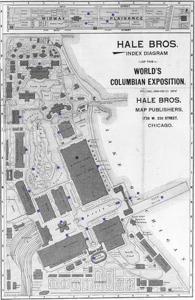
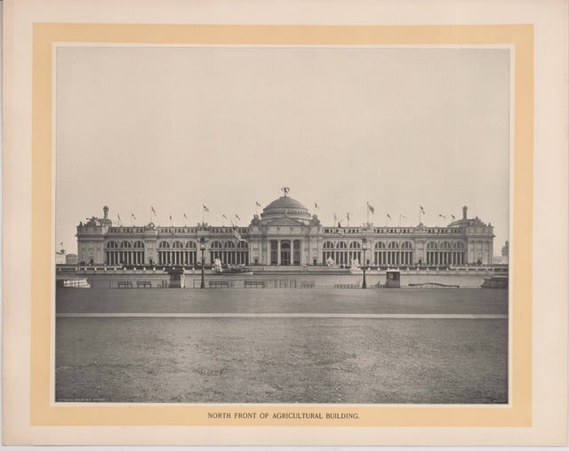

The founders of our company selected the name Burnham Nationwide to embrace the philosophy of Chicago architect and urban planner, Daniel Hudson Burnham. Just as Daniel Burnham envisioned greatness in every endeavor, at Burnham Nationwide we do so on a daily basis.

Daniel Burnham was the Director of Works for the World’s Columbian Exposition in Chicago and also took a leading role in the creation of master plans for the development of the City of Chicago. His influence stretches beyond the many notable skyscrapers he designed, like the Rookery Building, the Marshall Field and Company Building, and Union Station, and is continued to be felt across the city today.

*Image from* [*Chicago History Museum*](https://www.chicagohs.org/history/expo/map.html)

## World’s Columbian Exposition

The 1893 World’s Columbian Exposition was the largest world’s fair to that date and it celebrated the 400-year anniversary of Christopher Columbus’ arrival in the New World. The world’s fair was also known as the “White City” and featured neoclassical architecture that followed Beaux-Arts principles of design. Those principles include symmetry, balance, and splendor. The exposition occupied 630 acres in Jackson Park and the Midway Plaisance.

The fair saw over 26 million visitors during its six month stay in Chicago. During that time, innovations beyond architecture made their debut. Food products including Cream of Wheat, Juicy Fruit gum, and Pabst Blue Ribbon beer plus technological innovations like the dishwasher and fluorescent light bulbs all made their [first appearance at the World’s Fair](http://www.history.com/news/7-things-you-may-not-know-about-the-1893-chicago-worlds-fair).

Of the more than 200 buildings created for the exposition, only one remains today: the Palace of Fine Arts. The original Palace of Fine Arts Building was designed by Charles B. Atwood for D.H. Burnham & Co. The building was constructed with a brick substructure under a plaster facade. In 1933, the building was converted to the Museum of Science and Industry and was re-cast in limestone to preserve the Beaux Arts facade.

## City Beautiful Movement

The World’s Fair brought many positive contributions to Chicago’s city planning, including the City Beautiful movement and Daniel Burnham’s Plan of Chicago. The City Beautiful movement aimed to bring beautification and grandeur to urban and city planning. It originated at the Chicago World’s Fair and extended to cities including Washington D.C., Cleveland, and Detroit.

## Chicago City Planning

Daniel Burnham, along with Edward H. Bennett, prepared “The Plan of Chicago,” which was the first comprehensive plan for the controlled growth of an American city. As part of the City Beautiful movement, the plan featured a new civic center, axial streets, and park land along the lakefront. Only small parts of the plan were implemented at the time, but it continues to influence the development of Chicago long after his death. In particular, Burnham’s focus on the development of the lake and riverfront as well as the park system may be one of his longest lasting legacies in Chicago.

## Burnham Nationwide Leads the Way in Innovation

While Chicago is home, since Burnham began over 25 years ago, we have secured hundreds of thousands of permits in more than 3,000 municipalities nationwide. We think back to our namesake as part of everything we do. Just as Daniel Burnham worked to improve Chicago through the City Beautiful movement, at Burnham we work to help guide architects and building developers through their construction projects in Chicago and across the country.

The desire for innovation has led Burnham Nationwide to create unique building permit tools like PermitMapper, which allows you to search for permit and construction details online quickly and accurately, and BurnhamEYE, which is a mobile app that provides a consistent and secure way of documenting and reporting installations.

Our industry is seeing exciting growth and developments. At Burnham, we feel that our innovative and sustainable techniques can play a key role in keeping that momentum moving in the right direction.
