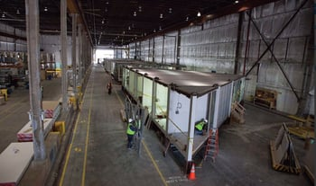

One of the hottest construction trends on our radar is  “modular construction.” You may be familiar with this trend already, or have seen some pieces of houses being transported on the highway, normally accompanied by a “large load” sign. But did you know that modular construction goes beyond just constructing homes? Entire skyscrapers are being build from these modular units, all around the world.

With many advantages to this new type of construction, such as low cost and high efficiency, it’s no wonder that this new method of creating buildings is putting an entirely different spin on the construction sites that we are used to. Let’s start with the basics of what these modular units actually are, a look inside a modular construction facility, and map a few “mod” buildings.

## What are modular buildings?

Modular buildings are sectional prefabricated buildings that are built off site, and consist of multiple sections called modules (or mods). Each mod is constructed to specific specifications according to extensive planning with architects and designers. Once the planning for the mods are complete, the off site production facility constructs each modular unit to the specific and unique specifications.

After all the units are complete, the mods are brought to their final destination, typically being transported via trucks. Once they reach the site, they are set atop the building’s already poured foundation by use of cranes. Each mod is made to fit together perfectly, like a puzzle. Once every mod in set in place, there are just a few minor installations that need to be done on-site, like electricity and plumbing connections.   

## Advantages of modular construction

### Speed of construction

All modular construction is done off site, typically in a massive indoor production facility. Workers are divided into construction teams where they focus on making one unique mod, again and again. Having teams repeating the processes reduces turnaround time to seven days for each unique mod to be completed from start to finish.  

Additionally, given the large space of the production facilities, work can be done simultaneously, rain or shine and through all four seasons, allowing construction to be done as much as 50% faster.  

### Cost and environment saving

In having the same mods being build several times over, the manufacturers can master exactly what quantity of materials is needed for any given job.

Building in a closed facility also saves the environment. With reduced waste and reduced equipment uses, there are less site disturbances.

### Safer

Being able to control the building environment through building indoors allows for workers to maintain a clean environment, reducing dust and potential falls due to most work being done at ground level.

Since on-site construction is reduced, you can see fewer trucks and deliveries, all which reduce the risk for accidents.

> “Neighbors can expect up to 48 percent fewer truck deliveries and 70 percent fewer workers on-site.” Erik Antokal of FC Modular.

## A look inside a FC Modular's construction facility

Getting the opportunity to have a personal tour of FC Modular’s production facility was truly a non-typical afternoon for me. Set in the Brooklyn Navy Yard (FC Modular takes pride in being #MadeInBrooklyn), we prepared for the tour with safety glasses and helmets. Stepping into the massive open facility, you immediately get a sense that this isn’t your typical construction site.

Each construction team was busy working on mods for a high rise building that would soon be home to residential apartments. Everyone had a specific mod they were responsible for; once they were complete, the mod would be moved, and the team would reconstruct the exact mod, over and over again. Erik Antokal told me that it takes 930 mods, with 225 unique types, to construct a 32-story high rise building.

## Using the Burnham PermitMapper, we mapped a few modular buildings under construction

### [1324 Quintero Street Los Angeles, CA](http://www.burnhammapper.com/search/los-angeles/1324-Quintero-Street)

One of the latest opportunities that Burnham is proud to be a part of is the construction of Ark.la[’](http://ark.la/quintero/)s newest modular home. Set in Los Angeles’s Echo Park, the four home modular development just broke ground this month. Designed by award-winning architect Chris Krager, the modular units will have a focus on being energy-efficient and house sustainable design features.

### [461 Dean Street, Brooklyn, NY](http://www.burnhammapper.com/search/new-york-city/461-Dean-Street)

Constructed at FC Modular’s facility, the 32- story residential building sits almost atop the Barclays Center, on the corner of Flatbush Avenue. Getting credit in [The New York Times](http://www.nytimes.com/2016/02/07/realestate/new-yorks-new-high-end-rentals.html?hpw&rref=realestate&action=click&pgtype=Homepage&module=well-region®ion=bottom-well&WT.nav=bottom-well), this modular apartment high-rise will offer apartments at market-rate and half will be affordable units when opened later this year.
