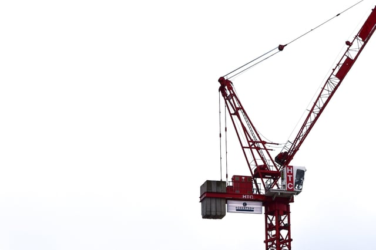

As building permit expediters, we manage the building permit application process on behalf of building managers and contractors. Every jurisdiction - including states, cities, towns and counties - has different requirements for issuing permits and different fees associated with each permit, and fees accrue for each jurisdiction. These costs should be taken into account when budgeting for any project.

<em>image by [Ethan Kent](https://unsplash.com/photos/5wEOLxZ8t38)</em>

Before starting any building project, you must file your building permits and pay the appropriate permit fees. The building manager or owner, contractor, or building permit expediter, like Burnham Nationwide, is responsible for completing the appropriate forms and returning them to the right jurisdiction office that governs building permits. The actual cost of building permits will depend on the location of your property and the specific type of work that will be performed there, and is calculated using the jurisdiction's fee schedules.

The process of applying for and paying for building permits may seem like an unnecessary evil, but if you don’t obtain the correct permits, you will be risking fines or stop work orders during inspections. Building permits are necessary to ensure public health and safety and construction quality, among other reasons. Construction should not begin until your permits are approved and issued.

Here are some examples of areas of construction that require building permits. Keep in mind that this can vary greatly based on your location:

-   <strong>New construction:</strong> Construction on a brand-new building or other structure will require a permit.
-   <strong>Additions:</strong> If you are adding on to or expanding a building, like adding additional square footage or a garage or deck on a residential structure, you will be required to file a permit for construction.
-   <strong>Major renovations:</strong> This could include remodeling a building or restoring an older single family home. Any major renovations require building permits.
-   <strong>Structural changes:</strong> These changes generally involve things like adding or removing walls or any type of demolition. Building permits are especially necessary for these types of constructions as they can change the load-bearing portions of a structure and potentially make it unsafe.
-   <strong>Electrical, plumbing and mechanical work:</strong> In many cases any type of electrical, plumbing or mechanical work will require building permits. For small projects or repair-and-replace installations, you may not need a permit, so it’s best to check with your local jurisdiction before beginning work.

Since there are so many differences in building permit fees throughout the country, we took a look at how much you should budget for building permits in a few major cities: Chicago, New York City, Los Angeles and Denver.

## How Much Does a Permit Cost in Chicago?

The City of Chicago provides a [Permit Fee Calculator](https://ipiweb.cityofchicago.org/DynamicPortal/Forms/FeeCalculator.aspx) that estimates permit fees as determined by the permit fee formula. In order to use the Permit Fee Calculator, you must know factors such as construction type, occupancy type, area in square feet and project scope. For questions about permit fees, you can also contact the City of Chicago directly at [permitfees@cityofchicago.org](mailto:permitfees@cityofchicago.org).

## How Much Does a Permit Cost in Los Angeles?

The City of Los Angeles Department of Building and Safety also has a [Permit Fee Calculator](http://www.ladbs.org/services/pay-fees/permit-fee-calculator) that can help you estimate permit fees online. Fees calculated using the online calculator are an approximation of the actual fees based on the current fee ordinance. You can estimate your permit fees for Building, Electrical, Fire, Grading, HVAC, Plumbing and Sign permits. You can also [download fee schedules](http://www.ladbs.org/faq/fee-schedules) and valuation tables on their website.  

## How Much Does a Permit Cost in New York City?

Permit fees in NYC depend on the scope of the work and Building Code requirements. The majority of construction projects require a Department of Building permit. 

According to the NYC Department of Buildings, the primary permit applications are: New Building (NB) and Alterations Type-1, 2 and 3:

-   NB: Construction of new structures

-   ALT1: Major alterations that will change use, egress or occupancy

-   ALT2: Multiple types of work, not affecting use, egress or occupancy

-   ALT3: One type of minor work, not affecting use, egress or occupancy

## How Much Does a Permit Cost in Denver?

Permit fees in Denver are assigned to a project throughout the process by different departments or agencies. The Denver government website allows you to estimate fees for your project with a [fee schedule](https://www.denvergov.org/content/denvergov/en/denver-development-services/help-me-find-/fees.html). Fee schedules are available for a wide variety of building projects, including:

-   Planning and rezoning
-   Site development
-   Building
-   Zoning
-   Landmark preservation
-   Public Works/SUDP
-   Fire permits
-   Miscellaneous fees  
    

Managing your building permit process and understanding how much you’ll need to pay in fees can be burdensome. At Burnham, we help you fill out permit paperwork and keep track of fees. This lets you focus on the more important parts of your construction project, while we use our knowledge of the industry to streamline the building permit process.
