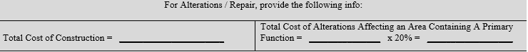

On January 2, 2020, The City of Chicago - [Mayor's Office for People with Disabilities (MOPD](https://www.chicago.gov/city/en/depts/mopd.html)) released an updated form in line with the [Chicago Accessibility Code](https://codes.iccsafe.org/content/CHIBC2019P1/chapter-11-accessibility) which was effective as of December 1, 2019 and applicable to all permit submittals moving forward. Burnham is here to update you on the implemented changes to the form related to alteration projects. 

**Additional Requests**

Under MOPD Schedule (A),the new form includes a section that requires confirmation on whether elements related to the alterations to primary function areas are in compliance. For clarification on what qualifies as primary function, reference the [**Primary Function Area**](https://codes.iccsafe.org/content/CHIBRC2019P1/chapter-3-provisions-for-all-compliance-methods#CHIBRC2019P1_Ch03_Sec305.7) [<strong>(for Section 305)</strong>](https://codes.iccsafe.org/content/CHIBRC2019P1/chapter-3-provisions-for-all-compliance-methods#CHIBRC2019P1_Ch03_Sec305)which defines the area of a building or facility containing a major activity for which the building or facility is intended. This part of the form will help the plan examiner understand whether elements can be brought into compliance as part of the scope of work. This section obligates that at least 20% of the overall alteration cost of the primary function area is spent towards bringing any or all of the identified elements into compliance. 

It is our understanding that the “Check if Accessible” intends to clarify: 

**Y** = confirmed by Architect signing the MOPD form that elements comply with the new construction requirements of the referenced codes.

<strong>\*</strong>  = it is not feasible to bring the existing element into further compliance based on existing conditions or costs exceeding 20% of the alteration cost. 

**N** = the element is not in compliance (these are the elements that should be reviewed to determine if it is feasible to be brought into compliance).

**N/A** = work being done does not trigger compliance such as bringing a base building toilet room into compliance, but not other primary function spaces on the floor. 

The gray box underneath the table could be used to add comments for further clarification. If  unsure about what qualifies as an alteration under the new code to determine applicable costs, reference the definition for [**Alterations**](https://codes.iccsafe.org/content/CHIBRC2019P1/chapter-3-provisions-for-all-compliance-methods#CHIBRC2019P1_Ch03_Sec305.6) [<strong>(for Section 305)</strong>](https://codes.iccsafe.org/content/CHIBRC2019P1/chapter-3-provisions-for-all-compliance-methods#CHIBRC2019P1_Ch03_Sec305)<strong>.</strong>  This includes modifications or renovations that affect or could affect the usability of the building or facility or part of the building or facility.

Under MOPD Schedule (B), there are two costs that need to be completed. The first is the total construction is for the entire project. The second is the total cost of alterations affecting the Primary Function area. This calculation allows for the the exclusion of normal maintenance, painting or changes to electrical and mechanical systems. If these are excluded, it is recommended that the Architect maintain records that clarify the basis for determining the alteration cost.  Further, these are only specific to alterations of the area containing a primary function.

Feel free to reach out to our [Code Team](/our-technology/burnham-eye/) with any questions.

Is the January 2020 MOPD form described in this post still the current version used for Chicago permit submittals? The core structure and the underlying code references (Chapter 14B-11 of the Chicago Building Code, ICC A117.1-2009, and the 2018 Illinois Accessibility Code) remain current as of 2026. Note that MOPD's Accessibility Compliance Unit is actively soliciting feedback from architects and stakeholders to refine its project data forms, so check MOPD's current form page directly before submitting, in case revisions have since been finalized. What does the "\*" notation on the MOPD form's Schedule A compliance checklist? It indicates that bringing an existing element into further compliance isn't feasible - either because of physical/existing conditions, or because doing so would push the cost beyond the 20% threshold of the total alteration cost allocated to that primary function area. Does every renovation project need to bring 20% of its alteration cost toward accessibility compliance? Only when the work involves alterations to a primary function area - defined as the part of a building containing the major activity the building or facility is intended for. Work limited to non-primary-function spaces (like a base building toilet room not tied to a primary function area) would be marked N/A rather than triggering the 20% obligation. What costs can be excluded when calculating the total alteration cost for MOPD Schedule B? Normal maintenance, painting, and changes to electrical and mechanical systems can generally be excluded from the alteration cost calculation — though architects are advised to maintain clear records documenting the basis for any exclusions, in case that calculation is later questioned during plan review. Where can I get help interpreting the MOPD form or its accessibility requirements for my project? MOPD's Accessibility Compliance Unit offers pre-permit plan review guidance for a nominal fee and can be reached directly by phone or email to meet with architects, developers, and other industry professionals before formal permit submission.
