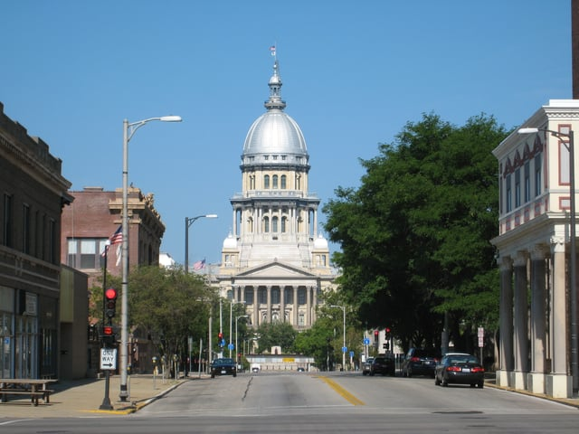

Important [Amendments to the Illinois Environmental Barriers Act](http://www.ilga.gov/legislation/fulltext.asp?DocName=09900SB2956enr&GA=99&SessionId=88&DocTypeId=SB&LegID=96283&DocNum=2956&GAID=13&Session=), Senate Bill 2956, were introduced in the Illinois General Assembly this past February by Senator Linda Holmes. The General Assembly passed these changes to the Illinois accessibility law for people with disabilities at the end of May, and Govern Rauner signed the bill into law this month. We thought we would take a closer look at the Environmental Barriers Act amendments.

## The Illinois Environmental Barriers Act and the ADA

The [Illinois Environmental Barriers Act](http://www.ilga.gov/legislation/ilcs/ilcs3.asp?ActID=1519&ChapAct=) (Environmental Barriers Act), 410 ILL. Comp. Stat.  25 et. seq., enacted in 1985 and amended in 1996, is the state law governing accessibility for people with disabilities. The statute requires that newly constructed or altered public facilities and multi-story housing units be built to comply with the state’s accessibility standards.

The Americans with Disabilities Act (ADA), is the federal law prohibiting discrimination against people with disabilities and requires that certain types of buildings and facilities be designed and built to permit accessibility. In Illinois, it is necessary to comply with both the ADA and the Environmental Barriers Act. Prior to the amendments, the Environmental Barriers Act did not always align with the ADA and made compliance with both the federal and state laws confusing. The Illinois Attorney General’s Office (IAG) is responsible for enforcing the Environmental Barriers Act and drafted the amendments so the Illinois accessibility law parallels the ADA and its current standards.

Illinois’ regulations implementing the Environmental Barriers Act are found in the [Illinois Accessibility Code](https://www.illinois.gov/cdb/business/codes/Documents/WebVersionIAC.pdf) (Accessibility Code), 71 ILL. Admin. Code tit. 71, sec. 400 et. seq. The most recent version of the Accessibility Code became effective in 1997. The Accessibility Code, administered by the Illinois Capital Development Board (Capital Development Board), contains the Illinois design and construction standards for accessibility. The IAG is also working together with the Capital Development Board to update the Accessibility Code so it completely aligns with the ADA’s regulations.

## Highlights of Changes to the Environmental Barriers Act

The amendments to the Environmental Barriers Act include some of the following changes:  

-   Substitutes the term “individuals with disabilities” for the previously used term “environmentally limited persons”
-   References the “2010 Standards for Accessible Design” which are the current regulations implementing the ADA 
-   Revises the definitions of a number terms and adds other defined terms such as: accessible, accessible means of egress, accessible route, adaptability, circulation path, multi-story housing, primary function area, and public right-of-way
-   Beginning January 1, 2017, the Capital Development Board is required to revise the Accessibility Code within three years of any updates to the ADA Standards for Accessible Design
-   Specifies that the Environmental Barriers Act and the Accessibility Code apply to all public facilities and multi-story housing that began construction after May 1, 1988
-   Twenty percent of the units in multi-story housing that began construction after May 1, 1988, must be adaptable - easily converted for use by persons with different levels of disability
-   New housing must comply with the U.S. Department of Housing and Urban Development’s [March 6, 1991, Fair Housing Accessibility Guidelines](http://portal.hud.gov/hudportal/HUD?src=/program_offices/fair_housing_equal_opp/disabilities/fhefhag) and “all subsequent versions, amendments, and supplements”
-   All alterations of a public facility or multi-story housing must comply with the version of the Accessibility Code that existed at the time the alterations began
-   Includes a new section governing alterations that affect the path of travel to a primary function area
-   Specifies that violations of the Accessibility Codes are also violations of the Environmental Barriers Act
-   Provides the IAG with the authority to investigate violations of the Environmental Barriers Act and the Accessibility Code
-   Adds specific penalty provisions for violations of the Environmental Barriers Acts and Accessibility Code, including penalties for violations by owners, architects, engineers, and government officials

## Current Status of Amendments to the Illinois Environmental Barriers Act and Updated Illinois Accessibility Code

Governor Rauner signed the amendments to the Environmental Barriers Act into law on July 15, 2016. The effective date for the law is January 1, 2017. Also, the IAG and the Capital Development Board are continuing to work on the updates to the Accessibility Code, and it is anticipated that the revised code will be released in January of 2017. We will update you when the amendments to the Illinois Accessibility Code are proposed and adopted.
