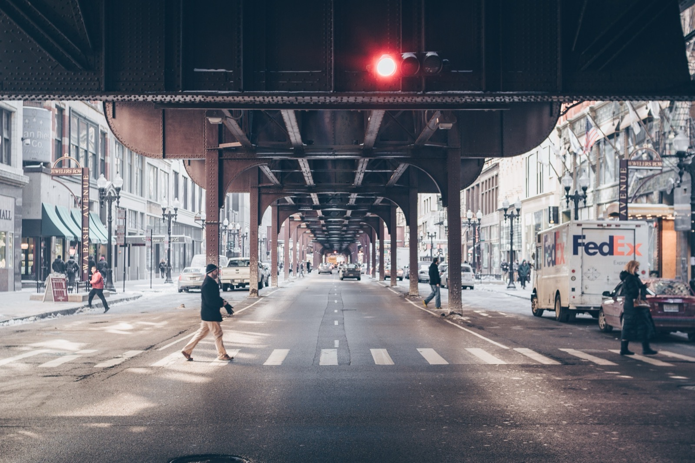

June has just begun and Illinois State Legislature is staying productive. Last weekend, Lawmakers wrapped up and approved a variety of bills which included a new infrastructure budget, a Chicago casino, a [marijuana bill](http://ilga.gov/legislation/101/HB/10100HB1438sam002.htm) and more.

**Paving the roads in Illinois**

A major win for the state includes a [$45 billion six-year infrastructure package](http://ilga.gov/legislation/billstatus.asp?DocNum=62&GAID=15&GA=101&DocTypeID=HB&LegID=113884&SessionID=108) that contains plans to repair Illinois roads, bridges, public schools and university buildings. The bill includes a proposal for nearly $1.8 billion in tax increases and new taxes to help cover costs.

Photo by [Josh Sorenson](https://unsplash.com/@joshsorenson?utm_source=unsplash&utm_medium=referral&utm_content=creditCopyText) on [Unsplash](https://unsplash.com/search/photos/illinois-bridge?utm_source=unsplash&utm_medium=referral&utm_content=creditCopyText)

[Of the proposed](https://www.chicagotribune.com/politics/ct-met-ritzker-illinois-capital-plan-20190517-story.html) spending, an estimated $28.6 billion would be devoted to transportation projects, including $23 billion for roads and bridges and $3.4 billion for mass transit. The plan also calls for spending $5.9 billion on repair and building projects at schools, universities and community colleges. Another $4.4 billion would go to state facilities.

**All bets on Chicago**

The gambling bill that passed includes a large, privately owned, Chicago casino with smaller ones in the south suburbs.The bill raises concerns with city officials with the fear that sports betting would cut into their own tax take. Still, the city is expected to get a third of the tax revenue.

**Going Green**

Illinois has made history by becoming the first state to create a commercial recreational marijuana industry through legislation as opposed to voter initiative. The bill doesn’t take effect until January 1, 2020 but businesses are preparing. There are currently 55 dispensaries in the state of Illinois and that number is set to increase, but not without a few hiccups. There will be challenges along the way which include zoning regulations, application fees and additional costs.

Many of these changes include opportunity for new and expanded businesses, and Burnham is here to help. Reach out to our team of experts for any of your code compliance and permit needs.

Is Illinois' $45 billion infrastructure package from 2019 still being implemented, and how far along is it? Yes — Rebuild Illinois is a six-year capital program through Fiscal Year 2025, and it has been substantially executing on its original commitments. Illinois allocated roughly $12.4 billion for construction projects in its FY2025 budget, with transportation, schools, and university buildings all receiving funding through the program as originally planned. Did the Chicago casino end up getting built? It's in progress. Bally's Chicago casino was approved and broke ground in 2024 at the former Chicago Tribune Freedom Center site along the Chicago River, with the permanent facility expected to open around 2026-2027. A temporary casino operated by Bally's has been running in the Medinah Temple since September 2023 while the permanent facility is under construction. Has recreational marijuana actually taken hold in Illinois since this post, and what does it mean for permitting? Yes — Illinois' recreational marijuana market has grown substantially since launching January 1, 2020. As of 2026 there are well over 100 licensed dispensaries statewide (up from the 55 mentioned in this post). From a permitting perspective, cannabis dispensaries and cultivation facilities involve the same complexity of zoning, use classification, and buildout permitting as other commercial uses, plus cannabis-specific state licensing requirements layered on top. Do marijuana dispensaries need special permits beyond a standard commercial buildout? Yes — state cannabis licensing (through the Illinois Department of Financial and Professional Regulation) is a prerequisite, and many municipalities have added their own zoning overlay requirements (distance buffers from schools, residential zones, or other dispensaries) that must be confirmed before any permit application for the buildout itself. Was sports betting ultimately legalized in Illinois alongside the casino bill? Yes — the same 2019 gaming expansion bill that authorized the Chicago casino also legalized sports betting in Illinois, which launched in 2020. Illinois is now one of the larger sports betting markets in the country, though the tax structure and revenue split with the city has continued to be a point of negotiation in subsequent state budget cycles.
