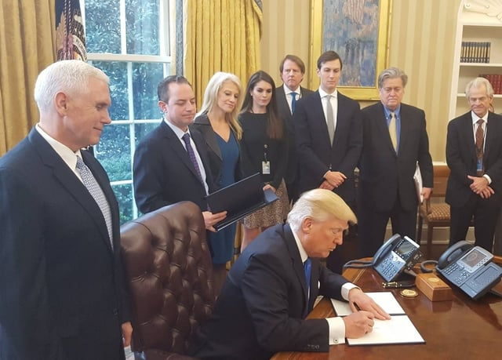

On January 30, 2017, President Trump signed an [Executive Order on Reducing Regulation and Controlling Regulatory Costs](https://www.whitehouse.gov/the-press-office/2017/01/30/presidential-executive-order-reducing-regulation-and-controlling) (Executive Order), referred to as the two-for-one regulation order. This Executive Order has important implications for the development of future regulations such those implementing the Americans With Disabilities Act (ADA) Title III, the section of the ADA covering private entities that operate as places of public accommodations or commercial facilities.

## Executive Order Overview

The Executive Order sets forth requirements for new “executive department or agency” regulations:

-   The agency must repeal two existing regulations for any new regulation proposed or promulgated during fiscal year 2017.
-   The total incremental cost of any new regulation during fiscal year 2017 must be zero.
-   The incremental cost of a new regulation may be offset by eliminating the current costs resulting from two or more prior regulations.
-   In future years, for any regulation that increases the incremental cost, the agency head must identify “offsetting regulations” and the costs or savings from any new or repealed regulation.

The Executive Order states that these requirements must be implemented “to the extent permitted by law.”

Exempted from the Executive Order’s requirements are regulations relating to the military, national security, or foreign affairs as well as regulations that relate to agency operations or are exempted by the Director of the Office of Management and Budget (OMB).

## Executive Order’s Interim Guidance

There are many questions about how the Executive Order will be carried out, in part, due to many of the Executive Order’s ambiguities. OMB issued an [Interim Guidance](https://www.whitehouse.gov/the-press-office/2017/02/02/interim-guidance-implementing-section-2-executive-order-january-30-2017) (Guidance) on the Executive Order on February 2, 2017, in order provide some clarification.

The Executive Order was unclear about what types of regulations are subject to the order. The Guidance limits the Executive Order to “significant regulatory action” as defined by [Executive Order No. 12866](https://www.reginfo.gov/public/jsp/Utilities/EO_12866.pdf) (EO 12866), signed by President Clinton in 1993. Under EO 12866, significant regulatory actions include those that: “Have an annual effect on the economy of $100 million or more or adversely affect in a material way the economy, a sector of the economy, productivity, competition, jobs. . . .” The Guidance states for any new significant regulatory action before September 30, 2017, that imposes costs, there must be “two ‘deregulatory’ actions” that “fully offset the costs” of the regulation.

The language of the Executive Order is also unclear as to the type of agency that is subject to the order. The Guidance states that the Executive Order only applies to agencies required by EO 12866 to submit their regulatory actions to the  Office of Information and Regulatory Affairs (OIRA). Independent regulatory agencies are not subject to the Executive Order but are encouraged to comply.

## Executive Order criticized for Only Focusing on Cost

Critics of the Executive Order point out that significant agency rules already go through a detailed analysis by OMB. However, now only costs will be considered without giving any consideration to a regulation’s benefits no matter how great they are relative to a regulation’s costs. Thus, the Executive Order will have a deleterious effect on critical regulations with important public benefits.

Moreover, the Executive Order’s process for creating a new rule is very burdensome because now agencies must conduct a cost assessment for two existing regulations when developing a new regulation. In addition, given that the lengthy rulemaking process is used to repeal existing regulations, an agency must undertake the rulemaking process for three rules to promulgate one new rule.

As a practical matter, the Executive Order will basically halt the promulgation of new regulations.

## Impact on the ADA Title III Regulations

One significant set of ADA Title III regulations likely to be impacted by the Executive Order are the [Accessibility Guidelines for Pedestrian Facilities in the Public Right-of-Way](/final-review-blog/accessibility-guidelines-for-pedestrian-facilities-in-the-public-right-of-way/) (PROWAG) under development by the Architectural and Transportation Barriers Compliance Board (Access Board), the independent agency responsible for developing accessibility guidelines.

The Access Board has been working on PROWAG for many years. The most recent draft rule was published in 2011. When we last checked, the Access Board was hoping to submit a final rule in mid-2017.

The Access Board submits its significant regulatory actions to OIRA, and the United States Department of Justice (DOJ) and the United States Department of Transportation (DOT) must adopt PROWAG as regulations in order for them to become enforceable standards.  DOJ and DOT are federal executive branch departments covered by the Executive Order and, therefore, PROWAG will be affected by the Executive Order.

Other major ADA Title III regulations being developed by DOJ are also unlikely to move forward. Examples of such regulations are the Accessibility of Equipment and Furniture and Accessibility of Web Information and Services of Public Accommodations.

## Legal Challenge to Executive Order

Several organizations recently filed a lawsuit challenging the Executive Order in the United States District Court for the District of Columbia, [Public Citizen, Inc. v. Trump](https://assets.documentcloud.org/documents/3456917/2-8-17-Public-Citizen-Complaint.pdf), No. 1:17-cv-00253 (D.D.C.filed Feb. 8, 2017). The plaintiffs are asking for the Executive Order to be invalidated because it will block or require the repeal of important regulatory protections. The complaint alleges that the order is unconstitutional and will force executive agencies to violate a variety of statutory requirements in order to be compliant with the Executive Order. For example, the Executive Order “requires the agencies to consider factors not specified in or inconsistent with their governing statutes.”

We will continue to monitor this important lawsuit and other developments relating to the two-for-one Executive Order. It should also be noted that changes at DOJ may also impact the extent to which new ADA Title III regulations will be promulgated and existing regulations will be enforced.
