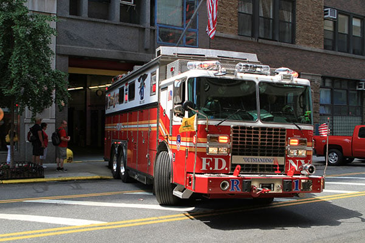

New York City solar installations must comply with the Fire Department, City of New York’s (FDNY) code requirements. In a prior post, we discussed some of the [New York City Fire Code provisions](/final-review-blog/nyc-fire-code-barriers-to-installing-solar/) that cause delays and increase the cost of installing solar in the city. Based on our experience assisting clients with solar permits, we also recommended possible solutions to the issues posed by the New York City Fire Code. We are pleased FDNY recently took steps to resolve some of the problems faced by New York City solar installers and will review these improvements in this post.

## New NYC Fire Code Guide

The [New York City Fire Code (NYC Fire Code)](http://www1.nyc.gov/site/fdny/about/resources/code-and-rules/nyc-fire-code.page) was revised in 2014. Despite this relatively recent update, some of the NYC Fire Code requirements are unclear or problematic when installing solar panels. Solar installers who are unsure about a project’s compliance with the NYC Fire Code need to apply for a variance pursuant to NYC Fire Code Section 104.8 to confirm correct interpretations of the code.The [variance procedure](http://www.nyc.gov/html/fdny/pdf/fire_prevention/TM5.pdf) requires extra documentation and an additional $420 fee. Also, the variance review adds several weeks to the permit process.

This February, FDNY introduced the [NYC Fire Code Guide](http://www1.nyc.gov/assets/fdny/downloads/pdf/business/nyc-fire-code-guide-12-3-15.pdf) (Guide) to help clarify the meaning of some of the NYC Fire Code sections. The new Guide incorporate FDNY’s responses to Frequently Asked Questions previously found on FDNY’s website. In addition, the Guide incorporates new guidelines relevant to solar installers. With the help of the Sustainable City University of New York (Sustainable CUNY), New York City solar installers were able to bring some of the NYC Fire Code issues they confront to FDNY’s attention.

## Guidance on Clear Path Requirements

In our prior post, we noted that one of the NYC Fire Code sections that creates the most problems for solar installers is NYC Fire Code Section 504.4 governing rooftop access and obstructions. Particularly problematic is the language of NYC Fire Code Section 504.4.4(2) that requires “reasonable” access to “bulkhead doors, fire escapes, access ladders, cockloft vents, skylights, scuttles, and shafts.” It is not always clear what the FDNY will interpret to be “reasonable.”

The new guidelines state that the NYC Fire Code Section 504.4.4 six feet horizontal roof clear path requirement will be interpreted as offering “reasonable” access to one or more of the sides of a building feature, such as a skylight or bulkhead door, if the clear path is adjacent to the building feature.

NYC Fire Code Section 504.4.4.7 allows certain “conduit and piping” to cross over the required clear path if steps are provided over such conduit or piping. The Guide also clarifies that rooftop plumbing ventilation pipes are not included in the conduit and piping permitted to cross a rooftop clear path.

## More Flexible Pitched Roof Requirements

NYC Fire Code Section 512.3 governs the installation of solar panels on pitched roofs. A roof is considered ”pitched” under the NYC Fire Code if its slope is more than 20 degrees.The NYC Fire Code Section 504.4 clear path requirements do not apply if a rooftop is pitched because firefighters can access a pitched roof from a ladder.

An issue encountered by solar installers is that many New York City single-family and two-family homes’ roofs that appear pitched are sloped at less than 20 degrees. It was unclear whether these roofs needed to comply with the more burdensome flat roof clear path requirements, or they could comply with NYC Fire Code Section 512.3 that only requires a 3-foot wide access along the ridge of the side of the roof with solar panels.

FDNY now states in the Guide that it is adopting interim guidelines that apply to these shallower roofs. If a single-family or two-family home’s roof slope is no less than 9.5 degrees, the pitched roof requirements of NYC Fire Code Section 512.3 will apply.

## Improved NYC Fire Code Guidelines Part of Ongoing Support for Solar in NYC

The new NYC Fire Code Guide is another important step in the continuing work to expedite the solar installation process in New York City. Future dialogue between FDNY and solar installers through the [NYC Solar Partnership](http://www.cuny.edu/about/resources/sustainability/solar-america/partners.html) led by Sustainable CUNY will hopefully bring about additional changes to problematic NYC Fire Code requirements for New York City solar installers. Sustainable CUNY’s work on behalf New York City solar installers has been critical to improving the solar installation process in New York City.
