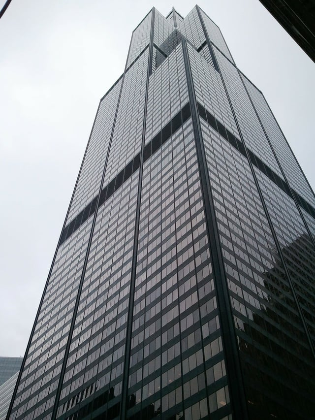

Chicago's iconic Willis Tower, formerly known as the Sears Tower, is slated for its first upgrades since 1985 and Burnham Nationwide is contributing our services throughout the redevelopment process. The Chicago division’s involvement is multifaceted and includes all aspects of a large redevelopment: assisting with pre-construction processes, expediting the main building permits, and filing the required permits for tenant remodeling during the redesign.  
Construction of the Willis Tower was completed in 1973 and at 1,450 feet and 108 floors, it was the tallest building in the world until 1993. The structure remains the second-tallest skyscraper in the United States and attracts 1.7 million visitors per year to its Skydeck observation area. Given both the historical significance and present-day draw of the structure, redevelopment projects of this scale require efforts that extend far beyond just the construction phase. Burnham’s project managers have been involved with relocating current tenants, reconfiguring infrastructure to accommodate the construction process, and relocating entrances as part of the “re-positioning” phase in order to allow for public occupancy of the skyscraper as much as possible during construction.

## Redesign Will Revitalize Indoor and Outdoor Spaces

The redesign was [recently reviewed](https://www.gensler.com/projects/willis-tower-repositioning) by the Chicago Tribune's architecture critic Blair Kamin, who has shed light on some of the new features coming to the tower. The upgrade has been designed by Gensler’s Chicago office and alters existing entrance features designed by the structure’s original architect, Skidmore, Owings, and Merrill. Kamin believes that the changes "should make Willis more welcoming to passers-by and could enliven the now-dull South Wacker Drive office canyon" with design elements that include a new pedestrian pavilion, three floors of retail space, and a public green area atop the addition. The retail space includes a proposed winter garden situated on Jackson Boulevard that will replace the elevated plaza currently encircling the structure as well as changes to the tower’s above- and below-ground entrances. The redesign will address the functionality issues with the existing plaza, one of the features constructed in 1985, where “portions of the plaza’s red granite surface are actually slanted, making it difficult to set down a chair.”

Additional changes include 150,000 square feet of new tenant amenities such as lounge areas, a fitness center, a café, and expansion of the existing Skydeck observation area located on the Willis Tower’s 103rd floor to include the 102nd floor. Kamin predicts that "the scope of the project suggests it could make a significant impact" for both leasability of the tower and for public use, further opining that the "retail structure is respectful of Willis' powerful architecture" while creating a more inviting streetscape.

Blackstone Group and Equity Office, responsible for the redevelopment, have plans for alterations to the skyscraper's Skydeck attraction that may include new features such as an additional [ledge](https://www.bisnow.com/chicago/news/mixed-use/blackstones-willis-tower-renovations-may-radically-tranform-skydeck-72439?utm_medium=email_share&utm_source=newsletter) that allows visitors to walk the exterior of the building while clipped to a safety harness, and the construction of a rappel line from the 103rd to 102nd floor. The line would be enclosed by glass and would compliment the existing glass observation area.

[Crain’s Chicago](http://www.chicagobusiness.com/realestate/20170222/CRED03/170229968/willis-tower-upgrades-set-the-table-for-national-restaurant#utm_medium=email&utm_source=ccb-realestatereport&utm_campaign=ccb-realestatereport-20170222) has reported that the redevelopment has a budget of $500 million and that the building is currently 85% leased, however the redesign’s focus on tenant amenities has increased interest in the building and has prompted the National Restaurant Association to relocate their Chicago office to the Willis Tower with talks in progress with additional tenants.

## Moving Forward with the Construction Process

The Willis Tower redesign is now entering the main permitting process and Burnham is currently active in permitting the superstructure as well as filing the permits through all remaining City of Chicago Departments to complete the main construction permitting process. With construction scheduled to begin by June 2017, work of this scale requires expertise at every level and Burnham Nationwide is proud to assist with permitting for Chicago architecture's icon.

<em>This post was updated on March 24th, 2017.</em>
