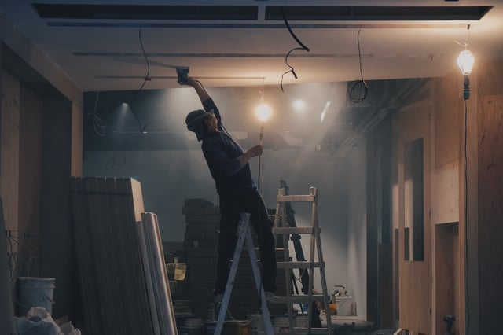

The United State Environmental Protection Agency’s (EPA’s) development of rules to address lead-based paint renovation, repair, and painting in public and commercial buildings has been a complex and contentious process. The Agency’s work on the rules has been significantly impacted by industry and public interest group litigation. Now, the Trump administration’s policies may also affect the regulation of lead paint renovation activities in non-residential buildings. The rules’ status has important implications for building owners and managers, contractors, developers, and anyone else involved in building maintenance and renovation.

<em>photo by [Hengstream](https://unsplash.com/@hngstrm)</em>

## Creation of the Original Lead RRP Rule

A number of federal agencies regulate lead exposure to protect against health hazards, especially during childhood, that are linked to adverse health effects such as diminished cognitive ability and behavioral changes. In 1977, pursuant to the Consumer Product Safety Act, the U.S. Consumer Product Safety Commission passed [regulations prohibiting](https://www.ecfr.gov/cgi-bin/text-idx?tpl=/ecfrbrowse/Title16/16cfr1303_main_02.tpl) the use of lead-containing paints for products manufactured after February 27, 1978.

[Title IV of the Toxic Substances Control Act](https://www.law.cornell.edu/uscode/text/15/chapter-53/subchapter-IV) (TSCA), added to to the statute by the Residential Lead-Based Paint Hazard Reduction Act of 1992 (15 U.S.C. §§ 2681-2692), gives EPA authority to regulate contamination from lead-based paint used prior to the 1978 ban. TSCA § 402(c)(3) specifically requires EPA to regulate the renovation and remodeling of “target housing, public buildings constructed before 1978, and commercial buildings.” 42 U.S.C. § 2682(c)(3). TSCA defines target housing as pre-1978 constructed housing with some exceptions.

In 2008, EPA issued regulations governing the renovation of target housing and child-occupied facilities likely to disturb lead-based paints, the Lead Renovation, Repair, and Painting (RRP) Rule, [40 CFR Part 745, Subpart E](https://www.ecfr.gov/cgi-bin/text-idx?SID=cd05f748c481fd0ec85ffb94b9193066&node=sp40.31.745.e&rgn=div6), that became effective April 22, 2010 (extended to October 1, 2010). Child-occupied facility is defined in § 745.83 as a pre-1978 constructed building or portion of a building, including a public or commercial building, visited by a child under six at least twice a week for three hours per day, combined weekly visits of six hours per week, and 60 hours per year.

The 2008 Lead RRP Rule contains specific training, certification, and accreditation requirements for those renovating covered buildings. Additionally, the rule includes detailed work practice standards provided at § 745.85 and recordkeeping and reporting requirements stated at § 745.86.

## Legal Challenges to Lead RRP Rule

A number of parties representing different interests filed petitions for review soon after the final Lead RRP Rule’s publication. Environmental and health public interest groups brought legal challenges, in part, because the new rule did not protect against lead hazards resulting from non-residential buildings. The cases were eventually consolidated into *National Association of Home Builders v. EPA* (No. 08-1258) before the Court of Appeals for the District of Columbia.The public interest parties and EPA entered into a [2009 settlement agreement](http://nchh.org/Portals/0/Contents/RRP_Settlement_Agreement_Signed_8-24-09.pdf) (Settlement Agreement) that required EPA to undertake four different rulemakings to address the issues raised in the lawsuits.

Two of the rulemakings required by the Settlement Agreement were standards for the RRP of the exterior and interior of public buildings constructed pre-1978 and commercial buildings. EPA was to propose work practice standards for exterior renovations of non-residential buildings and publish a final rule by July 15, 2013. With respect to the interior renovation of non-residential buildings, EPA was to evaluate the risk of lead-based paint. Unless EPA concluded that these activities do not create a hazard, EPA was to propose work practice standards. The Settlement Agreement provided the option to combine the exterior and interior standards into one rulemaking.

On May 6, 2010, EPA published in the Federal Register an [Advance Notice of Public Rulemaking for the Lead RRP Program for Public and Commercial Buildings](https://www.gpo.gov/fdsys/pkg/FR-2010-05-06/pdf/2010-10097.pdf#page=1) explaining that EPA planned to begin the process of proposing safe practices for the renovation of exteriors of non-residential building and deciding whether lead-based paint hazards result from interior renovations.

Industry groups raised concerns that a lead RRP program for public and commercial buildings would result in unnecessary costs for businesses and requested that more in-depth data be collected with respect to the potential risks of lead exposure during renovation. A 2012 [amendment](http://www.nchh.org/Portals/0/Contents/RRP-Revised-Settlement-9-7-12.pdf) to the Settlement Agreement combined the standards for the interiors and exteriors of non-residential buildings into one rulemaking and pushed back the deadlines for rulemaking milestones.

During subsequent years, EPA engaged in a number of activities to work toward acquiring all the necessary data. In 2014, EPA [made available](https://www.gpo.gov/fdsys/pkg/FR-2014-08-06/pdf/2014-18357.pdf) for public review and comment the Agency’s methodology for evaluating the lead hazards posed by the renovation of public and commercial buildings.

## Status of the Rule for Public and Commercial Buildings

EPA had most recently agreed to propose standards by March 31, 2017, if the RRP activities in non-residential buildings were found to create a lead-based paint hazard. However, EPA will not be meeting that deadline given the litigation and complexities involved in assessing the effects of RRP work.

Currently, EPA is [surveying](https://www.burnhamnationwide.com/hubfs/2017_PDFs/NY_Lead_v__EPA_Status_Rpt_8_22_17.pdf) different building industry sectors about renovation activities in public and commercial buildings to determine the extent to which these work practices may result in lead exposure. Detailed surveys have been sent out in phases so adjustments can be made before the next group of surveys is sent out, and the process is expected to progress through 2017.

EPA is also continuing the Agency’s work in developing a methodology for determining the exposure and health risks posed from lead during public and commercial building RRP. The Agency does not have a projected date for the Notice of Proposed Rulemaking for the Lead RRP Program for Public and Commercial Buildings, but it is not expected to be published for at least another year. Once the rule is proposed, the creation of a final rule is likely to be a lengthy process. Also, it should be noted that EPA is facing other [legal challenges](http://earthjustice.org/sites/default/files/files/lead-petition.PDF) to its lead standards that could affect rule development.

## Impact of Recent Executive Orders and Proposed Federal Budget

The Trump administration issued a series of Executive Orders earlier this year to reduce the number and cost of regulations. [Executive Order 13777](https://www.whitehouse.gov/the-press-office/2017/02/24/presidential-executive-order-enforcing-regulatory-reform-agenda) calls upon federal agencies to assess existing regulations and make recommendations “regarding their repeal, replacement, or modification.” This past spring, EPA [provided](https://www.federalregister.gov/documents/2017/04/13/2017-07500/evaluation-of-existing-regulations) opportunity for public input on the regulations that should be considered as falling under Executive Order 13777’s mandate.

Industry groups [responded](http://www.boma.org/SiteCollectionDocuments/FINAL%20EPA%20Reg%20Evaluation%20Comments%20from%20Real%20Estate%20Industry%20FILED%2005-15-17%20\(002\).pdf?_zs=1wwvF1&_zl=F8nn3) with calls for an end to EPA’s effort to develop rules for lead RRP in public and commercial buildings. They argue that EPA has failed to make a finding that RRP work in non-residential buildings results in a lead hazard that requires regulation. However, public interest groups assert that halting the development of these regulations will endanger children and others.

Concern has also been [raised](http://www.nchh.org/Portals/0/Contents/Congressional-Senate-Letter_5-25-2017.pdf) about the proposed federal budget cuts that would eliminate many existing programs preventing lead exposure, including the EPA training program for proper lead-based paint removal practices that were created by the original Lead RRP Rule.

As EPA continues to work on the lead RRP rule for public and commercial buildings, it should be noted that some states (for example, California) have their own lead renovation requirements that are more stringent than the federal rules and are not limited to residential buildings.
