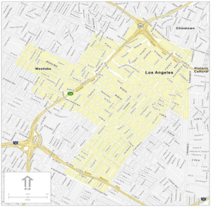

Across the country, municipalities limit construction activity, building permit issuances, or street closures during certain dates and times through November and December. This is done to promote full access to retail stores, restaurants and other businesses by the public.

The Los Angeles Bureau of Engineering has reduced the parameters and adjusted dates due to the reduction in holiday activities; providing contractors an opportunity to complete work in areas that would've otherwise be heavily trafficked.

<strong>Los Angeles Holiday Moratorium Dates 2025: </strong> 

-   November 26 - 30
-   December 5 - 7
-   December 12-28
-   January 1, 2026

During this time, the City of Los Angeles prohibits construction work in the public right of way including lane closures, unless the project is approved for a Holiday Moratorium Exemption (HME.) [Review the document here](https://apps.engineering.lacity.gov/holiday_moratorium/docs/No13_Notice.pdf) for additional details including Moratorium restrictions, limitations and filing methods. 

In some cases, these holiday restrictions may be waived for short-term work such as a service connection, a public safety emergency or for an activity the Council District deems "Business Friendly" or a necessity. For complete LA Holiday Moratorium Information [visit this page.](https://apps.engineering.lacity.gov/holiday_moratorium/docs/No13_Notice.pdf)

As always, the Burnham Nationwide team is available to answer any questions on moratorium procedures or to assist with the application process for waivers in our offices throughout the country.

What are the LA Holiday Moratorium dates for this year? The Bureau of Engineering hasn't published the 2026 dates yet — they're typically released closer to the season. Based on the recurring pattern, expect several separate windows rather than one continuous block: roughly the week of Thanksgiving, a few days in early-to-mid December, then a longer stretch from mid-December through New Year's Day. Why does LA split its moratorium into multiple separate date ranges instead of one continuous period? It's designed around when retail and shopping traffic peaks: Thanksgiving week, weekends leading into Christmas, and the stretch right up through New Year's — rather than blanketing the entire six-week period, the city carves out the specific high-traffic windows when construction would cause the most disruption. What's a Holiday Moratorium Exemption (HME) and how do I get one? An HME is the formal approval needed to perform non-emergency construction work in the public right-of-way during moratorium dates. You file through the LA Bureau of Engineering's dedicated holiday moratorium portal, and approval depends on factors like whether the work is a short-term necessity, a public safety issue, or something the local Council District deems "business friendly." Does the moratorium apply to all construction citywide, or just certain streets? It applies to a specific list of streets published each year by the Bureau of Engineering — generally major retail and commercial corridors — rather than every street in the city. Always check the current year's street list rather than assuming last year's restrictions still apply. Is emergency repair work allowed during the LA moratorium? Yes, public safety emergencies and short-term necessities like service connections are generally exempt from the restriction, though documentation or notification requirements still typically apply.
