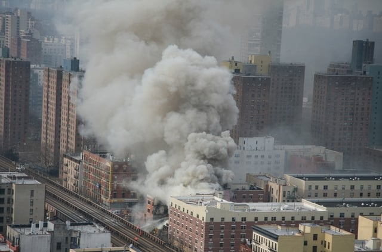

New York City’s Mayor de Blasio [signed legislation](https://www.youtube.com/watch?v=-v5i6noJqPk) yesterday responding to a number of recent horrific New York City gas explosions.The blasts, resulting in deaths and injuries, brought to light some major problems with the city’s system for installing and inspecting gas connections. The ten new laws use a multifaceted approach to increasing the safety of New York City’s gas infrastructure.

## Events Leading up to New Legislation

Eight people were killed in an East Harlem gas explosion that also demolished two buildings and injured many in March of 2014. A National Transportation Safety Board [review](http://www.nytimes.com/2015/06/10/nyregion/consolidated-edison-is-largely-liable-in-deadly-east-harlem-explosion-regulators-find.html?) blamed both Con Edison and New Yorking City for the explosion. The blast was due to a gas leak resulting from Con Edison’s improper welding of two gas pipes. Also, the city’s failure to repair a damaged nearby sewer line was a contributing factor. In addition to the many lawsuits filed by victims of the disaster, Con Edison sued New York City for its role in causing the blast.

In March of 2015, a gas explosion in the East Village causes two deaths, dozens of injuries, and the destruction of three buildings. Five people, including the landlord, were eventually arrested and charged. An illegal connection to the neighboring building’s gas line, kept hidden from Con Edison inspectors, caused the explosion. In addition to creating the unsafe conditions, two of those responsible failed to notify anyone once they became aware of the gas leak. Also, a master plumber allowed his license to be used by a subcontractor who certified the gas system was properly installed.

Earlier this year, 36 people whose apartments were destroyed in the East Village explosion brought a lawsuit against Con Edison, New York City, and others. Amongst the issues raised in the case is the city’s [“illogical and antiquated system of enforcement, inspections, and . . . self-certification”](http://nypost.com/2016/10/10/city-claims-immunity-in-17m-east-village-explosion-lawsuit/) for gas connections.

There were also several other gas explosions in 2015, and an illegal gas connection in the [Bronx resulted in a house explosion](http://www.ny1.com/nyc/all-boroughs/news/2016/09/29/deadly-bronx-house-blast-latest-.html) this past September. A Fire Department of New York Battalion Chief was killed by airborne debris from the blast.

These cases and other instances of illegal gas hookups have resulted in a new focus on New York’s system for ensuring the safety of gas connections. It became evident that the New York Department of Buildings (DOB) needs to increase inspections and improve communications with gas utilities. Also, the city’s self-certification program allowed plumbers performing illegal and unsafe gas connections to avoid detection.

## End of Gas Systems Self-Certification Program

New York City previously allowed licensed master plumbers to [certify that a gas system](https://www1.nyc.gov/assets/buildings/ppn/oppn394.pdf) was installed in accordance with the New York City Administrative Code. Self-certified gas systems were only randomly inspected by DOB.

Last spring, DOB Commissioner Chandler [announced](http://www.nydailynews.com/new-york/city-inspectors-closer-gas-connections-article-1.2597044) that DOB would phase out the self-certification program. Instead, DOB inspectors will check every system before the gas is turned on. The removal of the self-certification program was to be phased in for the different city boroughs starting with Manhattan this past summer but was delayed. A [notice was finally published](https://www1.nyc.gov/assets/buildings/pdf/gas-test-n-finish-self-cert.pdf) last month stating the self-certification gas test and finish program ended in Manhattan effective November 22, 2016, and a DOB inspection is required.

## Overview of New Laws

As noted by the Mayor at yesterday’s signing, the legislation improves gas system safety in a number of different ways. Several of the new laws strengthen the city’s system for installing and maintaining gas lines, including oversight of work on gas systems. Some of the other bills focus on better communication between tenants, building owners, gas utilities, and DOB. The remaining legislation seeks to improve New York City’s knowledge about its gas infrastructure to increase safety.

The majority of the ten amendments to the New York City administrative code signed yesterday were introduced in the City Council in February of 2016. Hearings on the legislation were held this past April and November. Based on comments received, revisions were made to some of the bills before the City Council unanimously approved the amendments on November 16th and sent them to the Mayor for signature.

The following is a brief summary of the new laws: 

-   New stricter qualifications for those who can work on gas piping systems starting January 1, 2020 - [No. 0738A](http://legistar.council.nyc.gov/LegislationDetail.aspx?ID=2253265&GUID=982A9657-F8BE-4BD1-95BC-AE429F490DDB)
-   Requires DOB to perform the final inspection of all gas piping systems effective January 1, 2018, and eliminates the need for self-certification - [No. 1079A](http://legistar.council.nyc.gov/LegislationDetail.aspx?ID=2253265&GUID=982A9657-F8BE-4BD1-95BC-AE429F490DDB)
-   Requires building owners to arrange for periodic inspections of existing gas piping systems performed by a licensed master plumber or someone the plumber supervises beginning January 1, 2019 - [No. 1088A](http://legistar.council.nyc.gov/LegislationDetail.aspx?ID=2576393&GUID=1E92C4E1-6EED-4658-88EB-4AFF161BED78)
-   The building owner shall provide tenants with instructions regarding actions to be taken when a gas leak is suspected - [No. 1090A](http://legistar.council.nyc.gov/LegislationDetail.aspx?ID=2576397&GUID=96B36893-E839-49BF-A632-160FC2343197)
-   A utility and building owner must notify DOB within 24 hours if the gas is shut off in a building due to safety issues - [No. 1093A](http://legistar.council.nyc.gov/LegislationDetail.aspx?ID=2576395&GUID=CC4EA262-C855-4376-9C4B-F3938263853E)
-   A designated city office or agency will identify gas safety risk factors and develop a report to help focus enforcement - [No. 1094A](http://legistar.council.nyc.gov/LegislationDetail.aspx?ID=2576396&GUID=92F89670-5273-4291-8DEC-449782CC2313)
-   Gas utilities will provide annual reports to the designated city agency or office and meet annually to discuss the reports - [No. 1098A](http://legistar.council.nyc.gov/LegislationDetail.aspx?ID=2576425&GUID=7116458A-9B57-48E6-B3AE-01B132CA86F2)
-   Requires DOB to adopt a natural gas detector standard based on an industry standard - No. [1100A](http://legistar.council.nyc.gov/LegislationDetail.aspx?ID=2576426&GUID=D9EE7190-AF91-411D-A017-8305FF6D6F0D)
-   Creates a gas violation resolution program allowing building owners a temporary grace period for bringing their gas installations into compliance - [No. 1101](http://legistar.council.nyc.gov/LegislationDetail.aspx?ID=2576424&GUID=A5DD1383-C52A-498F-B97B-BCF8E8005D3B)
-   Classifies as an “immediately hazardous” violation, considered a Class 1 violation, operating a gas piping system without a permit, notice to the utility, or an inspection - [No. 1102](http://legistar.council.nyc.gov/LegislationDetail.aspx?ID=2576423&GUID=C1C83DC4-52E6-403F-B826-E7AB6F436DBF)

## Phasing in the New Requirements

Mayor de Blasio stated at yesterday’s signing ceremony: “safety is our top priority and this legislation will help ensure that building owners will fix problems before they turn into tragedy.” However, the changes mandated by the laws will not happen overnight. Some of the new requirements will be phased in over the next several years. Also, DOB and other New York City agencies must still create rules and programs to implement parts of the legislation. However, the newly signed laws are an important first step in preventing the conditions that may lead to a gas explosion.
