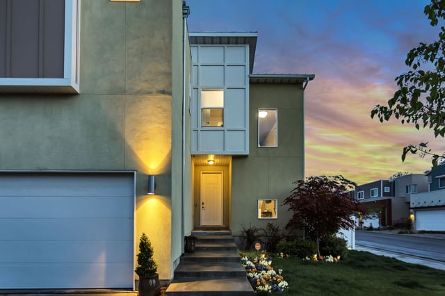

There has been a great deal of [press](https://www.nytimes.com/2018/05/09/business/energy-environment/california-solar-power.html) about California’s recently adopted mandate that all new homes must have solar power beginning in 2020. What has been missed is that this new rule supports California’s very progressive goal that all new construction attain net zero energy use for residential buildings by 2020 and commercial buildings by 2030.

<em>Photo by [Brian Babb](https://unsplash.com/@brianbabb)</em>

Net zero energy buildings consume no more energy than they produce with renewable energy sources. To achieve net zero energy use, such buildings must have a source of renewable energy, for example, solar panels and incorporate energy efficiency strategies. Thus, California’s new solar requirement is critical to fostering the adoption of net zero energy construction.

[Project Drawdown](/final-review-blog/burnham-nationwides-climate-change-drawdown-series/) ranks net zero buildings as Number 79 of its 100 solutions to global warming. However, the program [notes](http://www.drawdown.org/solutions/buildings-and-cities/net-zero-buildings) that net-zero buildings really bring together a variety of solutions that are analyzed individually by Project Drawdown such as “smart windows; green roofs; efficient heating, cooling, and water systems; better insulation; distributed energy and storage; and advanced automation.” California has been steadily moving towards achieving its net zero energy goals.

## Background to California Net Zero Energy Building Goals

The California Public Utilities Commission (Public Utilities Commission) adopted its first state-wide [Long Term Energy Efficiency Strategic Plan](http://www.energy.ca.gov/ab758/documents/EEStrategicPlan.pdf) (Strategic Plan) on September 18, 2008, setting forth California’s energy efficiency goals through 2020 or later. The Strategic Plan included as two of its four “Big Bold Energy Efficiency Strategies” the goals that net zero energy will be achieved in California for all new residential construction by 2020 and commercial construction by 2030.

The Public Utilities Commission’s [2013 Integrated Energy Policy Report](http://www.energy.ca.gov/2013publications/CEC-100-2013-001/CEC-100-2013-001-CMF.pdf) (2013 Report) notes the work of the Public Utilities Commission, the California Energy Commission (Energy Commission), and others to support the development of zero net energy buildings. The 2013 Report discusses the need to steadily increase the energy efficiency requirements of buildings with each update of the state building energy efficiency code to eventually reach net zero energy use as well as provide proper financial incentives and training for industry professionals.

In 2015, the Public Utilities Commission released the [Residential New Construction Zero Net Energy Plan](https://docs.wixstatic.com/ugd/cc790b_ee8ded2821d44adeb97e3a98fd625c22.pdf) (Residential ZNE Plan) which contains a detailed strategy for assuring the construction of new net zero single-family homes and low-rise multifamily buildings (3 stories or less) by 2020. The process for creating the Residential ZNE Plan included many opportunities for stakeholder involvement.

To facilitate attainment of residential net zero new construction by 2020, the Residential ZNE Plan outlines six goals and goal results that were incorporated into a timeline based on priorities:

-   Create awareness for builders and homeowners so they adopt net zero construction voluntarily before 2020;
-   Improve education and tracking for the workforce supporting net zero construction;
-   Provide a suite of technical tools for designers, builders, and developers;
-   Develop a way to value net zero homes to help with financing and affordability;
-   Improve the electrical grid infrastructure to support net zero homes; and
-   Collaborate across agencies to assure regulations, incentives, and codes are aligned to support net zero construction.

Many of the initiatives relating to these goals are completed or well under way.

## 2019 Building Energy Efficiency Standards

As part of the 2019 update to Title 24, Part 6, Building Energy Efficiency Standards (2019 Standards) that will go into effect January 1, 2020, changes were proposed in an Energy Commission [rulemaking](https://efiling.energy.ca.gov/Lists/DocketLog.aspx?docketnumber=17-BSTD-02) in January 2018. There was a public comment period that closed March 5, 2018, that included public hearings. After a round of revisions and additional public comments, the Energy Commission finally adopted the 2019 Building Energy Efficiency Standards after a hearing on May 9, 2018.

The 2019 Standards include the mandate that all new low-rise residential buildings must have solar panels or share in a solar photovoltaic system built for a set of homes beginning in 2020 (there are some exceptions). However, these standards also include new energy efficiency requirements. For example, the 2019 Standards update the thermal envelope standards and allow for the installation of technology to shift energy use to off-peak times. The combination of these energy efficiency standards and the solar energy requirement makes the attainment of net zero energy use in all new California low-rise residential buildings by 2020 much more likely.

The new standards also make improvements to the energy efficiency of commercial buildings that will help move the state closer to the goal that all new construction of commercial buildings will be net zero by 2030.

## Ongoing Work On Commercial Zero Net Energy Plan

The Public Utilities Commission released a draft [Commercial Zero Net Energy Action Plan](https://docs.wixstatic.com/ugd/cc790b_4632fea589974de79b4a7953bc7cdc19.pdf) (Commercial ZNE Plan) in December 2017. A prior Commercial ZNE Plan was finalized in June 2011, but the updated plan will align with changes to the market and state policies such as better integration of distributed energy resources into the grid and a decline in the cost of solar generation and energy storage. The new Commercial ZNE Plan will add zero net energy for “multi-building projects, campuses and large-scale developments.” The new draft also looks at how existing buildings can attain zero net energy use. California also has a goal that 50 percent of all existing commercial structures will achieve zero net energy use by 2030.

There are also aggressive requirements for state-owned buildings. California Governor Brown’s [Executive Order B-18-12](https://www.gov.ca.gov/2012/04/25/news17508/) (April 25, 2012), required all new construction of state-owned buildings or major renovations being designed after 2025 to be net zero energy. This included an interim requirement that 50 percent of such facilities have net zero energy use by 2020. Additionally, 50 percent of the square footage of existing state buildings should attain net zero energy use by 2025.

We look forward to participating in California’s move to net zero energy buildings and are excited to help project teams accomplish the State’s significant goals.
