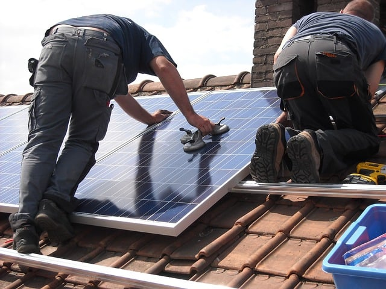

The [North American Board of Certified Energy Practitioners (NABCEP)](http://www.nabcep.org/) was founded in 2002 with a mission “to support, and work with, the renewable energy and energy efficiency industries, professionals, and stakeholders to develop and implement quality credentialing and certification programs for practitioners.” NABCEP is known as the gold standard for Photovoltaic (PV) certification programs. We at Burnham understand how important it is to ensure that PV systems are installed safely. In this post, we’ll share the background of the NABCEP, the three different certifications offered, and the benefits of certification for solar installers and consumers.

## History of the NABCEP

The NABCEP was designed to provide a certification program for solar professionals as well as consumers served by the solar industry. According to the NABCEP, “The NABCEP PV Installation Professional and Solar Heating Installer Certifications are accredited to the ISO/IEC 17024 standard by the American National Standards Institute (ANSI).”

The goals of the NABCEP certifications are to:

-   Promote renewable energy
-   Provide value to Solar Installation and Sales Professionals
-   Promote worker safety and skill
-   Promote consumer confidence

## Certifications Offered by the NABCEP

The NABCEP offers three different certifications: PV Technical Sales Certification, PV Installation Professional Certification, and Solar Heating Installer Certification. From 2010 until 2012, the NABCEP also offered the Small Wind Installer Certification. The program is no longer open to new applicants. However, existing certificants may continue to renew their certification every three years by documenting continued education and experience in the field.

#### PV Technical Sales Certification

The PV Technical Sales Certification is designed for salespeople, application engineers, financial or performance analysts, or site assessors. All candidates for the PV Technical Sales Certification must have experience selling PV systems, a specified level of training, and an OSHA ten hour construction industry card (or equivalent).

#### PV Installation Professional Certification

The PV Installation Professional Certification is designed for installers, project managers, foremen/supervisors, and designers. All candidates for the Solar PV Installation Professional Certification must have experience in the field acting as the person responsible for installing PV systems, a minimum of 58 hours of advanced PV training, and an OSHA ten hour construction industry card (or equivalent).

NABCEP Solar PV Installation Professional Certification is North America’s only renewable energy personnel certification that has been ANSI accredited to the internationally recognized ISO/IEC 17024 standard.

#### Solar Heating Installer Certification

The Solar Heating Installer Certification is designed for the person responsible for the system installation, like contractors, foremen, supervisors, and journeymen. All candidates for the NABCEP Solar Heating Installer exam must have experience in installing Solar Heating systems and a specified level of training or work experience.

## Benefits of NABCEP Certification

NABCEP certification ensures that solar industry practitioners have voluntarily met standards and qualifications and passed an exam. The certification programs provide benefits for both solar professionals and consumers.

For Solar Industry Professionals:

-   Certifications promote consumer confidence and differentiates the certificate holder from competitors.
-   Allows for installer mobility as the market moves from state to state.

For consumers:

-   Provides a means to identify qualified installers, promoting confidence in the work performed.
-   Preserves consumer choice, maintaining access to both certified and uncertified installers.

## Solar Training and Education for Professionals (STEP)

STEP is a training and education program from the U.S. Energy Department. According to [energy.gov](http://energy.gov/eere/sunshot/solar-training-and-education-professionals-step), the program “works to lower the soft costs of going solar, such as permitting, installation, and supply chain costs,” which make up more than half of the cost of installing solar energy.

STEP will provide innovative training and education programs for solar industry professionals as well as industries related to solar, including real estate, finance, insurance, fire and code enforcement, and state regulations to help meet President Obama’s goal to train 75,000 people in solar energy by 2020.

As part of the STEP funding program, which was announced in May 2016, the NABCEP was awarded over $1 million for their Personnel Certifications for the Design, Installation, and Maintenance of Photovoltaic Systems project. When completed, the project will develop three new industry-validated certifications for individuals working in PV operations and maintenance and in mid-scale PV system design and installation. NABCEP is also improving and updating the current PV Installation Professional Certification program.

Learn more about NABCEP certifications for solar installers at [www.nabcep.org](http://www.nabcep.org).
