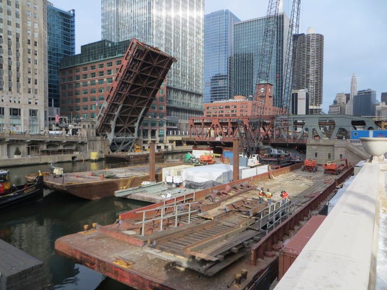

The majority of construction projects in the City of Chicago require Public Way Use Permits because the Windy City has so much public property. Thankfully, Burnham has extensive experience in navigating the permit process for our clients, and we thought it would be helpful to explain how to obtain a Public Way Use Permit.

## What is the Public Way?

The public way is any city property that allows for travel, including streets and sidewalks.The [City of Chicago](https://www.cityofchicago.org/city/en/depts/bacp/provdrs/public_way.html) states that if your business has anything that “extends over, under, or is on the public way,” it requires a Public Way Use Permit (Grants of Privilege). Canopies, awnings, signs, light fixtures, banners, and underground vaults are examples of elements requiring a permit if placed in the public way.

[Sidewalk Cafés](https://www.cityofchicago.org/content/dam/city/depts/bacp/businesslicenseforms/pwu/sidewalkcafepacket2016121815.pdf), the sale of food and liquor on the sidewalk, are also considered a public way use and require a Sidewalk Café Permit. This permit is required from March 1st through December 1st and must be renewed every year. Businesses seeking a Sidewalk Café Permit must also have a Retail Food License.

## Public Way Use Permits Require City Council Approval

The Chicago [Small Business Center](https://www.cityofchicago.org/city/en/depts/bacp/sbc/public_way_use_permits.html) (SBC) - Public Way Use Unit (PWU) is responsible for issuing Public Way Use Permits.To obtain the permit, both aldermanic and City Council approvals are required. First, the application must be submitted to the relevant alderman. After receiving the alderman’s approval, the application is transferred to the Committee on Transportation and Public Way (Committee). The application is sent to the City Council for passage after Committee approval. In lieu of submitting the application to the alderman, applicants may present a proposed ordinance directly to City Council.

In addition to a Public Way Use Permit, anything identifying the building, such as signs, awnings, canopies and banners, are required to have a Department of Buildings Sign Permit. Only a licensed sign contractor may apply to obtain a Sign Permit, and Chicago provides a [list of approved contractors](https://www.cityofchicago.org/dam/city/depts/bacp/pwusigns/listoflicensedsigncontractors.pdf).

The common practice is to apply for the Public Way Use Permit and Sign Permit at the same time using the [Bundle Permit Application](https://www.cityofchicago.org/content/dam/city/depts/bacp/businesslicenseforms/pwu/PWU_Bundle_Permit_Application-V.2.21.14.pdf). The SBC-PWU is located at City Hall, 121 N. LaSalle St., Room 800. For temporary use of the public way due to construction, applicants must obtain a Construction Canopy Permit from Chicago Department of Transportation, also located at Chicago City Hall.

## Information Needed for Permit Application

When Burnham receives a request from our clients to obtain Public Way Use Permits, we work to first secure the location, duration, and type of closure needed for their construction project, as all permits are billed by the City according to those responses. Once we have those items, we can inform our clients of the costs, feasibility of the closures, and what to anticipate during the permitting process.

The application process may take between 30-90 days from the time a complete application is submitted, and each permit is valid for five years. Along with the [application itself](https://www.cityofchicago.org/content/dam/city/depts/bacp/businesslicenseforms/pwu/PWU_Bundle_Permit_Application-V.2.21.14.pdf), one must include a copy of the business license certificate, photographs of the surrounding public way, plans, a certificate of insurance, and an acceptance letter acknowledging the terms and conditions relative to the issuance of the permit. It is important to be aware that City of Chicago has transitioned to an online system for submitting these applications.

We at Burnham are pleased to be able to assist our clients with complicated Public Way Use Permits and ensure their projects are completed smoothly. If you have any questions or concerns with your building project, please [contact us](/contact/).
