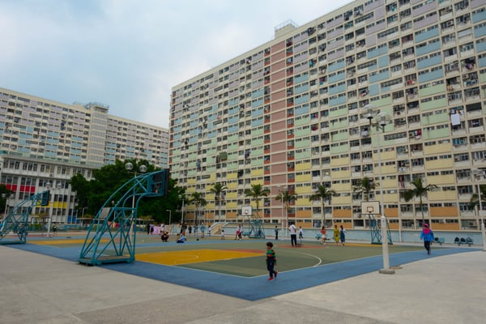
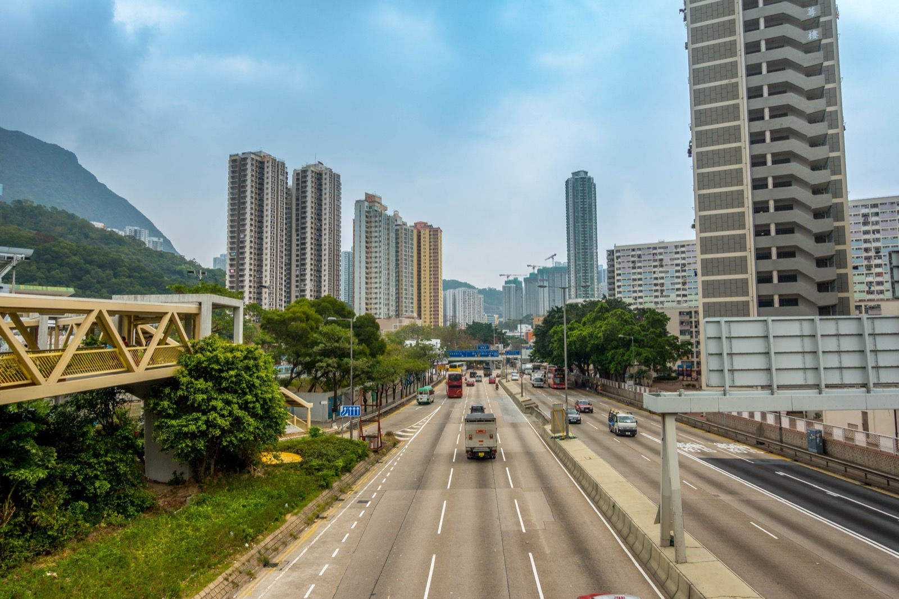

Many American cities are facing an affordable housing crisis that affects middle and low income families. Some cities and states are adopting laws and policies to encourage the private development of affordable housing. However, a more comprehensive public housing program, housing funded and administered by a government authority, would also help reduce the current shortage. In this post, we look at a few of the reasons public housing has encountered barriers in the United States and some public housing programs abroad.

<em>Choi Hung Public Housing Estate, Hong Kong by [Ben Silverman](http://www.bensilv.com/)</em>

## Current Approaches to Increase Affordable Housing

We have written blog posts about attempts to solve the affordable housing shortage in a number of major cities in the United States. Some of the solutions being tried are zoning changes, density bonuses, and tax incentives. Most notable is California’s adoption of a [group of laws](/final-review-blog/californias-new-affordable-housing-laws-impact-developers/) in 2017 that included additional funding for affordable housing development and restrictions on communities using zoning laws and other means to prevent affordable housing development.

In the last several years, Chicago created [several pilot programs](/final-review-blog/affordable-housing-chicago-adopts-new-developer-requirements/), San Francisco updated its [density bonus programs](/final-review-blog/new-san-francisco-density-bonus-laws/), and New York City adopted [historic zoning changes](/final-review-blog/historic-zoning-changes-new-york-city-zoning-for-quality-and-affordability/) to stimulate additional affordable housing development. However, all of these solutions ultimately rely on the willingness of private developers to build affordable housing.

## History of Public Housing in the United States

In a recent article in The American Prospect, [Why America Needs More Social Housing](http://prospect.org/article/why-america-needs-more-social-housing), Peter Dreier describes an alternative approach used abroad. We need what he terms “social housing,” affordable options “protected in perpetuity from market pressures.” Unfortunately, given the stigma associated with public housing in the United States due to its ugly history, government-owned or developed housing as a broader option has not been given serious consideration in recent years.

Richard Rothstein chronicles the history of racism in American public housing in his book [The Color of Law: A Forgotten History of How Our Government Segregated America](https://www.epi.org/publication/the-color-of-law-a-forgotten-history-of-how-our-government-segregated-america/). At its inception, United States public housing was largely for white working and lower-middle class residents. According to Rothstein, the federal government began building public housing that was segregated by race during the New Deal. Continued segregation policies at the federal and local level forced African Americans into public housing located in poor and high-density areas. Public housing for African Americans contained fewer amenities than projects for white families.

Over time, many white families moved from public housing as private housing was more readily available to them, and thus, public housing became associated with African Americans. As a result of critical decisions and policies at the federal and local level, including Congress’ inability to provide adequate funding, African American public housing residents, “became more removed from mainstream society than ever, packed into high-rise ghettos where community life was impossible, where access to jobs and social services was more difficult, and where supervision of adolescents and even a semblance of community policing was impractical.”

Litigation, such as [Gautreaux v. Chicago Housing Authority](https://www.bpichicago.org/programs/housing-community-development/public-housing/gautreaux-lawsuit/), helped to finally change public housing policy. Many of the older public housing projects were demolished and programs to scatter public housing throughout different neighborhoods were developed. However, despite this litigation and passage of the Fair Housing Act of 1968, [segregation in some public housing persists](https://www.nytimes.com/2018/04/07/opinion/sunday/americas-federally-financed-ghettos.html). Additionally, over the years, funding for public housing has diminished.

## Public Housing Abroad

Other parts of the world have robust public housing programs and use these programs to provide shelter for both middle and low income citizens.

### Vienna

In his article, Peter Dreier offers the programs in Vienna, Austria as an example of successful public housing. The Viennese government has owned or financed public housing since the 1920's. Today, Vienna has an absence of homelessness and rundown areas with a concentration of low income residents.

Importantly, government subsidized or owned housing is available to the middle class, and therefore, about 60 percent of Vienna’s population lives in public housing. The Vienna city government purchased large portions of land and employed leading architects to design housing projects. The first developments of the 1930’s were designed as communities with many amenities such as “kindergartens, nurseries, mothers’ advice centers, courtyards, health clinics, libraries, sports facilities, post offices, cooperative stores, bathhouses, cafes, meeting rooms, and gardens.”

Vienna’s public housing contains residents with a mix of income levels. “Unlike low-income subsidized housing in the United States, residents are not asked to leave if their incomes go up.” Over the decades, Vienna has been steadily adding to the government-owned and subsidized housing to respond to a growing need.

According to Dreier, “Every country in Western Europe has some version of social housing, but Vienna’s is by far the largest and most successful.”

### Hong Kong

About half of Hong Kong’s population lives in public housing. Most of the public housing consists of blocks of high-rise buildings, including many modern super-tall towers.

<em>Hong Kong Public Housing High-Rises by [Ben Silverman](http://www.bensilv.com/)</em>

The Hong Kong public housing program began in response to a [1953 fire that destroyed the squatter homes in the Shek Kip Mei](http://www.heritagemuseum.gov.hk/documents/2199315/2199693/Public_Housing-E.pdf) area of Hong Kong, rendering a large refugee population homeless. Hong Kong built two-story buildings in 1954 to start resettling the fire victims.

The government then began developing a public housing program to provide affordable housing and completed its first high-rises by 1957. According to the [Hong Kong Housing Authority’s website](https://www.housingauthority.gov.hk/en/about-us/public-housing-heritage/public-housing-development/index.html), the first self-contained public housing community was opened in 1971 with “shopping malls, schools, bus terminus and other community facilities.”

Today, the Hong Kong Housing Authority and Hong Kong Housing Society manage a complex web of public housing programs. The public housing developed by these two entities can be [rented or purchased with government provided subsidies](https://www.huduser.gov/portal/pdredge/pdr-edge-trending-081417.html). The programs range from rental public housing for low income families to what is known as “sandwich class” estates. These are buildings developed and managed by the government that have apartments that may be sold to “middle-income residents who don’t qualify for low-income public housing but cannot afford private housing.”

Despite Hong Kong’s large supply of public housing, there is still a shortage of affordable housing. Hong Kong’s real estate prices are the most expensive in the world, making private housing out of reach for a large share of Hong Kong residents. Adding to the problem is the fact that some public housing can even eventually be resold on the private market. There is [currently a big push](https://www.scmp.com/news/hong-kong/economy/article/2132130/extra-land-not-enough-solve-hong-kongs-housing-crisis-without) to create even more Hong Kong public housing to meet demand.

## Exclusionary Zoning Ordinances

Changing zoning laws to encourage private development of affordable housing in the United States is an important step but it needs to be undertaken on a larger scale. Our zoning laws also have a long history of being used to discriminate against certain races and classes.

As some have observed, class-based segregation has been on the rise as segregation by race has decreased. Exclusionary zoning laws that prevent the development of multi-family housing and/or small residential lots in some areas, have contributed to segregation and a lack of affordable housing in many urban areas. Richard Kahlenberg stated in a [2017 New York Times Op-ed](https://www.nytimes.com/2017/08/03/opinion/sunday/zoning-laws-segregation-income.html) that “To bolster the 1968 Fair Housing Act, we need a new ‘economic fair housing act’ to prohibit or discourage local ordinances that unnecessarily exclude people from entire neighborhoods and their schools.”

While eliminating exclusionary zoning ordinances is an important step in combating segregation and creating affordable housing, much more needs to be done to meet demand on the scale that is required. Perhaps some new forms of public housing should be considered to help reduce our affordable housing shortage.

Has the U.S. made any moves toward the kind of "social housing" model this post advocates for? Yes, more than a dozen U.S. cities have passed or proposed social housing legislation since 2018, with Montgomery County, Maryland and Seattle among the most active. Montgomery County's Housing Opportunities Commission has built thousands of mixed-income units using a model explicitly compared to Vienna's, while a 2024 Seattle ballot measure created a Social Housing Developer to build mixed-income publicly owned housing with no private developer required. What is Vienna's public housing model and why is it considered successful? About 60% of Vienna's population lives in government-owned or subsidized housing, available to both middle and low-income residents - residents aren't asked to leave if their income rises, which prevents income segregation within developments. The result is a city with very little homelessness and none of the concentrated poverty associated with American public housing. Why does U.S. public housing have such a different reputation than public housing in Vienna or Hong Kong? Largely due to deliberate policy choices - the federal government built racially segregated public housing during the New Deal era, concentrated African American residents in underfunded high-density projects, and then systematically defunded maintenance and operations over decades. The stigma traces directly to those discriminatory policy decisions rather than to public housing as a concept. Is exclusionary zoning still a major barrier to affordable housing in the U.S.? Yes, and it's receiving more federal attention than ever - HUD's PRO Housing program offers grants to communities that actively remove exclusionary zoning barriers, and the 2026 ROAD to Housing Act ties some localities' CDBG funding to housing production, creating incentives to reduce exclusionary practices. Is Hong Kong's public housing model still a useful reference point despite its political changes since 2018? The structural model - mixed-income high-rises integrated with retail, schools, and transit, run by a government housing authority - remains relevant as a planning concept, though Hong Kong's political situation has changed significantly since this post was written, and its housing shortage has actually worsened as real estate prices remain among the highest in the world.
