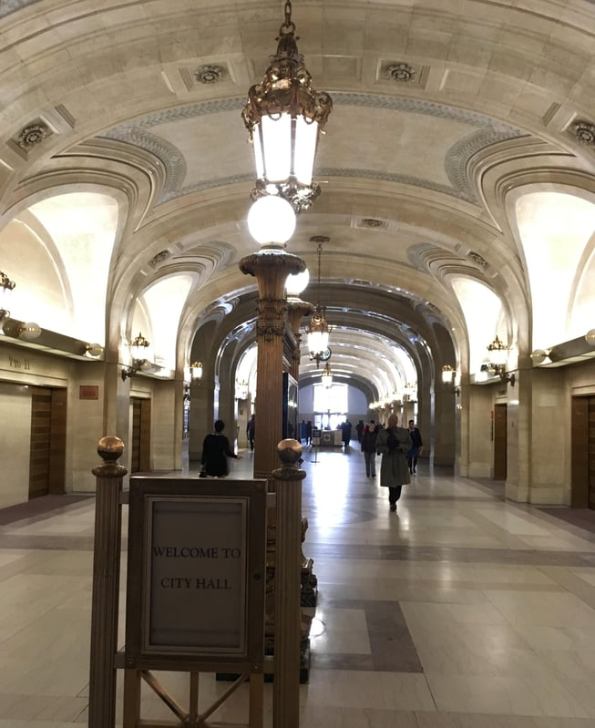

On March 29, 2017, the City of Chicago Department of Buildings (DOB) published new rules regarding the suspension of [building permit application privileges](https://www.cityofchicago.org/content/dam/city/depts/bldgs/general/Rules_Regs/SuspensionPermitApplicationPrivileges.pdf) and [licenses, registrations, and certifications](https://www.cityofchicago.org/content/dam/city/depts/bldgs/general/Rules_Regs/SuspensionRevocationLicenseRegCert.pdf) (Rules) by the department. These Rules implement [Ordinance 02016-8628](https://chicago.legistar.com/LegislationDetail.aspx?ID=2908017&GUID=78FF3E8F-8849-431F-B98E-1C3FAEA29C2B&Options=Advanced&Search=), amendments (Amendments) to the Chicago Municipal Code (Code) designed to increase the Building Commissioner’s (Commissioner) ability to suspend building permit privileges and licenses, registrations, and certifications of those who don’t follow the Codes’ requirements. The new Rules became effective on April 8, 2017.

## Relationship to Code Amendments

In a [prior post](/final-review-blog/chicago-department-of-buildings-takes-steps-to-prevent-building-code-violations/), we discussed the recent Amendments the new Rules are designed to carry out. Included in the Amendments are provisions that state the Commissioner may “suspend or revoke,” for professionals who play a role in the construction and building permit process, the ability to apply for a building permit or to hold a City license, registration, or certification. Two new Code sections, Sections 13-8-130 and 13-8-140, enumerate the conditions under which the Commissioner may take such action.

Importantly, if the privileges of a particular entity are suspended, the suspension applies to any “controlling person(s) of that entity.” Residential real estate developers, permit expediters, general contractors, crane operator, plumbers, electricians, and sign contractors are some of the professions affected by the new enforcement provisions.

The Amendments also add new Sections 13-12-060(b) and 13-32-045 that specify the Commissioner may remove the permit application privileges of architects, structural engineers, and permit expediters who submit “plans, drawings, or calculations” that don’t comply with the Code or such persons exhibit a “pattern” of failing to make corrections, meaning five or more times within a 12-month period.

## Highlights of New Rules

The Rules set forth the basis for suspension or revocation by referring back to the Amendments’ provisions. Additionally, the Rules state that the Commissioner “has elected to use progressive remediation.” However, immediate suspension or revocation may be imposed under conditions specified in the Rules, such as property damage or loss of $100,000 or more.

According to the Rules, there is a right to a preliminary hearing to contest the Commissioner’s decision before the suspension of privileges. The suspension or revocation is not effective until ten days from the date of the notice of suspension of privileges, and a request for a preliminary hearing must be filed with the Commissioner during this ten-day period. A preliminary hearing will be held within two business days of the date the request is received by the Commissioner.

It should be noted that the Amendments Section 13-8-150 also provides for a full hearing before the Commissioner for those who have lost a City license, registration, or certification. A written request for a full hearing must be filed within 45 days of the suspension or revocation.

The Rules refer to Amendments Section 13-8-130(b) regarding the full hearing process to contest the suspension of the ability to apply for building permits. Section 13-8-130(b) simply states that a person, “may file a written request with the Commissioner to contest the basis for the suspension.” If they do not agree with the Commissioner’s final decision, it may be appealed to a court.

The Rules also state that the DOB may “maintain a public listing” of persons whose permit application privileges or license, registration, or certification has been suspended or revoked.

## Procedure for Comment on the Rules

According to DOB’s website, public notice of the Rules was provided through publication in the Chicago Sun-Times on the date the Rules were signed, March 29, 2017. Anyone wishing to provide input needed to submit comments by April 7, 2017, the day before the rules became effective, by emailing DOB\_rules@cityofchicago.org. Unlike the federal and Illinois administrative procedure standards that normally provide a lengthier time period for public comments (a minimum of 45 days in Illinois), as well as time for review and incorporation of comments, the City of Chicago does not have such procedural requirements.

## Accessing the New Provisions

To provide access to the Chicago Building Code, DOB’s website links to American Legal Publish Corporation’s website. However, as of the publish date of this post, the link notes that it is only current through the Council Journal of September 14, 2016. Given that the ordinance containing the amendments was adopted on February 22, 2017, the Amendments are not currently available through American Legal Publish Corporation.

The only way to read the Amendments is by looking at the [text of Ordinance 02016-8628](https://chicago.legistar.com/LegislationDetail.aspx?ID=2908017&GUID=78FF3E8F-8849-431F-B98E-1C3FAEA29C2B&Options=Advanced&Search=&FullText=1) as it appears online in the City of Chicago Office of the City Clerk Legislative Information Center. The new Rules are currently only available through a [link on DOB’s website](https://www.cityofchicago.org/city/en/depts/bldgs/provdrs/stand_plan/alerts/2017/march/proposed-rules-regarding-suspension-of-permit-privileges-and-sus.html).
