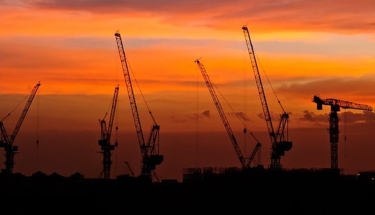
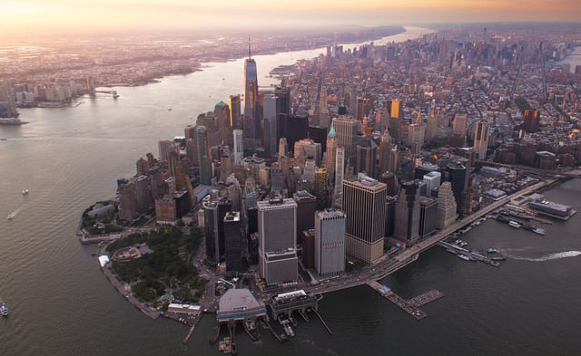

New York Mayor de Blasio signed into law [new construction noise](http://legistar.council.nyc.gov/LegislationDetail.aspx?ID=3086321&GUID=3AFD0A78-F3C1-4B03-8A2E-0E3E97E5815E) mitigation requirements on January 18, 2018. The legislation, sponsored by City Councilman Ben Kallos, is a response to the dramatic increase in complaints over that last few years, especially those resulting from after-hours construction noise. It is important to be aware of these new requirements that will impact the New York City construction industry.

## Prior Law Governing Construction Noise

In 2005, Mayor Bloomberg signed [Local Law 113](http://www.nyc.gov/html/dep/pdf/law05113.pdf), the New York City Noise Code, in order to establish updated standards to reduce noise, including setting decibel (dB) level thresholds. The 2005 law mandated that the Commissioner of Environmental Protection adopt rules mitigating construction noise and required the development of Construction Noise Mitigation Plans.

The construction-related rules implementing the new law were adopted in 2007 and are codified in [Title 15, Chapter 28](http://www.nyc.gov/html/dep/pdf/noise_constr_rule.pdf) of the Rules of the City of New York. They include the requirements for a construction site Construction Noise Mitigation Plan that is maintained at the site and subject to inspection. The rules also enumerate the different steps to be taken to minimize noise from specific types of tools and equipment.

An Alternative Noise Mitigation Plan may be required in circumstances when it is impossible to precisely comply with the rules. The rules also provide that construction equipment may only be used between 7:00 am and 6:00 pm weekdays unless special authorization is granted to work after hours, known as an after-hours variance (AHV). The New York City Department of Environmental Protection (DEP) may require additional steps to mitigate noise if an AHV is granted.

Other relevant rules are codified at [Title 15, Chapter 30](http://www.nyc.gov/html/dep/pdf/noise_minimal.pdf) and contain requirements for construction activities that are regarded as having a minimal noise impact.

DEP is responsible for implementing standards to prevent construction noise and responding to construction noise complaints. The New York City Department of Buildings (DOB) oversees construction permits, including those for after-hours work.

<em>Photo by [Brandon Jacoby](https://unsplash.com/@jacobybrandon)</em>

## Construction Noise Complaints Rising

New York City construction noise complaints have more than doubled from 2010 to 2015 according to an [audit](https://www.osc.state.ny.us/press/releases/aug17/083117a.htm) conducted by the Office of the New York State Comptroller and released in August 2017. With the increase of construction in the city, the resulting noise is significantly more problematic.

The majority of complaints during the audit period (January 1, 2014, to June 30, 2016) resulted from after-hours work: 74 percent of the total complaints. After looking at a sample of construction noise complaints that included locations with the greatest number of complaints, it was apparent that most of the noise came from locations that DOB granted after-hours variances.

For the same sample, the DEP inspectors reported for the vast majority of complaints that the noise was not excessive. Yet, the inspectors visited the source of the noise an average of five days after the complaint was filed. The auditors also found that:

When making decisions to grant after hours work variances, DOB officials did not consider construction noise complaints made to 311, nor did they consider construction noise citations issued by DEP. As such, DOB is allowing contractors to obtain continuing extension of existing AHVs or multiple AHVs for the same construction sites without critical review, which is a significant factor in the rise of complaints.

The New York State Comptroller made a variety of recommendations for DOB and DEP as a result of the audit. The proposed changes included items such as improving communication between DOB and DEP; shortening inspection response time; analyzing the 311 system data to determine which locations have multiple complaints; and updating the process for AHV issuance and renewal, including consideration of noise complaints for a construction project seeking an AHV.

It should be noted that developers and construction companies believe AHVs are essential to keeping projects on schedule when confronted with unforeseen delays. According to The Real Deal, [AHVs also help combat](https://therealdeal.com/issues_articles/the-after-hours-construction-boom/) the current shortage of skilled construction workers.

## New Construction Noise Law

The new requirements primarily focus on after-hours construction noise and add new sound level standards. The updated law also increases the places that noise readings may be taken to facilitate quicker inspector response times. To conduct a reading, inspectors are no longer dependent on getting access to the residence of the person complaining. 

DEP may now issue advisories or violations for sites that received an after-hours variance if the aggregate sound levels exceed:

-   7dB(A) above ambient sound level in a “residential receiving property dwelling unit” beginning January 2020 (currently 8dB(A);
-   The noise levels mandated by section 24-228(a) for sites more than 200 feet from an affected residential property;
-   75dB(A) when measured outside the property line or on a public-right-of-way 50 feet or greater from the source when the source is within 200 feet of the affected residential property beginning January 2020 (currently 80dB(A); or
-   85dB(A) for street construction noise when measured outside the property line or on a public-right-of-way 50 feet or greater from the source.

The updated noise construction law adds a new section on stop work orders that may be issued for violations of the sections pertaining to after-hours work and unreasonable noise levels, including the newly imposed levels for sites with after-hours variances. Such stop work orders can be issued verbally or via site posting along with also being served on or mailed to the site owner, lessee, or occupant.

## New Legislation Also Includes DEP Changes

In response to the many after-hours complaints, the law also requires DEP to adopt new rules that specify inspection times to assure that the inspection is conducted close to the time of the complaint or when the noise is most likely to be repeated.

The new law also requires greater transparency from DEP. The department must now publish on the city’s website its method for measuring noise levels when conducting inspections. Additionally, DEP is required to annually prepare reports for the mayor, city council, and website. The report must contain information for the prior year listed in the new law such as the numbers of DEP inspectors, complaints, after-hours noise complaints, violations issued, and approved alternative noise mitigation plans.

Construction Noise Mitigation Plans and applications for Alternative Noise Mitigation Plans must now be filed electronically with DEP. A companion [piece of legislation](http://legistar.council.nyc.gov/LegislationDetail.aspx?ID=2858229&GUID=21B486A2-BF64-4C7D-A858-5707A07AA2E9) requires DEP to make all noise mitigation plans viewable by the public on the city’s website.

Also, it is now possible to apply for an Alternative Noise Mitigation Plan after construction has begun if it can be shown that all reasonable measures have been taken, “but aggregate sound levels from the site exceed or are reasonably anticipated to exceed one or more the applicable limits.”

The new law is effective July 17, 2018, 180 days from the date it was signed (January 18, 2018). DEP must still promulgate new rules governing inspection timeframes.

It will take several years to clearly determine the extent to which the new law helps to reduce construction noise complaints and whether it adversely impacts the pace of New York City construction.

<em>DEP provides helpful construction noise related information and documents on its [Noise Codes & Complaints website page](http://www.nyc.gov/html/dep/html/noise/index.shtml), including a [guidance document](http://www.nyc.gov/html/dep/pdf/construction_guidance.pdf) detailing construction noise control products and vendors.</em>
