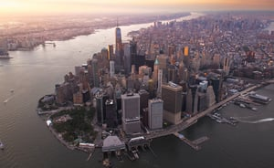

New York City’s Energy Conservation Code will come into effect on May 12, 2020 to coincide with the New York State’s Energy Code. The environmental goal is to continuously improve buildings’ energy efficiency with the intention to meet the 80% greenhouse gas reduction by 2050. These new requirements are in keeping with the City’s commitment to combat climate change.

**New York State Adopts 2020 Energy Conservation Code**  
Burnham’s New York office [summarized the most recent changes](/final-review-blog/updated-new-york-city-energy-conservation-code/) to New York State Energy Code in 2016 when the New York State Fire Prevention and Building Code Council voted to update the Energy Conservation Construction Code of New York State (ECCCNYS). The State of New York works to incorporate the most recent version of the International Energy Conservation Code (IECC) as it’s revised on a three-year cycle.

The new ECCCNYS will include derivative work from the 2018 edition of the International Energy Conservation Code (IECC) published by the International Code Council (ICC). The New York State Energy Research and Development Authority (NYSERDA) developed [NYStretch](https://www.nyserda.ny.gov/All-Programs/Programs/Energy-Code-Training/NYStretch-Energy-Code-2020) as a statewide model code for New York jurisdictions to use to meet their energy and climate goals. It supports energy reduction goals by accelerating the savings obtained through their local building energy codes. Jurisdictions that adopt the model code are incentivized with savings of roughly 11% over the 2020 Energy Conservation Construction Code of New York State (2020 ECCCNYS) when that energy code is released by New York State Department of State.

**New York City Adopts Energy Conservation Code**

New York City is authorized by the New York State Energy Law to enact its [own energy code](https://www1.nyc.gov/site/buildings/codes/2020-energy-conservation-code.page), provided the City’s code is more stringent than the requirements for New York State, codified in the New York State Energy Conservation Construction Code (NYSECCC). Since 2009, the New York City Energy Conservation Code(NYCECC) has regulated energy consumption in New York City buildings.

In June 2017, Mayor de Blasio issued the [Climate Action Executive Order](/final-review-blog/new-york-city-takes-bold-steps-to-meet-paris-climate-agreement/) stating that New York City would adopt the goals of the Paris Climate Agreement and directing city agencies to develop plans for reducing greenhouse gas ((GHG) emissions, leading to consecutive [stringent](/final-review-blog/new-york-city-laws-to-increase-energy-efficiency/) energy codes.

The Department is mandated by [Local Law 85](https://www1.nyc.gov/html/gbee/html/plan/ll85.shtml) to submit to the New York City Council proposed amendments to this code to bring it up to date with or exceed the latest edition of the NYSECCC. It must follow any revision of the NYSECCC that establishes more stringent requirements than those imposed by this code and no later than the end of the third year after the effective date of the code.This will help ensure that New York City maintains an updated Energy Code far into the future.

**Updated Energy Grades**

The energy efficiency grading scale was adjusted by [Local Law 95](https://www1.nyc.gov/assets/buildings/local_laws/ll95of2019.pdf) in 2019 to better mandate that a building receives an energy efficiency letter grade based upon the building’s energy benchmarking score generated by the United States Environmental Protection Agency’s ENERGY STAR [Portfolio Manager®](https://www.energystar.gov/buildings/facility-owners-and-managers/existing-buildings/use-portfolio-manager). The letter grades are assigned based Grades are based on Energy Star scores:

A: 85 or Above

B: 70 - 84

C: 55 - 69

D: 0 - 54

F: Buildings that don’t submit required benchmarking information

N: Buildings exempted from benchmarking or not covered by the Energy Star program

The law also includes a requirement for the Department of Buildings to annually conduct spot audits of benchmarking information. This important addition will limit the temptation to tamper benchmarking data.

The energy code is ever-evolving as we heed the call to mitigate the effects of climate change. Burnham has an excellent in-house [Building and Energy Code Team](/what-we-do/code-consulting/) that can answer your specific questions or conduct a more comprehensive evaluation and provide you with an action plan to make sure you’re in compliance and ensuring we’re all being good stewards of our planet.

Is the energy code described in this post (effective May 2020) still the current NYC Energy Code? No - that 2020 NYCECC has now been superseded. The 2025 NYC Energy Conservation Code took effect March 30, 2026, after the City Council adopted it in December 2025. Projects filed before March 30, 2026 are still reviewed under the 2020 code, but anything filed after must comply with the new, stricter 2025 edition. What's the most significant change in the new 2025 NYCECC compared to the 2020 version? The clearest shift is around fossil fuels - while the 2020 NYCECC generally allowed efficient gas-fired systems, the 2025 NYCECC expressly prohibits fossil fuel combustion systems in new construction (with limited exceptions), pushing strongly toward heat pumps and electric water heating instead.  How much more energy-efficient is the 2025 NYCECC expected to be? It's projected to deliver roughly 10-15% additional energy savings compared to the 2020 code, depending on building type - building on top of the 2025 ECCCNYS state baseline, which itself incorporates the 2024 IECC and ASHRAE 90.1-2022. Does the new energy code apply to renovations, or just brand-new buildings? Both - Alteration Type-1, -2, and -3 applications (covering significant renovations) are subject to the 2025 NYCECC just like new construction, so it's not limited to ground-up projects. Are the energy efficiency letter grades (A through F) described in this post still how NYC grades buildings? Yes - that benchmarking and letter-grade system, established under Local Law 95, remains the current framework for grading buildings based on their ENERGY STAR Portfolio Manager score, independent of this newer energy code update for new construction and major renovations.
