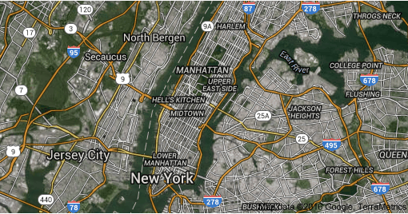

Solar mapping is an important tool for encouraging the adoption of solar. The number of solar maps for different communities has been steadily growing in recent years. These solar maps serve a variety of functions and incorporate different types of data. I have always found it interesting to analyze information that is overlaid on a map. In this post, we will take a closer look at two leading examples of solar maps, the New York City Solar Map (NYC Solar Map), and the soon to be released New York State Solar Map (NY Solar Map).

## The Benefits of Solar Maps

A solar map is an interactive tool that sits on the Internet. It provides information based on meteorological, topographical, and financial data that are integrated into the map. The most common solar maps are created for municipalities.

Solar mapping can help homeowners, businesses, and communities determine the potential for solar at a particular location. They can also inform policy decisions relating to solar development. In addition to estimating the amount of solar energy that may be generated at a chosen property, solar maps may also provide information about the possible cost of a site-specific solar installation and its energy cost-savings. Some solar maps contain a tool for drawing a solar rooftop system’s design at a particular location. The maps can also help determine the best placement options based on area shading and other factors. Frequently, solar maps include information about financial incentives and local solar permit requirements.

## New York City Solar Map

The development of the [NYC Solar Map](http://www.nycsolarmap.com/) was coordinated by Sustainable CUNY of the City University of New York, and it is part of Sustainable CUNY’s larger program to facilitate the adoption of solar in [New York City](/final-review-blog/a-progressive-approach-to-solar-in-new-york-the-solar-ombudsmen/) and [New York State](/final-review-blog/the-solar-ombudsmen-part-ii-expanding-their-successful-approach-to-solar-in-new-york-state/). The NYC Solar Map was first displayed on June 16, 2011.

The software used in the NYC Solar Map was developed by CUNY’s Center for Advanced Research of Spatial Information along with help from CUNY’s College of Staten Island High Performance Computing Center. The United States Department of Energy (DOE) program, Solar American Cities, and the New York State Energy Research and Development Authority (NYSERDA) provided funding for the map.

The NYC Solar Map incorporates a variety of different technology and data. For example, the map determines the potential rooftop solar output for a specific location using a combination of topographical and meteorological data. Some of the necessary topographic information is provided by Light Detection and Ranging (LiDAR). The LiDAR data, collected by planes, uses a pulse of light to gather information resulting in three-dimensional models reflecting an area’s shape and other surface characteristics. It is considered the most accurate way to determine shading for solar mapping purposes. The solar map also uses meteorological data from the National Renewable Energy Laboratory (NREL), as well as NREL’s solar modeling tool, PVWatts, that calculates the energy produced by a system. ESRI’s topographic map and solar model are also used.

## NYC Solar Map Features:

-   A Zoom to Borough tool allows one to take a closer look at solar installations in any of the City’s boroughs.
-   Icons show an area’s existing solar installations and information about a particular installation is shared with a click on the icon.
-   The Find Address feature allows one to locate a specific building and assess its solar energy potential.
-   The Summary provides a particular building’s estimated annual electric bill savings from a solar array, the maximum kilowatts of solar that may be installed, and the annual carbon emission reduction. The Site Details share additional information, such as the size of the useable area for solar and the amount of solar energy that could be generated per month.
-   The NYC Solar Calculator may be adjusted for different variables, and the Calculator Output includes the total system costs before and after incentives, the payback period, electricity bill savings, and available incentives.
-   The Calculator Output page also provides the ability to obtain quotes from solar installers and steps for installing solar in the City.
-   The Draw Solar tool allows one to design a solar array at a precise location.

## New York State Solar Map

The Governor of New York is about to announce the launch of the NY Solar Map. Sustainable CUNY is also coordinating work on the NY Solar Map, and the map received support from DOE and NYSERDA. The NYC Solar Map will be rolled into this new statewide map. LiDAR data was used for some portions of the map in addition to the New York City section. More LiDAR data may be added over time.

## NY Solar Map features:

-   The Solar Potential Calculator estimates a specific building’s likely electricity generation from a solar installation and potential cost savings.
-   One of four user categories may be specified when inputting a location: residential, commercial, installer or municipal/non-profit. The assumptions used in calculating the results may be adjusted.
-   The Output section of the Solar Potential Calculator specifies the system size, payback period, annual savings, and a system’s costs after incentives.
-   Users of the map may request quotes from solar installers through the Solar Potential Calculator.
-   It also provides information relevant to a particular community such as ongoing community solar campaigns and local solar permit guides.
-   A section contains statistics, such as the number of existing solar installations.
-   Map Layers incorporates different data to help visualize the State’s solar market.
-   Advanced Tools can help determine potential barriers for large-scale solar projects.

The solar map is a component of a statewide portal that brings together all the necessary information for solar installation, such as a step-by-step guide on how to install solar, solar installation permit and interconnection requirements, and financing information.

## Importance of Mapping Technology

New York City’s and State’s solar maps are examples of the role of solar mapping technology to help with both policymaking and site-specific decision making. Other new mapping technologies can play a similar role. At Burnham, we developed [PermitMapper™](/our-technology/permit-mapper/), a web application that allows for easy research on construction in Chicago, New York, and Los Angeles. Currently, included in PermitMapper’s data are permit numbers, issue dates, types of permits, work descriptions addresses, contractor information, and status updates. As PermitMapper continues to evolve, we will be adding more data pertinent to the building industry.
