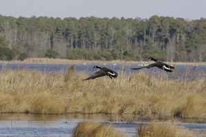

New York City’s proximity to water bodies, including the ocean, places the city’s solar installations in special flood hazard and wetland areas. We at Burnham assist clients with New York City solar permits and find the solar permit application process in special flood hazard and wetland areas may require added time and costs. In this post, we will provide an overview of the requirements for New York City solar permits in these areas, as well as highlight parts of the process that could be improved.

## Special Flood Hazard Area Standards Stem from the National Flood Insurance Program

New York City’s Special Flood Hazard Area construction requirements derive from a federal mandate. In 1968, the National Flood Insurance Program (NFIP) was created to provide insurance for those living in areas at severe risk of flooding, called Special Flood Hazard Areas. The Federal Emergency Management Agency (FEMA) administers the flood insurance program.

The New York State Department of Environmental Conservation (DEC) manages NFIP at the state level, acting as a liaison between FEMA and local communities. For a local community to be eligible for NFIP, the community must create legal standards for flood damage prevention governing any construction in a Special Flood Hazard Area. New York City adopted its own regulations, Building Code, Appendix G (Appendix G), in order to participate in NFIP.

## Special Flood Hazard Area Requirements for Solar Permits

Unfortunately, despite efforts such as the [NYC Solar Permitting Process Guide](http://www.cuny.edu/about/resources/sustainability/solar-america/installer-resources/NYC_DOB_Solar_Permitting_Process_Final.pdf), there is still confusion, as well as significant costs and delays, caused by the Appendix G standards. One issue is the requirement that any new solar-related equipment be placed above the design flood elevation (DFE), the Appendix G minimum elevation of the lowest floor, or be built to prevent water from accumulating. This rule applies to equipment in both new and existing buildings.

For solar installations, the New York City Department of Buildings (DOB) allows only the alternating current (AC) disconnect and conduit leading to it to be below the DFE. This means that equipment such as solar micro-inverters and meters must be at least eight to fourteen feet above the ground. Yet, this equipment has automatic shutoffs so it may be safely submerged in water. In addition, DOB’s Appendix G interpretation sometimes conflicts with Article 690 of the Electrical Code which necessitates locating the equipment at an easily accessible height, meaning without the need for a ladder.

Appendix G also contains a variety of other requirements that must be met before a solar permit application may be approved. It is necessary to determine that the solar installation is not a substantial improvement according to Appendix G guidelines, and a written statement must be provided attesting to this fact. Also, the application must identify the base flood elevation and DFE for the property. A special inspection for compliance with the flood zone requirements is also necessary.

Additionally, if all the equipment is on the roof, except the AC disconnect, only a certification that all the work is above the DFE must be included. However, the requirements for circumstances when the equipment is located below the roof but above the DFE need to be clarified. It is unclear whether in some of these cases the application must contain: (1) architectural drawings that show elevations and the equipment above the DFE and (2) a New York Licensed Surveyor stamped survey or elevation certificate. The latter requirement adds an additional cost of approximately $1000 for the solar installation, a significant cost increase. The architectural drawings showing the precise elevations should be sufficient.

## Federal and State Standards for Wetland and Coastal Erosion Areas

A sizeable portion of New York City’s waterfront consists of wetlands, but many have been lost or degraded. Although wetlands have a variety of benefits, they have become particularly important to New York City in the wake of Hurricane Sandy due to their ability to protect against flooding and oceanic storm surges.

The U.S. Army Corps of Engineers regulates wetlands under Section 404 of the federal Clean Water Act. At the state level, the DEC is responsible for wetland standards under the Tidal Wetlands Act of 1973 and Freshwater Wetlands Act 1975. The DEC requires permits for construction work that is located in tidal wetlands, marshes along the Atlantic coast and lower Hudson River, and freshwater wetlands, marshes located near rivers and lakes.

The New York State Coastal Erosion Hazard Areas Law authorizes DEC to regulates activities in coastal areas prone to erosion. Construction work in a coastal erosion hazard area also requires a permit from DEC, unless the local community is administering the permit program.

New York City works together with federal and state agencies to protect wetlands and coastal erosion areas, including the development of accurate maps. [Local Law 21/09](http://www1.nyc.gov/assets/buildings/local_laws/ll21of2009.pdf) specifically authorizes DOB to assure that construction projects in the city meet DEC requirements for wetland and coastal erosion areas.

## The Process for Obtaining a Solar Permit in a Wetland or Coastal Erosion Area

Solar installations in a wetland or coastal erosion area are exempt from the DEC permit requirement unless they include work in the ground such as a conduit trench. If groundwork is being done, then a DEC permit and the relevant map [must be submitted to DOB](http://www.nyc.gov/html/dob/downloads/bldgs_bulletins/bb_2009-012.pdf) along with the solar permit application. Even with the exemption for all other solar permit applications, there are some additional requirements for a property in a wetland or coastal erosion area.

The first step in the process is to check the property’s Building Information Number in the [Building Information System](http://www.nyc.gov/bis) (BIS), DOB’s database. If BIS indicates that the property may be in a tidal wetland, freshwater wetland, or coastal erosion area, one must locate the [relevant map](http://www.nyc.gov/html/dob/html/codes_and_reference_materials/wetlandsMaps.shtml) on DOB’s website and check whether the solar installation’s property is in one of these areas.

Once the property is identified in BIS as possibly being in a wetland or coastal erosion area, the map must be included with the solar permit application, even if the map ultimately shows the property is not actually in such an area. One must also submit a certification stating that the property is not in one of these areas if that is the determination reached after the map review. If the map identifies the property as being in a wetland or coastal erosion area, one must provide a certification stating the property is in one of these areas but the type of work does not require a DEC permit.

## Improvements Continue for New York City Solar Permit Applications

New York City has undertaken significant work to streamline the solar permitting process and support the adoption of solar. We have tried to highlight significant changes, such as our post about the recent expansion of the types solar permits eligible for [Professional Certification](/final-review-blog/guide-to-expediting-solar-permits-with-nyc-professional-certification/). At Burnham, we hope by calling attention to issues, such as the Special Flood Hazard Area requirements, we may encourage further improvements to New York City’s solar permit process.
